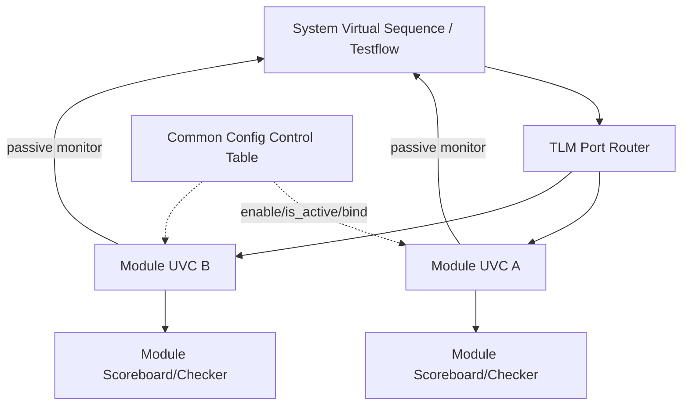

<!-- generated by yt-paper; edits will be overwritten -->

# Maximize Vertical Reuse, Building Module to System Verification Environments with UVM e

[:material-open-in-new: 원문 보기](https://dvcon-proceedings.org/wp-content/uploads/maximize-vertical-reuse-building-module-to-system-verification-environments-with-uvm-e.pdf){ .md-button .md-button--primary target=_blank }

> 200M 게이트 ASIC 검증에서 module UVC를 system UVC로 계층적으로 가져오는 vertical reuse 프레임워크(TLM port router, 공통 configuration control 테이블, 공통 testflow virtual sequence)를 UVM e로 구현해 system testbench 코드량을 줄이고 게이트당 검증 생산성을 약 4배 높였다는 사례 보고.

| 항목 | 내용 |
|---|---|
| 저자/출처 | Horace Chan, Brian Vandegriend, Deepali Joshi (PMC-Sierra), Corey Goss (Cadence) |
| 유형 | PAPER |
| 카테고리 | Verification |
| ID | `ref-20261018-7acd` |

## 핵심 인사이트

- Module-to-system 재사용의 실패 원인은 코드 재사용 자체보다 유지보수 책임 분리, 하위 RTL/TB 변경의 전파, 디버그 지식 전달에 있으며, 이를 구조적으로 해결하는 것이 핵심이다.
- TLM port 기본 바인딩은 transport 1:1, analysis 1:N broadcast, 정적 바인딩이라는 제약이 있어, 라우팅 테이블 기반 TLM port router로 런타임 재구성과 multicast를 지원하는 것이 설계의 핵심이다.
- Module UVC 내부 바인딩을 system UVC가 끊을 수 있도록 RTL 포트×프로토콜 레이어를 인덱스로 하는 공통 configuration control 테이블(enable, is_active, bind_enable)을 두어, 내부 연결 지식 없이도 연결을 선택적으로 조정하게 한다.
- Testflow는 직렬/병렬(동기화)/병렬 fire-and-forget 세 가지 phase 유형으로 단순화하여 module TB의 시퀀스 흐름을 system에서 lock-step으로 조율한다. 원문은 UVM e의 testflow가 복잡하고 설정 부담이 크다고 판단해 이를 대체했다.
- 정량 효과는 게이트 수 기준 'verified gates per line of code'가 104k에서 413k로 증가한 것(약 4배)으로 보고되며, 다만 단일 프로젝트 사례이므로 일반화에는 주의가 필요하다. 또한 하위 module UVC의 저품질 코드(메모리 누수, 비효율 루프)가 system 시뮬레이션 성능을 크게 떨어뜨릴 수 있어 프로파일링과 코드 리뷰가 필수다.

## 상세 요약

### 배경 및 문제 정의

현대 ASIC/SoC는 규모가 커져 chip/system 레벨 검증 환경을 처음부터 구축하기가 비현실적이다. 본 논문의 대상 디바이스는 200M 게이트급이며, 이전 프로젝트(60M 게이트)보다 약 4배 크다. 저자들은 divide-and-conquer 방식으로 module → subsystem → system 순으로 검증 범위를 나누되, 각 계층의 testbench를 재사용하는 vertical reuse가 생산성의 핵심이라고 주장한다.

이전 프로젝트에서 module TB의 sequence, checker, monitor를 system TB에 직접 재사용하려 했으나 다음 세 가지 이유로 실패했다.

- **코드 유지보수**: module TB는 module 수준 테스트를 위해 진화하며, system 엔지니어가 새 릴리스를 통합하는 데 많은 시간이 소요되었다.
- **디버그 어려움**: RTL 변경이 하위 TB에 반영되었지만 system 엔지니어에게 전달되지 않아 비이슈 실패를 디버깅하는 데 시간이 낭비되었다.
- **지식 전달**: subsystem 엔지니어가 system TB에 익숙하지 않아 실패 시나리오를 재현하고 지원하기 어려웠다.

결국 재사용 모델이 무너지고 엔지니어들은 코드를 복제하게 되었다. 저자들은 기존 UVM 가이드라인이 module-to-system plug-and-play 통합을 지원하는 프레임워크를 제공하지 않는다고 지적하며, UVM e System UVC 아키텍처(UVM e User Guide 기반)를 기반으로 세 가지 확장을 제안한다.

### 핵심 아키텍처 및 방법론

**1. 기본 구조 (System UVC)**

Module UVC는 일반 UVM testbench와 유사하지만 다음 차이가 있다.
- master virtual sequence driver와 register sequence driver는 module UVC 외부에 있으며, 포인터로 내부 test flow virtual sequence에 연결된다.
- stimulus 생성은 interface 계층(RTL 신호 구동), protocol 계층(트랜잭션 처리), payload generation 계층으로 나뉘며, 각 계층은 TLM port로 연결되어 system UVC가 구조 변경 없이 임의 계층에 접근할 수 있다.
- 수신 측 checker와 monitor도 TLM port로 구조화되며, module 내부 checker와 scoreboard는 system UVC에서 접근 가능하다.

System UVC는 module UVC를 무제한으로 중첩할 수 있다. 실제 구현은 10개의 subsystem UVC로 구성되고, 일부 subsystem은 3~4개의 module UVC를 가져 총 깊이 3이다. Module 간 monitor와 scoreboard를 체인으로 연결해 end-to-end 검사를 수행하고, 중간 interface UVC는 disable 후 passive agent로 활성화하여 hop-by-hop 검사를 가능하게 해 디버그 시 고장 지점을 좁힌다.

**2. TLM Port Router (기여 A)**

UVM 기본 TLM 바인딩의 한계는 다음과 같다.
- TLM transport port는 1:1만 지원한다.
- TLM analysis port는 1:N이지만 트랜잭션이 모든 입력 포트에 broadcast된다.
- 바인딩이 정적이다.

이를 해결하기 위해 system UVC는 module UVC 포트를 직접 연결하지 않고 TLM port router에 연결한다. Router는 e template으로 구현되어 데이터 타입에 무관하게 재사용되며, (source port id, channel id) 쌍을 키로 하는 keyed list 기반 routing table을 조회한다. 멀티캐스트를 지원하기 위해 목적지가 여러 개일 수 있고, 트랜잭션의 channel id를 갱신한 뒤 필요 시 복제하여 전송한다. 시뮬레이션 중 routing table을 변경해 연결을 재구성할 수 있다.

**3. Common UVC Configuration Control (기여 B)**

Module UVC를 독립 실행할 때는 내부 TLM 포트가 모두 바인딩되지만, 시스템에서는 일부 연결을 끊어야 한다. 바인딩을 reuse 코드에서 제외하면 system 엔지니어가 내부 연결을 처음부터 다시 작성해야 하므로 비효율적이다. 따라서 저자들은 module UVC마다 공통 configuration control 테이블을 두었다.

- 인덱스: RTL 포트(1차) × 프로토콜 스택 계층 수(2차)
- 항목: enable (UVC 활성 여부), is_active (active/passive), bind_enable (TLM 바인딩 연결 여부)
- Module UVC는 인스턴스 생성과 connect_ports 단계에서 이 테이블을 따라야 하며, keyed list로 빠르게 조회한다.

**4. Common Test Flow Virtual Sequence (기여 C)**

모든 module UVC의 virtual sequence는 빈 time consuming method(TCM) 형태의 testflow phase 구조를 상속한다. Module 엔지니어는 이 phase를 확장하여 동작을 채운다. 저자들은 UVM e의 testflow가 지나치게 복잡하고 설정이 많으며 실수가 나기 쉽다고 판단해 단일 진입점을 가진 더 단순한 testflow를 구현했다. System virtual sequence는 모든 module의 phase를 lock-step으로 실행하며, 세 가지 유형을 제공한다.

| 유형 | 동작 | 예 |
|---|---|---|
| 직렬 (serial) | 한 module의 phase가 끝날 때까지 다음 module 실행 안 함 | 두 module의 register 접근이 섞이지 않도록 |
| 병렬 (parallel, 동기화) | 모든 module phase 완료까지 다음 phase로 진행 안 함 | 모든 module이 reset에서 빠져나올 때까지 대기 |
| 병렬 fire-and-forget | 모든 module phase를 시작만 하고 즉시 다음 phase로 진행 | 조율 없이 traffic sequence 시작 |

프로젝트에서 사용한 15단계 testflow는 init_env, reset, wait_reset_done, config_tb, config_device, start_traffic_seq, wait_device_sync, perform_feature_test, wait_sim_timeout, abort_simulation, end_traffic_seq, wait_traffic_seq_finish, wait_clean_traffic, perform_device_test, perform_post_process_test이다. 이 중 perform_feature_test는 testcase가 자극을 추가하는 empty hook이다.

### 실험 결과 및 결론

**생산성 지표 (Table I)**

| 지표 | 이전 프로젝트 | 현재 프로젝트 | 변화 |
|---|---|---|---|
| 게이트 수 | 60M | 200M | +333% |
| 전체 코드 라인 | 575k | 484k | -16% |
| System TB 코드 라인 | 324k | 215k | -34% |
| 전체 대비 system TB 비율 | 56% | 44% | -22% |
| Gate verified per line | 104k | 413k | +400% |

핵심 지표인 게이트당 코드 라인 수(code density)는 약 4배 개선되었다. 저자들은 이를 엔지니어링 시간 절감의 근사치로 해석한다.

**일정 및 디버그 효과**

- System TB 구축 기간: 이전 프로젝트 2~3개월 → 현재는 subsystem 1개당 2~3일, 전체 통합은 1개월 미만
- System testcase는 두 개의 subsystem testcase를 import하고 coherent traffic 모드로 제약하는 방식으로 20줄 미만에 작성 가능
- 디버그 시 module UVC의 internal monitor를 passive 모드로 켜면 module TB와 동일한 상세 정보를 얻을 수 있어, subsystem 엔지니어가 ramp-up 없이 분석에 참여할 수 있다.

**도전 과제 및 교훈**

- **VIP 리비전 충돌**: 여러 module UVC가 같은 VIP의 다른 리비전을 쓰면 system 레벨에서 충돌한다. 대응책은 (1) VIP 개발 조기 동결, (2) 하위 호환 유지, (3) 호환이 불가능하면 통합 담당자가 모든 module UVC의 VIP 리비전을 동시에 갱신하는 것이다.
- **저품질 module 코드**: module 단계에서는 드러나지 않던 비효율 코드(CPU 과다 사용, 메모리 누수)가 system 규모에서 시뮬레이션 성능을 크게 떨어뜨리거나 크래시를 일으킬 수 있다. 프로파일링과 시니어 리뷰가 필요하며, 한 사례에서는 십여 줄의 코드 재작성으로 30% 성능 향상을 얻었다.

**향후 과제 (SystemVerilog 포팅)**

예비 타당성 검토 결과, 다음 이유로 SV 포팅은 어렵지만 이론적으로는 가능하다고 결론짓는다.
- SV는 AOP를 지원하지 않으며, 이 프레임워크의 module-to-system 기능 상당수가 AOP로 구현되어 있다. SV에서는 design pattern으로 흉내 낼 수 있으나 코드량이 크게 늘어난다.
- 특히 testflow phase의 AOP 구현을 callback과 class factory로 바꾸는 작업이 큰 부담이다.
- e keyed list ↔ SV associative array, e template ↔ SV parameterized class로 대응은 가능하다.

**결론**

본 논문은 module-to-system vertical reuse 전략을 200M 게이트 디바이스에 실제 적용했으며, 그 결과 생산성, 코드 품질, RTL 디버그 속도가 개선되었다고 주장한다. 다만 결과는 단일 프로젝트에서의 자체 측정치이며, 생산성 지표는 게이트/코드 라인 비율이라는 간접 지표에 기반한다. 또한 세 가지 확장(TLM port router, 공통 configuration control, 공통 testflow)의 개별 기여도를 분리한 ablation 실험은 제시되지 않았다.

## 관련 영상

<iframe src="https://www.youtube-nocookie.com/embed/bXhsC6gVkK0" title="[DVCON2013] Maximize Vertical Reuse, Building Module to System Verification Environments with UVM e" loading="lazy" allow="accelerometer; clipboard-write; encrypted-media; gyroscope; picture-in-picture; web-share" referrerpolicy="strict-origin-when-cross-origin" allowfullscreen></iframe>

**[DVCON2013] Maximize Vertical Reuse, Building Module to System Verification Environments with UVM e** — [YouTube에서 보기](https://www.youtube.com/watch?v=bXhsC6gVkK0) · [영상 페이지](../../videos/bXhsC6gVkK0.md)
