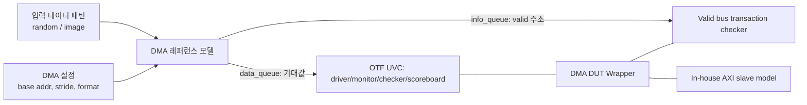

<!-- generated by yt-paper; edits will be overwritten -->

# Multimedia IP DMA verification platform

[:material-open-in-new: 원문 보기](https://dvcon-proceedings.org/wp-content/uploads/multimedia-ip-dma-verification-platform.pdf){ .md-button .md-button--primary target=_blank }

> 멀티미디어 IP의 DMA 검증을 숙련 엔지니어 의존 없이 수행하도록 UVM 기반 재사용 검증 플랫폼(MDVP)을 구축해, 신규 DMA 테스트벤치 작성 시간을 1일에서 30분 수준으로 줄인 Samsung Exynos 사례 보고서.

| 항목 | 내용 |
|---|---|
| 저자/출처 | Suhyung Kim, Sangkyu Park, Myungwoo Seo, Sangjin Lee, Jiyeon Park (Samsung Electronics Co., Ltd.); 학회/출처 정보는 문서에 명시되지 않음 |
| 유형 | PAPER |
| 카테고리 | Verification |
| ID | `ref-20261018-86a9` |

## 핵심 인사이트

- DMA 검증의 난이도는 버스 프로토콜 위반이 SoC 전체를 멈출 수 있다는 점에 있으며, 이로 인해 숙련 엔지니어의 검증 병목이 프로젝트 일정의 critical path가 됨. 지식과 VIP를 플랫폼에 축적하는 것이 인력 확장의 핵심 수단이라는 점이 설계 동기임.
- 기능 검증(출력 비교)만으로는 불필요한 버스 요청을 잡을 수 없으므로, 레퍼런스 모델이 만든 valid address 정보를 이용한 valid bus transaction checker를 별도로 두는 구조가 핵심 기법임. 의도하지 않은 read/write가 성능 저하를 일으키는 문제를 직접 겨냥함.
- info_queue/data_queue 구조로 valid 주소 범위와 기대값을 시퀀스에서 한 번만 생성하고 UVC/VIP가 재사용하도록 한 설계는, 여러 컴포넌트가 주소 계산을 중복 수행하지 않게 하는 실용적 방법임.
- 재사용의 실질적 효과는 UVC 라이브러리뿐 아니라 base_vsequence(제어 knob 기반 공통 시나리오)와 dma_vsequence(공통 메서드 + 빈 메서드 override)처럼 시퀀스 계층까지 표준화했을 때 나타남. 초기 프로젝트에서 테스트벤치 버그가 잦았던 원인이 시퀀스 중복 구현이었다는 관찰이 흥미로움.
- 정량 지표(라인 수 1298→556, 초기 테스트벤치 1일→30분, 엔지니어당 동시 DMA 4→5개)는 인상적이지만 측정 조건과 통제 실험이 문서에 자세히 없어, 일반화하기 전에 자사 환경의 기준선과 비교가 필요함.

## 상세 요약

### 배경 및 문제 정의

최신 Exynos SoC의 멀티미디어 IP(예: 이미지 스케일러)는 대량의 영상·음성 데이터를 DRAM과 직접 주고받기 위해 여러 개의 DMA 인스턴스를 가진다. DMA에 버그가 있으면 버스 시스템이 멎어 SoC 전체에 영향을 줄 수 있으므로, 숙련된 시니어 검증 엔지니어가 주로 담당해 왔다. 그러나 DMA 수가 늘어나는 반면 시니어 인력은 제한적이어서, 시니어 한 명이 감당할 수 있는 DMA 수(보통 2~3개)가 병목이 되었다.

문서는 DMA 검증 항목을 다음 네 가지로 제시한다.
1. RTL 출력이 기대값과 일치하는지 확인
2. On-the-fly 인터페이스 프로토콜 확인
3. 기대된 버스 요청만 발생하는지 확인
4. AXI 프로토콜 확인

3, 4번은 시스템 전반에 대한 전문성을 요구하므로 신규 엔지니어에게 어렵다. 또한 시니어는 새 테스트벤치를 만들 때 이전 프로젝트 테스트벤치를 재활용하면서 드라이버/모니터 수정, 레퍼런스 모델 유지보수, 스코어보드, 압축 데이터 생성, VIP 유지보수, 레그레션 환경 관리 등을 모두 맡아야 했다. 저자들은 이를 해결하기 위해 MDVP를 설계했으며 목적은 네 가지다: (1) 신규 엔지니어도 충분한 검증 품질을 얻을 것, (2) 동작하는 초기 테스트벤치를 빨리 낼 것, (3) 코드 재사용을 극대화할 것, (4) 신규 엔지니어를 빠르게 육성할 환경을 제공할 것.

### 핵심 아키텍처 및 방법론

MDVP는 멀티미디어 IP DMA에 특화된 UVM 기반 검증 플랫폼으로, (a) DMA 레퍼런스 모델, (b) 여러 DMA 인스턴스가 공유하는 재사용 테스트벤치, (c) DMA 사양에 맞춰 구성하는 설정형 UVM 테스트벤치로 구성된다.

**A. 입력 데이터**: DMA 동작은 보통 데이터 패턴에 무관하므로 random 데이터를 쓰지만, 데이터 압축기가 있는 DMA는 random만으로 부족하다. 따라서 random과 non-random(영상) 패턴을 모두 제공한다. 영상 DMA에는 ImageMagick으로 해상도, 픽셀 비트폭, Bayer/RGB/YUV 등 포맷에 맞춘 자연스러운 패턴을 생성하며, 수만 개의 사전 정의된 이미지 DB를 활용한다.

**B. 레퍼런스 모델**: 기존 IP DMA 모델은 형태가 제각각이어서 변환 비용이 컸기 때문에, 모든 IP DMA 모델을 분석해 메모리 포맷 전체를 지원하는 새 레퍼런스 모델을 만들었다. 출력은 두 가지다.
- Valid address 정보: valid bus transaction checker에 사용
- 기대값: RDMA 입력 및 WDMA의 기준 데이터

이 정보는 문서의 Fig. 2처럼 `dma_info_queue`(시작 주소와 연속 유효 바이트 수 쌍)와 `dma_data_queue`(기대 데이터)로 저장된다. info_queue는 dma 시퀀스에서 한 번만 생성되므로 UVC와 VIP가 유효 주소를 다시 계산할 필요가 없다.

**C. 재사용 테스트벤치**: DMA 인스턴스를 감싸는 DUT Wrapper를 사용해 대부분의 구조를 재사용한다. 구성 요소는 APB BFM, clock/reset generator, valid bus transaction checker, AXI slave memory model이다.
- **Valid bus transaction checker**: 기존 WDMA 스코어보드는 작업 종료 후 기대 위치에 기대값이 있는지만 보므로, 잘못된 주소로의 write나 결과에 쓰이지 않는 read 요청은 잡지 못한다. 이 체커는 버스 요청마다 주소를 valid 정보와 대조해 불필요한 요청을 검출하며, 이는 성능 저하를 막기 위한 것이다.
- **In-house AXI slave model**: 상용 VIP의 일부 기능만 쓰고 있다는 판단에서 DMA 검증에 최적화된 자체 모델을 개발했다. 문서에 따르면 상용 VIP 대비 시뮬레이션 속도가 100% 향상되어 레그레션 TAT 단축에 기여했고, VIP 라이선스 비용도 줄였다.

**D. 설정형 UVM 테스트벤치**: DMA 인스턴스 간 차이는 on-the-fly 인터페이스 종류와 메모리 포맷에서 나온다. 이를 위해 다음과 같이 구성했다.
1. **DMA agent**: driver, monitor, checker, scoreboard를 `uvm_analysis_port`로 연결해 신규 UVC 개발 시 컴포넌트 구현에만 집중하게 함.
2. **DMA base test**: 팩토리 오버라이드로 UVC 구성을 정의하고, 모든 테스트 시나리오는 이 base test를 상속해 UVC 설정 중복을 줄임. 런타임 동적 변경이 필요 없다는 점을 전제로 함.
3. **Parameterized interface/component**: 신호 비트폭만 다른 인터페이스를 `tile_if#(DATA_WIDTH, POS_X, POS_Y)`처럼 파라미터화해 하나의 UVC로 처리함.

시퀀스 계층은 다음과 같이 표준화했다(Fig. 6).
- **base_vsequence**: 공통 테스트 시나리오를 랜덤 변수 형태의 제어 knob으로 묶고, 팩토리 오버라이드로 원하는 시나리오(예: zero latency, random latency)를 활성화함.
- **dma_vsequence**: 모든 DMA에 공통인 사전 정의 메서드와, 각 DMA 사양에 맞춰 채워야 하는 빈 메서드로 구성됨. 엔지니어는 이를 상속하고 빈 메서드만 구현하면 됨.
- **Parameterized sequence**: 초기에는 configuration sequence와 sequence item 간 연결 코드가 많아 버그가 잦았기 때문에, 인터페이스 파라미터에 따라 파라미터화된 dma_vsequence와 연결 메서드를 제공함. 인자가 다른 메서드 오버로딩을 virtual task/function이 지원하지 않아 parameterized subroutine으로 구현했다고 설명함.

### 실험 결과 및 결론

이 문서는 엄밀한 통제 실험보다는 실제 프로젝트 적용 사례를 보고하는 형식이다. 주요 결과는 Table I에 요약되어 있다.

| 항목 | MDVP 미적용 | 최초 MDVP | 현재 MDVP |
|---|---|---|---|
| DMA 인스턴스당 개발 라인 수 | N/A | 1298 lines | 556 lines |
| 초기 테스트벤치 작성 시간 | 1~2일 | 평균 1일 | 평균 30분 |
| 엔지니어당 동시 수행 DMA 수 | 시니어 2~3개 / 주니어 1~2개 | 평균 4개 | 평균 5개 |

- 첫 프로젝트는 시니어 1명, 주니어 2명, 신규 2명의 팀이 DMA 25개를 동시에 검증했다. 초기에는 UVC 라이브러리 구축에 시간이 많이 들었지만, 이후 테스트벤치 구현 시간이 줄었다.
- 여러 프로젝트를 거치며 UVC와 시퀀스가 축적된 현재는 신규 엔지니어가 30분 내에 새 테스트벤치를 만들 수 있다고 보고한다.
- 5명 규모의 팀이 20개 이상의 DMA 검증을 일정 내에 처리했다고 한다.

**결론**: MDVP는 적은 인력으로 멀티미디어 DMA를 효율적으로 검증하기 위한 플랫폼이며, 여러 Exynos 프로젝트에 적용되었다. 핵심 기여는 (1) valid bus transaction checker와 info/data queue를 통한 버스 레벨 검증의 자동화, (2) UVC뿐 아니라 시퀀스까지 포함한 재사용 구조, (3) 자체 AXI slave 모델을 통한 속도 및 비용 개선으로 정리할 수 있다. 다만 문서에는 측정 조건, 대조군의 세부 설정, 결함 검출률 같은 검증 품질 지표가 제시되어 있지 않아, 수치는 저자들의 현장 보고로 이해하고 자사 환경에 맞춰 재검증하는 것이 바람직하다. 또한 문서 본문이 짧아 구현 세부 사항(예: 메모리 포맷 변환기의 구조)은 충분히 다루지 않는다.

## 관련 영상

<iframe src="https://www.youtube-nocookie.com/embed/aYd553EDwmo" title="[DVCON2020]Multimedia IP DMA verification platform" loading="lazy" allow="accelerometer; clipboard-write; encrypted-media; gyroscope; picture-in-picture; web-share" referrerpolicy="strict-origin-when-cross-origin" allowfullscreen></iframe>

**[DVCON2020]Multimedia IP DMA verification platform** — [YouTube에서 보기](https://www.youtube.com/watch?v=aYd553EDwmo) · [영상 페이지](../../videos/aYd553EDwmo.md)
