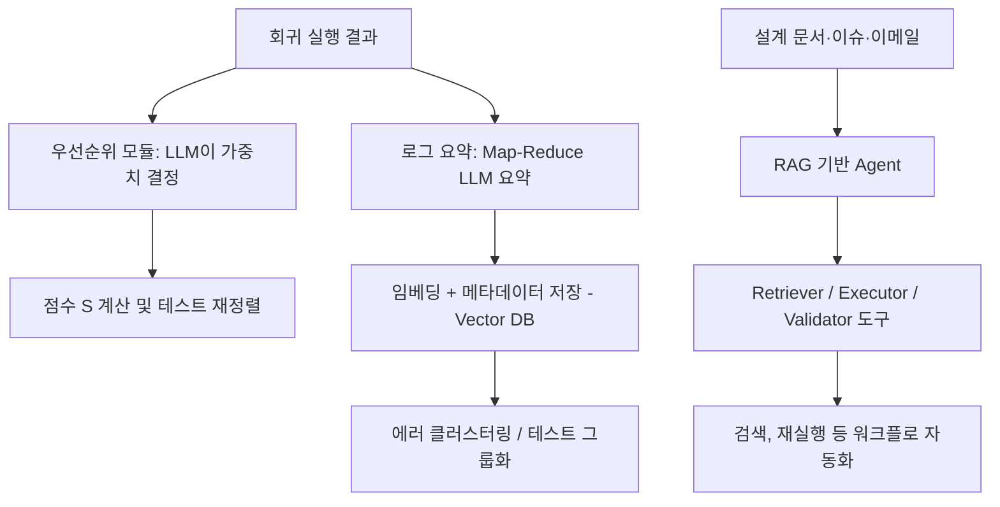

<!-- generated by yt-paper; edits will be overwritten -->

# A Large Language Model-Based Framework for Enhancing Integrated Regression

[:material-open-in-new: 원문 보기](https://dvcon-proceedings.org/wp-content/uploads/1045.pdf){ .md-button .md-button--primary target=_blank }

> 통합 회귀의 테스트 우선순위, 로그 과다, 데이터 접근성 문제를 LLM 가중치 조정·Map-Reduce 로그 요약·RAG Agent로 완화하는 프레임워크를 제안한 소규모 사례 연구다.

| 항목 | 내용 |
|---|---|
| 저자/출처 | Jin Choi, Sangwoo Noh, Seonghee Yim, Seonil Brian Choi (Samsung) |
| 유형 | PAPER |
| 카테고리 | Verification |
| ID | `ref-20261018-8b34` |

## 핵심 인사이트

- LLM은 테스트 우선순위 점수(Change Impact, Execution Cost, Regression History)의 가중치만 결정하고, 실제 점수 계산은 사전 계산된 수치로 수행해 LLM의 수치 연산 부담을 줄인 구조가 핵심이다.
- 검증 단계(초기: RTL 변경 중심, 후기: 실패 잔존 중심)에 따라 가중치가 달라지는 것을 보여주며, 두 시나리오에서 ωCI=0.7 vs ωRH=0.6 등 상반된 가중치가 제시되었다.
- 로그 요약은 Map-Reduce를 선택했는데, 청크 간 일관성 저하 문제를 chunk/overlap 크기 조정으로 완화한다고 주장한다. 평균 로그 184.04MB를 232 bytes 요약으로 줄여 약 99.87% 데이터 감소를 보고했다.
- FAISS는 메타데이터 필터링을 지원하지 않아 과다 검색 후 수동 필터링이 필요했고, 이는 확장성 한계로 명시되었다.
- 평가 규모가 작다: 단일 시나리오 기반 시뮬레이션, 로그 1종, 벡터 DB 109건, 에이전트 사례 2건으로 일반화 근거는 제한적이며, 시간 절감 수치(79.1%, 12.3시간)의 베이스라인 정의도 문서에서 충분히 설명되지 않는다.

## 상세 요약

### 배경 및 문제 정의

현대 디지털 설계가 복잡해지면서 검증 과정의 자원 소모가 커지고 있으며, 그중 통합 회귀(integrated regression)는 시간과 수작업이 특히 많이 드는 단계로 제시된다. 저자들은 이 단계의 문제를 세 가지로 정리한다.

1. **테스트 케이스 우선순위 최적화**: 우선순위는 RTL 변경이 많은 초기 단계와 실패가 누적된 후기 단계에서 달라진다. 수만 개 테스트 케이스를 수작업으로 재조정하기 어렵고, 입력 토큰 한계 때문에 LLM에 전체 정보를 한 번에 넣기도 불가능하다.
2. **로그 과다(log volume overload)**: 로그가 수백 MB 규모이며 동일 에러가 여러 테스트에서 반복되어 근본 원인 파악을 어렵게 한다.
3. **데이터 가용성(data availability)**: 설계 스펙, 문서, 이슈, 회귀 결과가 여러 시스템에 흩어져 있어 엔지니어가 검색·취합하는 데 시간이 많이 든다.

### 핵심 아키텍처 및 방법론

프레임워크는 세 개의 구성요소로 이루어진다(Fig. 1).

**A. 테스트 케이스 우선순위**

세 가지 요인을 정의한다.

- Change Impact (CI): $CI = \Delta RTL \times \text{Updated issues count}$ (1)
- Execution Cost (EC): $EC = 1 / t(\text{expected run time})$ (2)
- Regression History (RH): $RH = \frac{N_{fail}}{N_{total}} \times t_{failed} \times \text{Latest Status Discount Rate}$, 여기서 최근 상태가 passed이면 0.5, failed이면 1 (3)

최종 점수는 다음과 같다.

$$S = \omega_{CI} \cdot CI + \omega_{EC} \cdot EC + \omega_{RH} \cdot RH \quad (4)$$

LLM은 시스템 프롬프트에 정의된 요인 설명과 휴먼 프롬프트로 주어진 이메일, 릴리즈 노트, 이슈 리포트 등의 맥락을 받아 각 가중치 $\omega$를 구조화된 형식으로 출력한다. 이 가중치를 곱해 점수를 계산하고 테스트를 재정렬한다. 요인 값 자체는 과거 데이터로 미리 계산된다.

**B. 로그 요약**

에러 메시지를 입력으로 LLM이 요약을 생성하고, 임베딩과 메타데이터와 함께 벡터 DB에 저장한다. 요약 방식은 두 가지를 비교한다.

- **Map-Reduce**: 청크를 병렬 요약(Map)한 뒤, 토큰 한도를 넘으면 반복적으로 축약(Reduce). 확장성은 좋지만 청크 간 일관성이 떨어질 수 있다.
- **Refined**: 청크를 순차적으로 누적 요약. 문맥 일관성은 좋지만 대용량에서 느리고 확장성이 낮다.

저자들은 Map-Reduce를 선택했고, 청크·overlap 크기 조정으로 일관성 문제를 완화할 수 있다고 주장한다. 전처리(숫자·특수문자 제거)는 데이터 왜곡을 일으켜 하지 않았으며, 파일 경로와 에러 컨텍스트는 보존했다. Reduce 축약 루프는 최대 15회로 제한했다.

**C. RAG 기반 Agent**

RAG로 환각, 최신성 부족, 추적 불가능한 추론을 줄이고, 도구를 바인딩한 Agent가 요청에 따라 도구를 선택한다. 도구는 설계 스펙을 검색하는 Retriever, 작업을 수행하는 Executor(예: Query Executor, API Executor), 결과를 검증하는 Validator로 구성된다.

### 실험 결과 및 결론

**실험 환경**: 별도 파인튜닝 없이 Mistral-7B를 사용했고, 서빙·추론에는 vLLM을 사용했다. 

**A. 우선순위 최적화 (두 시나리오, 시뮬레이션 기반)**

| 시나리오 | 가중치 (CI / EC / RH) | 결과 |
|---|---|---|
| 초기 단계 (RTL 변경 중심) | 0.7 / 0.2 / 0.1 | RTL 변경 관련 테스트 총 소요 96.7시간, 미적용 대비 79.1% 감소 |
| 후기 단계 (100% pass 목표) | 0.1 / 0.3 / 0.6 | 잔여 실패 테스트 완료가 약 12.3시간 빨라짐 |

후기 시나리오에서는 짧은 실행 시간 테스트를 먼저 돌려 실패를 빨리 찾는 방향으로 가중치가 설정되었고, 긴 테스트는 뒤로 밀렸기 때문에 전체 실행 시간은 크게 줄지 않았다고 기술한다. 논문은 두 극단적 케이스만 다루었다고 명시한다.

**B. 로그 요약**

- 평균 로그 크기 184.04 MB, 에러 크기 약 0.29 KB, 요약 크기 232 bytes
- LLM 요약 시간 5.15초(vLLM), 벡터 DB 저장 0.009초
- 데이터 크기 약 99.87% 감소
- 벡터 DB 109건 대상 검색 시간 약 0.015초
- 검색은 키워드보다 에러의 문맥 설명형 프롬프트일 때 더 관련성이 높았다고 보고한다.

**C. RAG Agent**

- 클록 관련 스펙 검색: Spec Retriever가 상위 5개 문서를 가져오며 평균 0.03초가 걸렸다고 보고한다. 기존의 수동 키워드 검색과의 소요 시간 비교 수치는 본문에 제시되지 않았다.
- 특정 에러로 실패한 테스트 재실행: Query Executor가 DB 쿼리를 생성하고 Query Validator가 검증한 뒤 API Executor가 재실행하는 흐름을 제시한다. 도구 설명과 프롬프트 명확성이 성공의 핵심이라고 언급한다.

**결론 및 한계**

저자들은 LLM 기반 가중치 조정, 로그 요약·클러스터링, RAG Agent가 통합 회귀의 턴어라운드 시간을 줄일 수 있다고 결론짓는다. 다만 문서가 밝히는 한계는 다음과 같다.

- 우선순위 요인이 테스트 레벨에 한정되며, 엔지니어의 선호를 반영하는 메커니즘이 없다.
- FAISS는 메타데이터 필터링을 네이티브로 지원하지 않아 과다 검색 후 필터링이 필요하고, 대규모에서 성능이 저하된다.
- 단일 Agent가 모든 작업을 처리하여 성능과 신뢰성이 떨어졌으며, 다중 Agent 분리가 향후 과제다.
- 시뮬레이션 규모와 로그 종류가 제한적이며, 검증 전용 파인튜닝 모델은 향후 과제로 남는다.

논문 내 수치(79.1%, 12.3시간, 99.87%)는 비교 기준과 반복 실험 정보가 충분히 기술되지 않아, 방법론의 실효성을 판단할 때는 규모와 베이스라인을 함께 고려해야 한다.

## 관련 영상

<iframe src="https://www.youtube-nocookie.com/embed/Y6quamriBzo" title="[DVCON2025]A Large Language Model-Based Frameworkfor Enhancing Integrated Regression" loading="lazy" allow="accelerometer; clipboard-write; encrypted-media; gyroscope; picture-in-picture; web-share" referrerpolicy="strict-origin-when-cross-origin" allowfullscreen></iframe>

**[DVCON2025]A Large Language Model-Based Frameworkfor Enhancing Integrated Regression** — [YouTube에서 보기](https://www.youtube.com/watch?v=Y6quamriBzo) · [영상 페이지](../../videos/Y6quamriBzo.md)
