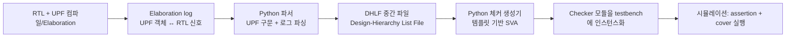

<!-- generated by yt-paper; edits will be overwritten -->

# Automation for Early Detection of X-propagation in Power-Aware Simulation Verification using UPF IEEE 1801

[:material-open-in-new: 원문 보기](https://dvcon-proceedings.org/wp-content/uploads/1060-Automation-for-Early-Detection-of-X-propagation-in-Power-Aware-simulation-verification-Using-UPF-IEEE-1801.pdf){ .md-button .md-button--primary target=_blank }

> UPF 전력 인텐트와 elaboration 로그에서 isolation·retention·power sequence 체커와 SVA assertion을 자동 생성해, X-propagation의 근원을 시뮬레이션 초기에 찾아 RCA 시간을 줄이는 방법을 제안하고 사례 프로젝트에서 버그 트렌드를 약 9일(약 20%) 앞당겼다고 보고한 논문.

| 항목 | 내용 |
|---|---|
| 저자/출처 | Tony Gladvin George, Ramesh Kumar, Kyuho Shim, Karan K, Wooseong Cheong, ByungChul Yoo (Samsung Electronics, Memory Division) — 발표 학회 정보 원문에 명시되지 않음 |
| 유형 | PAPER |
| 카테고리 | Verification |
| ID | `ref-20261018-8b44` |

## 핵심 인사이트

- 기존 방식은 X가 scoreboard까지 전파된 뒤에야 실패하므로 waveform 추적 비용이 크다. 제안 방식은 X가 발생하는 순간 또는 power sequence가 위반되는 순간 assertion이 실패하도록 해 RCA의 출발점을 근원 근처로 옮긴다.
- UPF만으로는 RTL 계층 경로를 알 수 없으므로 elaboration 로그(Xcelium 기준)에서 UPF 객체와 연결된 RTL 신호를 추출하는 것이 핵심 전처리다. 파서를 RTL 직접 파싱으로 대체하는 방안은 본 논문 범위 밖으로 남겼다.
- 생성 체커는 power_gating → ISO_EN 확인 → clamp 값 검사, save/restore 신호 토글 및 retention 값 일치 검사로 구성되며, cover property를 함께 넣어 체커 커버리지 기반 sign-off를 시도한다.
- 정량 결과는 자체 프로젝트 1건(40일 구간, 버그 11건) 기준의 proof-of-concept이며, 스크립트·체커 준비에 약 10% 추가 공수, triage 단계에서 약 25% 절감이라는 수치가 보고되었다. 일반화 가능성은 추가 검증이 필요하다.

## 상세 요약

### 배경 및 문제 정의

- SoC에서 IP별 power domain을 on/off하면, retention 셀은 레지스터 값을 저장·복원하고 isolation 셀은 꺼진 도메인의 출력을 고정값으로 clamp한다. 이 구조를 검증하려면 UPF 기반 시뮬레이션이 필요하다.
- UPF 시뮬레이션에서는 모든 블록이 꺼지지 않기 때문에 X가 발생·전파될 수 있다. 하나의 X가 수 클록 안에 수천 개 신호로 퍼질 수 있어 근원을 찾는 RCA가 어렵다.
- 기존 접근은 기능 테스트를 돌리고 데이터 무결성 scoreboard가 실패하기를 기다리는 방식이다. 이 방식은 설계 성숙도가 낮아지는 후반에 버그를 발견하게 만든다.
- 문서에 제시된 사례 기준 일정은 Lint/Compilation/Elaboration 약 1일, sanity 시뮬레이션 2일, regression 5일, triage 약 5일(추정치), UPF 수정 2일이다.
- 정적 체커(tool-generated low-power checks)는 'missing isolation cell' 같은 구조적 누락은 잡지만, isolation·retention 제어 신호가 올바른 순서로 동작하는지는 충분히 검사하지 못한다고 지적한다.
- 가능한 X 원인은 (1) isolation 셀 누락, (2) control 신호 누락, (3) 데이터 연결 누락, (4) 잘못된 power sequence 제어의 네 가지로 정리된다.

### 핵심 아키텍처 및 방법론

전체 흐름은 3단계 파이프라인이다.

- **1단계 (준비)**: RTL과 UPF를 컴파일·elaboration한다. 문서에서는 Cadence Xcelium의 elaboration 로그를 사용했다. UPF만으로는 RTL 계층 경로를 얻을 수 없다는 것이 이유다.
- **2단계 (파싱)**: Python 파서가 `set_isolation`, `set_isolation_control`, `set_retention`, `set_retention_control`, `create_supply_net`/`create_supply_set` 등 UPF 구문을 해석하고, `-applies_to inputs` 같은 규칙을 로그의 실제 신호 목록으로 펼쳐 DHLF 파일을 만든다. 예외 규칙(`-elements`)은 기본 규칙을 덮어쓴다.
- **3단계 (생성)**: 템플릿에 RTL 계층 경로를 채워 넣어 SystemVerilog checker를 만든다. 체커는 power, retention, isolation 그룹으로 묶인다.

생성되는 검사 항목은 다음과 같다.

1. **Power flow / power gating 체크**: `Power_state = POWER_DOWN`이면 다음 클록에 `ISO_EN == 1`이어야 한다. 실패 시 `uvm_error`를 발생시킨다.
2. **Isolation 값 검사**: `$rose(ISO_EN)` 이후 대상 신호가 UPF의 `-clamp_value`와 같은지 확인한다. 이 검사에서 잘못된 clamp는 X 전파의 원인으로 바로 드러난다.
3. **Retention 저장/복원 토글 검사**: `save_en`이 올라가면 신호 값을 `v`에 저장하고, `restore_en` 구간에서 같은 값이 되는지 확인한다.
4. **Coverage**: 각 검사에 `cover property`를 붙여 모든 power domain과 retention 셀이 low-power 진입을 거쳤는지 추적한다.

문서가 제시한 SVA 템플릿에는 일부 문법 오류(예: `Endproperty`, `end sequence`와 `Sequence` 키워드 표기, `$display`와 `else` 연결)가 보인다. 이는 개념 설명용 의사코드로 보는 편이 맞다. 실제 구현 코드는 본문에 없다.

논문은 기존 정적 체커와의 차이를 다음과 같이 설명한다. 생성된 assertion은 SoC 계층과 전력 제어 신호를 알고 있으므로 X가 발생한 시점에 바로 실패한다. 정적 체커는 이런 시점 정보가 없다.

또한 관련 연구로 Synopsys/Cadence의 tool-generated low-power check와 DVCon2022의 custom LP-check 접근을 언급한다. 본 논문은 custom LP-check를 자동 생성하고 SoC 규모로 확장하는 것을 기여로 내세운다.

### 실험 결과 및 결론

- **사례**: 샘플 칩 한 개가 sanity-clean RTL에서 synthesis 시작까지 40일이 걸린 프로젝트를 분석했다.
- **기존 방식**: 버그가 프로젝트 중간에 몰렸고, 버그 추이는 tape-out 근처에서야 안정되었다(Figure 12).
- **자동화 적용**: 같은 프로젝트를 다시 수행했을 때 11개 버그를 찾는 데 걸린 시간을 측정했다. 체커 실패가 RCA 엔지니어를 근원 가까이 데려다 주어 RCA 노력이 크게 줄었다. 버그 추이는 synthesis 9일 전에 안정되었으며, 이를 약 20% shift-left라고 보고했다(Figure 13).
- **비용**: 스크립트·체커 준비에 약 10% 추가 공수가 들었다. triage 단계에서 약 25% 절감이 있었다. 체커를 재사용 가능하게 만들어 후속 프로젝트의 배포 공수가 줄어들 것으로 기대한다.
- **시뮬레이션 시간**: 기존 방식은 X가 scoreboard까지 전파될 때까지 기다려야 하지만, 자동화 방식은 X 또는 sequence 위반이 발생하는 순간 실패한다고 설명한다.

**한계 및 주의점**
- 결과는 한 프로젝트, 11개 버그의 proof-of-concept이다. 통계적 일반화는 어렵다.
- 일정 수치 중 triage 5일은 "정확히 추적되지 않아 추정"한 값이다.
- Figure 12·13·14의 수치는 본문 텍스트만으로는 정확히 확인할 수 없다.
- Elaboration 로그 의존성 때문에 툴 플로우(Xcelium)에 묶이는 문제가 있다. 논문은 RTL 직접 파싱을 향후 과제로 남겼다.
- 논문 결론은 "scalable irrespective of the number of power domains"라고 주장하지만, 이를 뒷받침하는 대규모 실험은 본문에 없다.

**결론**: UPF 기반 power 인텐트를 자동으로 SVA 체커로 바꾸면 X-propagation 원인 추적을 앞당기고, 체커 커버리지를 sign-off 지표로 쓸 수 있다. 다만 효과는 단일 사례에서 확인된 수준이다.

## 관련 영상

<iframe src="https://www.youtube-nocookie.com/embed/nqmA1fsXAJM" title="[DVCON2023] Automation for Early Detection of X-propagation in Power-Aware Simulation Verification" loading="lazy" allow="accelerometer; clipboard-write; encrypted-media; gyroscope; picture-in-picture; web-share" referrerpolicy="strict-origin-when-cross-origin" allowfullscreen></iframe>

**[DVCON2023] Automation for Early Detection of X-propagation in Power-Aware Simulation Verification** — [YouTube에서 보기](https://www.youtube.com/watch?v=nqmA1fsXAJM) · [영상 페이지](../../videos/nqmA1fsXAJM.md)
