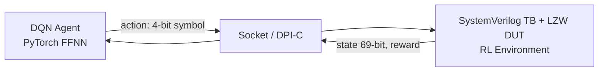

<!-- generated by yt-paper; edits will be overwritten -->

# Closing Functional Coverage With Deep Reinforcement Learning: A Compression Encoder Example

[:material-open-in-new: 원문 보기](https://dvcon-proceedings.org/wp-content/uploads/1046-Closing-Functional-Coverage-With-Deep-Reinforcement-Learning-A-Compression-Encoder-Example.pdf){ .md-button .md-button--primary target=_blank }

> 제약 랜덤 검증에서 functional coverage closure를 자동화하기 위해 DQN 에이전트를 SystemVerilog 테스트벤치와 DPI-C/소켓으로 공동 시뮬레이션하여, LZW 인코더의 CAM write 커버리지 136 bin 중 균등 랜덤(최대 28)보다 훨씬 많은 bin을 자동 생성 입력으로 채운 연구.

| 항목 | 내용 |
|---|---|
| 저자/출처 | Eric Ohana (Queensland University of Technology / University of Bielefeld) — IEEE 게재 논문 (학회명 원문 미기재) |
| 유형 | PAPER |
| 카테고리 | Verification |
| ID | `ref-20261018-8ec5` |

## 핵심 인사이트

- 검증 환경을 RL 문제로 매핑: 테스트벤치의 지능형 자극 생성기를 agent, DUT와 나머지 TB를 environment, 커버리지 bin 히트를 reward로 정의하는 프레이밍이 핵심 아이디어다.
- RL 상태로 DUT 내부 상태 전체가 아니라 최근 17개 입력 심볼(69-bit, valid 비트 포함)을 사용했다. 이는 CAM 쓰기/매치의 최대 길이에 맞춘 설계 선택이다.
- 균등 랜덤 입력은 136개 중 최대 28 bin만 채웠지만 DQN은 500 에피소드에서 133 bin(97.79%)을 채웠다. 남은 3개 bin은 750 에피소드 재실행으로 메웠고, 두 실행을 병합해 전체 커버리지를 달성했다.
- 시뮬레이터와 PyTorch 에이전트를 두 독립 프로세스로 띄우고 DPI-C 호출과 소켓으로 상태, 보상, 행동을 주고받는 구조는 기존 SV 환경을 크게 바꾸지 않고 DRL을 붙이는 실용적 패턴이다.
- 보상 설계(매치에 +1 가점)와 ε-greedy 감소 스케줄, 학습률 0.01, 할인율 0.75 등 하이퍼파라미터가 결과를 좌우한다. 단일 DUT·단일 카테고리 실험이므로 일반화와 재현성은 추가 검증이 필요하다.

## 상세 요약

### 배경 및 문제 정의

제약 랜덤(constrained random) 및 커버리지 기반 시뮬레이션 검증은 RTL 검증의 주류이지만, 전체 functional coverage 달성(verification closure)은 여전히 병목이다. 커버리지 홀(hole)을 메우려면 검증 엔지니어가 랜덤 제약을 수동으로 조정하고 directed test를 작성해야 한다. 본 논문은 이 수동 개입을 줄이기 위해 Deep Q-Network(DQN) 기반 심층 강화학습 에이전트를 검증 환경에 통합하는 방법을 제안한다.

저자는 디지털 시뮬레이션을 입력 트랜잭션을 순차적으로 생성하고 DUT 출력에 따라 다음 자극을 결정하는 순차 의사결정 과정으로 보고, 이를 RL 문제로 매핑한다. 테스트벤치의 지능형 자극 생성기가 agent, DUT와 나머지 TB 구성요소가 environment, 커버리지 bin 히트 정도가 reward에 해당한다.

검증 대상은 16-주소 CAM을 사용하는 LZW 압축 인코더(4-bit 입력, 5-bit 출력)다. 설계가 실제 RTL 검증을 대표할 만큼 복잡하면서도 커버리지 목표가 명확해 접근법의 효과를 판단하기 쉽다는 이유로 선택되었다. 목표 커버리지는 CAM write 카테고리로, 주소별로 가능한 쓰기 길이를 bin으로 정의하여 총 136개다.

### 핵심 아키텍처 및 방법론

전체 흐름은 다음과 같다.

- **상태(State)**: 최근 17개 입력 심볼을 표현하는 69-bit 벡터다. 각 심볼은 4-bit이고 MSB는 valid 비트로 reset 이후 상태를 나타낸다. 17은 CAM에 쓰거나 매치할 수 있는 최대 길이에 맞춘 값이다.
- **행동(Action)**: 16개 출력 원소를 가진 4층 FFNN의 출력에서 선택한 4-bit 입력 심볼이다. 각 원소는 Q(S,a)를 근사한다.
- **보상(Reward)**: CAM 활동이 없으면 0이다. CAM write이면 쓰인 심볼 수, CAM match이면 유효 심볼 수+1을 준다. 매치에 가점을 주는 이유는 이후 더 긴 쓰기를 가능하게 하기 때문이다.
- **정책 및 학습**: ε-greedy 정책을 쓰며 ε는 에피소드에 따라 선형으로 감소한다. 학습은 Q-learning 갱신식 $Q(S_i,A_i) = (1-\alpha)Q(S_i,A_i) + \alpha(R + \gamma \max_a Q(S_{i+1},a))$를 따른다. 학습률 $\alpha$는 1e-2, 할인율 $\gamma$는 0.75로 설정했다. 정책과 무관하게 학습하는 off-policy 방식이다.
- **에피소드**: 한 입력 시퀀스에 해당하며, CAM이 가득 찰 때까지 진행한다.
- **공동 시뮬레이션**: 디지털 시뮬레이터와 DQN 에이전트를 두 독립 프로세스로 동시에 실행한다. SystemVerilog는 DPI-C 함수 `rl_python`을 통해 C 측의 임베디드 Python을 호출하고, 에이전트는 서버 소켓을 열어 대기한다. 환경은 클라이언트로 소켓에 접속해 상태와 보상을 보내고 행동을 받는다. 데이터는 8-bit 정수 배열로 인코딩하며 배열 크기는 실행 중에 정한다.

한 번의 학습 반복은 하나의 입력 트랜잭션을 DUT에 넣고 커버리지 영향을 처리한 뒤, 다음 자극을 생성하는 과정에 해당한다.

### 실험 결과 및 결론

**기준선**: 균등 분포 랜덤 입력은 136개 bin 중 최대 28개만 채웠고, CAM 점유율은 152개 중 최대 44개였다. 저자는 이 수치가 수동 제약 조정과 directed test가 필요함을 보여준다고 해석한다.

**DQN 500 에피소드**: ε를 1.0에서 0.0으로 선형 감소시켰다. 136개 중 133개 bin(97.79%)을 채웠고, 전체 CAM 152개 위치를 모두 채웠다. 남은 bin은 CAM[13]에서 10 심볼 쓰기(최대 15), CAM[15]에서 12 심볼과 14 심볼 쓰기(최대 17)였다. 점유율 그래프에서 약 140 부근의 점프는 일부 bin이 건너뛰어졌음을 시사한다. 에이전트는 초기에는 짧은 시퀀스를 만들고 점차 같은 심볼을 반복하는 긴 시퀀스(예: 3이 17번 반복)를 생성하는 경향을 보였다.

**DQN 750 에피소드**: ε 감소가 더 완만하도록 재실행했다. 이 실행은 127개 bin을 채웠으며, 핵심은 500 에피소드에서 빠진 홀을 메운 것이다. 두 실행의 커버리지를 병합하여 CAM write 커버리지 136개 bin을 모두 달성했다.

**결론과 한계**: 저자는 수동 directed test 없이 두 차례 에피소드 시리즈로 전체 CAM write 커버리지를 달성했다고 주장하며, 산업 프로젝트 적용 가능성을 제시한다. 본문에 근거한 한계는 다음과 같다. (1) 단일 DUT(LZW 인코더)와 단일 커버리지 카테고리로만 검증되었다. (2) 최종 closure는 두 실행의 병합으로 이루어졌으며 단일 실행의 결과가 아니다. (3) 학습 시간, 수렴 분산, 다른 시드에 대한 재현성은 본문에 보고되지 않았다. (4) 손실 곡선(Figure 9)의 수렴 판단은 그림에 의존하며 본문만으로는 정량 기준이 제시되지 않았다.

## 관련 영상

<iframe src="https://www.youtube-nocookie.com/embed/s-CB6ioRcRo" title="[DVCON2023]Closing Functional Coverage  With Deep Reinforcement Learning: A Compression Encoder" loading="lazy" allow="accelerometer; clipboard-write; encrypted-media; gyroscope; picture-in-picture; web-share" referrerpolicy="strict-origin-when-cross-origin" allowfullscreen></iframe>

**[DVCON2023]Closing Functional Coverage  With Deep Reinforcement Learning: A Compression Encoder** — [YouTube에서 보기](https://www.youtube.com/watch?v=s-CB6ioRcRo) · [영상 페이지](../../videos/s-CB6ioRcRo.md)
