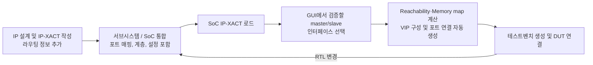

<!-- generated by yt-paper; edits will be overwritten -->

# IP-XACT based SoC Interconnect Verification Automation

[:material-open-in-new: 원문 보기](https://dvcon-proceedings.org/wp-content/uploads/ip-xact-based-soc-interconnect-verification-automation.pdf){ .md-button .md-button--primary target=_blank }

> 대형 SoC backbone interconnect의 검증 환경(VIP 연결, 주소맵, 라우팅 설정)을 IP-XACT 메타데이터로부터 자동 생성해 수 주 걸리던 구축 작업을 약 1일로 줄인 Samsung의 사례 보고.

| 항목 | 내용 |
|---|---|
| 저자/출처 | YoungRae Cho, YoungSik Kim, Seonil Brian Choi (Samsung Electronics Co., Ltd., Seoul, Korea). 학회/출처는 본문에 명시되지 않음. 입력 힌트의 저자 'Laura Hyslop'은 본문에서 확인되지 않음. |
| 유형 | PAPER |
| 카테고리 | Verification |
| ID | `ref-20261018-8f13` |

## 핵심 인사이트

- SoC 통합 흐름이 텍스트 기반에서 IP-XACT 메타데이터 기반으로 바뀌었기 때문에, 같은 메타데이터를 검증 환경 생성에도 재사용하는 것이 핵심 아이디어이다.
- 인터커넥트 검증에는 포트 연결 정보뿐 아니라 입력 슬레이브 인터페이스→메모리 맵→서브스페이스→출력 마스터 인터페이스로 이어지는 라우팅 정보가 필요하며, 기존 IP-XACT에는 이것이 기본적으로 없어 별도 추가가 필요하다.
- 라우팅 정보 추가 부담을 줄이기 위해 텍스트 기반 라우팅 정보를 IP-XACT로 변환하는 스크립트, 1:4 AXI2APB처럼 주소를 균등 분할하는 브리지용 규칙, 그리고 설계자용 GUI 도구를 조합했다. 마지막 프로젝트에서는 130개 중 120개 컴포넌트를 스크립트로 처리했다고 보고된다.
- SoC 사양 변경과 RTL 업데이트가 잦은 환경에서 IP-XACT 데이터를 갱신한 뒤 검증 환경을 재생성할 수 있다는 점이 실무적 가치이다. 수동 배선에서 생기던 오류성 failure와 false-negative를 줄이는 효과가 주장된다.
- 검증 지점을 leaf IP 인터페이스로 한정하지 않고 계층 내 임의의 인터페이스로 선택할 수 있게 되어, 서브시스템·SoC 단위 여러 테스트벤치(5개 이상)를 생성할 수 있다.

## 상세 요약

### 배경 및 문제 정의

- 현대 SoC에는 GPS, Modem, Wi-Fi, Bluetooth 등 다양한 기능이 통합되어 있으며, backbone interconnect에 수많은 master(CPU, MCU 등)와 slave(메모리, 주변장치 등)가 연결된다.
- 인터커넥트 검증에서는 reachability, routing 정확성, memory map, address space, deadlock-free, 성능(bottleneck) 등을 확인해야 한다.
- 검증 환경은 backplane RTL과, 실제 IP를 대신하는 VIP로 구성된다. 그러나 테스트벤치를 수동으로 코딩하고 각 master/slave를 개별 설정하는 방식은 시간이 많이 들고 오류가 발생하기 쉽다.
- 본문에 따르면 문제는 다음과 같다.
  - 각 VIP마다 계층 경로, 인터페이스 타입, 포트 이름과 폭, FIFO depth, outstanding 수 등을 설정해야 한다.
  - memory map, address space, decoding, reachability 정보도 함께 정의해야 한다.
  - 수백 개의 master/slave 인터페이스에 대해 VIP 포트와 RTL 포트를 잇는 연결 코드가 수만 줄 규모가 된다.
  - 통합 중 SoC 사양이 자주 바뀌므로(인스턴스 이름, 계층, 포트 이름, 라우팅) 검증 환경도 계속 수정해야 한다.
- 이 과정에서 잘못된 검증 failure가 많이 발생하고, 엔지니어링 자원이 낭비되며, 실제 설계 버그가 가려지는 문제가 있다고 보고된다.

### 핵심 아키텍처 및 방법론

**검증 환경 구성**

- UVM 기반 환경에서 실제 IP 인터페이스 자리에 VIP를 강제 연결한다. 호스트 CPU 등 backplane의 slave 측 인터페이스에는 master VIP를, 메모리 컨트롤러나 주변장치 같은 master 측 인터페이스에는 slave VIP를 연결한다.
- 프로토콜 검사는 VIP 내장 checker가 담당한다. End-to-end 트랜잭션 검증을 위해 Cadence Interconnect Validator 같은 system-level VIP를 추가로 설치해 fabric 내부 트랜잭션을 모니터링한다.

**기존 방식 (Spreadsheet 기반)**

- 2 ACE master, 3 AXI master, 1 ACE slave, 1 AHB, 2 APB slave 같은 예시 구성에 대해 spreadsheet에 VIP 설정, slave 주소 범위, master/slave mapping 테이블(reachability T/F)을 수동으로 입력한다.
- 이후 생성된 테스트벤치와 DUT 사이의 포트 연결도 수동으로 작성한다.

**IP-XACT 기반 자동화**

- IP-XACT 컴포넌트에는 원래 포트 목록, 비트 폭, bus interface, memory map, register 정의 등 설계 사양이 들어 있다. IP-XACT 표준에는 CCI, AXI2APB bridge 같은 interconnect용 라우팅 스키마도 있다.
- 인터커넥트 검증에 필요한 라우팅 정보는 다음 요소로 구성된다: 입력 bus interface, memory map, subspace map, subspace에서 출력 인터페이스로의 참조, base address, 출력 인터페이스의 address space. 이 구조는 입출력이 많은 컴포넌트에서 표현이 복잡하여 IP 설계자에게 부담이 된다.
- 해결책으로 다음 세 가지를 사용한다.
  1. **스크립트**: AMBA Designer(NIC, CCI)처럼 IP-XACT를 이미 생성하는 도구는 그대로 쓰고, 사내 bus generator의 텍스트 라우팅 정보는 스크립트로 IP-XACT 형식으로 변환해 컴포넌트 파일에 통합한다.
  2. **브리지 규칙**: 1:N 브리지(예: 1 by 4 AXI2APB, 입력 0x0–0xffff를 4등분하여 각 출력에 0x4000씩 할당)는 주소 범위를 균등 분할하는 규칙으로 처리한다. 1:1 프로토콜 변환기(AXI2APB 등)는 입력 전체 주소 범위를 출력에 그대로 매핑한다.
  3. **GUI 도구**: IP-XACT에 익숙하지 않은 설계자를 위해 GUI에서 입력 slave 인터페이스를 클릭해 memory map을 만들고, 출력 master 인터페이스를 클릭해 address space(예: 0x10000)를 만든 뒤, 드래그하여 base address를 지정한다.

**자동 생성 흐름**

- 설계자는 IP-XACT를 로드하고 연결할 master/slave 인터페이스를 GUI에서 고르기만 하면 된다.
- IP-XACT에는 계층, 프로토콜 타입, master/slave 모드, 포트 매핑, 포트 폭, master→slave 라우팅 정보가 들어 있으므로 사양 문서를 다시 확인하거나 수동 설정할 필요가 없다.
- RTL이 바뀌면 IP-XACT도 갱신되고, 검증 환경을 빠르게 재생성한다.

### 실험 결과 및 결론

**정량적 결과 (본문에 명시된 수치)**

| 항목 | 수동 방식 | IP-XACT 자동화 |
|---|---|---|
| 초기 검증 환경 구축 기간 | 2주 이상 | 약 1일 |
| 최근 SoC 인터커넥트 환경 규모 | — | master 50개 이상, slave 400개 이상 인터페이스를 VIP로 연결 |
| 라우팅 정보 자동 추가 | — | 마지막 프로젝트 130개 중 120개 컴포넌트 |
| 생성 가능한 테스트벤치 | 주로 end-to-end leaf 인터페이스 | 계층 내 임의 인터페이스 선택, SoC/서브시스템별 5개 이상 |
| 테스트벤치 갱신 빈도 | — | RTL 업데이트마다 재생성 가능(주 1–2회 발생) |

**정성적 결과**

- 테스트벤치 수정 시간이 크게 줄어 프로젝트 초기 단계에서도 RTL 업데이트마다 새 테스트벤치를 만들 수 있게 되었다.
- 잘못된 failure(false-negative 보고)가 줄고, 더 많은 테스트를 돌릴 수 있게 되었으며, 프로젝트 초기에 더 많은 인터커넥트 버그를 찾았다고 보고한다.

**결론**

- IP-XACT를 설계 통합의 공통 메타데이터로 삼으면 인터커넥트 검증 환경의 구성 정보도 그대로 얻을 수 있다.
- 이를 위해서는 검증에 필요한 라우팅 정보를 IP-XACT에 추가해야 하며, 이것이 설계 통합 흐름에 다소 부담이 된다. 본 논문은 이를 위한 스크립트와 GUI 방법을 제시한다.

**한계 및 참고 사항**

- 본문은 Samsung 내부 프로젝트 경험 보고이며, 사용 도구는 EDA 업체와 협력해 만든 자동화 흐름이다. 특정 도구에 대한 공개 벤치마크나 독립적 재현 실험은 없다.
- 오류 감소와 버그 발견 증가는 정성적 주장으로, 수치 비교는 제시되지 않는다.
- 본문에 Figure 번호가 중복되거나(Figure 5 두 번), 본문에서 참조한 Figure 4와 실제 그림이 어긋나는 등 편집상 불일치가 있다.
- 참고문헌에 IEEE 1685-2009(IP-XACT) 표준과 SoC interconnect 검증 관련 자료가 인용되어 있다.

## 관련 영상

<iframe src="https://www.youtube-nocookie.com/embed/dwO7ltLeOk4" title="[DVCON2019] IP-XACT based SoC Interconnect Verification Automation" loading="lazy" allow="accelerometer; clipboard-write; encrypted-media; gyroscope; picture-in-picture; web-share" referrerpolicy="strict-origin-when-cross-origin" allowfullscreen></iframe>

**[DVCON2019] IP-XACT based SoC Interconnect Verification Automation** — [YouTube에서 보기](https://www.youtube.com/watch?v=dwO7ltLeOk4) · [영상 페이지](../../videos/dwO7ltLeOk4.md)
