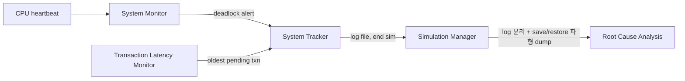

<!-- generated by yt-paper; edits will be overwritten -->

# Coherency Verification & Deadlock Detection Using Perspec/Portable Stimulus

[:material-open-in-new: 원문 보기](https://dvcon-proceedings.org/wp-content/uploads/coherency-verification--deadlock-detection-using-perspecportable-stimulus.pdf){ .md-button .md-button--primary target=_blank }

> Samsung과 Cadence가 automotive/mobile SoC의 캐시 coherency 검증과 PCIe 관련 deadlock 검증에 PSS(Perspec)를 적용해 테스트 생성을 자동화하고, 시뮬레이션 레벨 deadlock 탐지 환경을 구성한 사례 보고서이다.

| 항목 | 내용 |
|---|---|
| 저자/출처 | Moonki Jang, Jiwoong Kim, Hyerim Chung (Samsung Electronics); Phu L. Huynh, Shai Fuss (Cadence Design Systems). 원문에 학회명은 명시되어 있지 않으나, 최종 결과를 DVCon 2019(2월)에서 발표할 예정이라고 기술되어 있음 |
| 유형 | PAPER |
| 카테고리 | Verification |
| ID | `ref-20261018-90da` |

## 핵심 인사이트

- PSS의 atomic action과 Perspec 라이브러리(compute subsystem 모델, coherency action)를 쓰면 프로세서/메모리 구성 정보를 Excel/CSV 설정 테이블에 채우는 것만으로 모델링이 끝나며, 저자들은 이 작업이 수 시간 정도였다고 보고한다.
- PSS 시나리오에서 프로세서 코어나 메모리 리소스의 실제 이름을 직접 참조하지 않도록 작성해야 프로젝트 간 재사용이 가능하다. 저자들은 이를 위해 언어만으로는 부족하고 방법론과 라이브러리가 함께 필요하다고 강조한다.
- PCIe deadlock은 non-posted 요청 큐 포화, writeback과 snoop 간 의존, snoop queue 포화가 특정 타이밍에 겹칠 때 발생하므로 수작업으로 재현하기 어렵다. PSS의 parallel/sequence 구조와 제약 기반 랜덤화로 이런 시나리오를 기술하는 방식이 제시된다.
- Deadlock 탐지 환경은 System Monitor(heartbeat), Transaction Latency Monitor, System Tracker, Simulation Manager로 구성되어, 실버그 발생 시 원인 분석에 필요한 CPU 상태, 시나리오, 의심 트랜잭션, 파형 정보를 자동 수집한다.
- 논문은 진행 중인 프로젝트의 중간 보고서이며, deadlock 시나리오의 최종 결과나 정량적 커버리지/버그 수치는 포함되지 않는다. 효과에 대한 평가는 정성적 수준으로 읽어야 한다.

## 상세 요약

### 배경 및 문제 정의

자동차·모바일 SoC는 다수의 프로세서 코어, 다단계 캐시, coherent IO master를 포함하며, 이들이 메모리와 인터커넥트를 공유한다. 이런 구조에서는 캐시 coherency 문제와 livelock/deadlock 문제를 검증하기 위해 매우 많은 테스트 조합이 필요하다. 수작업으로 테스트 스위트를 만드는 비용이 크고, 특히 PCIe 관련 deadlock은 특정 트랜잭션 순서와 타이밍이 맞아야만 발생하므로 post-silicon 단계에서 원인 분석이 매우 어렵다. 저자들은 이를 tape-out 이전에 시뮬레이션 레벨에서 재현·검증하는 것을 목표로 한다.

### 핵심 아키텍처 및 방법론

**1) Coherency 검증 (Perspec 라이브러리 + PSS)**

테스트 개발은 네 단계로 구성된다: (1) compute subsystem 모델링, (2) 메모리 coherency 시나리오 개발, (3) 다른 서브시스템의 PSS 모델 개발, (4) 서브시스템 시나리오 개발. 논문은 1, 2단계만 다룬다.

- **모델링**: 프로세서 정보(#tag, #kind, #cluster)와 메모리 정보(블록, 주소 범위, #enabled)를 설정 테이블에 기입한다. 이 테이블로부터 `sml_processor_tag_e` 같은 열거형과 `sml_proc_subset_select_s` 같은 제어 구조체가 자동 생성된다. 예시 구성은 12개 코어(M0–B3), 3개 클러스터, 3개 DDR 블록이다.
- **기본 액션**: `write_data`, `copy_data`, `read_check_data`는 Perspec SML 라이브러리의 atomic action이다. 이를 chain으로 묶은 `pss_wr_cp_rc`가 재사용 가능한 빌딩 블록이 된다.
- **병렬 시나리오**: `pss_wr_cp_rc_3cores`는 세 코어를 `parallel`로 실행하며, 제약으로 코어 중복을 막는다. `pss_fs_rw_mem_rw`는 `cdn_coherency_ops_c::false_sharing_rw_base`를 병렬로 돌리면서, `constraint foreach`로 false-sharing 코어와 `pss_wr_cp_rc` 코어가 겹치지 않도록 한다.
- 테스트 범위는 false-sharing, true-sharing, exclusive access, DVM 테스트를 포함한다. 내장 coherency 테스트 스위트와 커버리지 결과를 검토해 부족한 부분을 추가했다.

**2) Deadlock 탐지 검증 환경**

- **System Monitor**: 주기적 인터럽트에 대해 CPU가 보내는 heartbeat를 확인한다. 일정 시간 응답이 없으면 deadlock으로 판단한다. SError나 livelock 등은 failure response로 구분된다.
- **Transaction Latency Monitor**: CPU 기원 트랜잭션의 지연을 기록하고, deadlock 시 가장 오래 완료되지 않은 트랜잭션을 넘긴다.
- **System Tracker**: CPU 상태(PC, GPR, PSTATE, fault/exception 레지스터), 현재 시나리오, 의심 트랜잭션, 추정 발생 시각을 수집해 로그를 남기고 시뮬레이션을 종료한다.
- **Simulation Manager**: Perspec 시나리오 생성·실행을 관리하고, 로그를 분석한 뒤 save & restore로 deadlock 시점 주변의 파형을 덤프한다.
- 자동 회귀 테스트 스위트(auto regression)와 함께 운용된다.

**3) PCIe deadlock 시나리오 (PSS)**

PCIe 순서 규칙상 posted write가 master 인터페이스를 빠져나가지 못하면 non-posted 요청과 completion이 추월할 수 없어 stall이 생긴다. 여기에 cache snoop이 겹치면 deadlock이 가능하다. 논문은 다음 흐름을 예로 든다.

1. CPU 클러스터가 PCIe EP에 non-posted read를 다수 발행해 RC 요청 버퍼를 채운다.
2. non-posted config write가 채널 포화로 수락되지 않는다.
3. CPU가 주소 A의 writeback을 발행하지만 write 채널이 막혀 진행하지 못한다.
4. PCIe EP가 A를 ReadOnce하면, 인터커넥트는 CPU 클러스터로 snoop을 보내지만 outstanding writeback 때문에 진행되지 않는다.
5. EP가 coherent read를 다수 발행해 snoop queue를 채운다.
6. EP가 WriteLineUnique(WLU)를 발행하면 Clean&Invalidate snoop이 필요하지만 snoop queue 포화로 전달되지 못한다.
7. Deadlock 달성.

이 흐름을 `parallel`과 `sequence`로 기술한다. Setup 단계(`pcie_config`, `pcie_rc_mem_write`, `write_cache`) 이후 코어 A0–A3가 `pcie_rc_mem_read`, `invalidate_cache`, `pcie_config_write` 등을 병렬로 수행하고, 동시에 PCIe EP가 `pcie_ep_mem_write`와 `pcie_ep_mem_read`를 순차 수행한다. 실제 타이밍 조합은 Perspec 스케줄러와 제약 랜덤화가 결정한다.

### 실험 결과 및 결론

- **Coherency**: 테스트 스위트 생성과 실행을 빠르게 완료했다고 보고한다. Perspec 라이브러리와 이전 프로젝트 시나리오 재사용이 주요 이유로 꼽힌다. 정량적 시간 절감이나 커버리지 수치는 본문에 제시되지 않는다.
- **PCIe deadlock**: 시나리오 실행과 검증은 진행 중이며, 최종 결과는 DVCon 2019에서 발표할 예정이라고 되어 있다. 따라서 deadlock이 실제로 재현되었거나 설계가 deadlock-free임을 확인했다는 결론은 본문에 없다.
- **교훈**: PSS 시나리오가 C 코드보다 작성하기 쉬웠다는 점, 재사용을 위해 리소스 이름을 시나리오에서 참조하지 않아야 한다는 점, PSS 언어 외에 라이브러리와 방법론이 필요하다는 점을 정리했다. 이는 UVM이 재사용 가능한 컴포넌트 방법론을 함께 제공하는 것과 비교된다.
- **기여**: (1) SoC 레벨 검증 작업에 PSS 적용, (2) 프로젝트 간(horizontal) 재사용 방법론, (3) deadlock 탐지 검증 환경을 제시한다.

요약하면, 이 논문은 PSS 기반 coherency 테스트 생성의 실무 적용 사례와 deadlock 탐지 인프라 설계를 보여주는 중간 보고서다. 정량적 성과 데이터보다는 방법론과 구조의 설명에 무게가 있다.

## 관련 영상

<iframe src="https://www.youtube-nocookie.com/embed/4qtButQK_lU" title="[DVCON2019] Coherency Verification & Deadlock Detection Using Perspec/Portable Stimulus" loading="lazy" allow="accelerometer; clipboard-write; encrypted-media; gyroscope; picture-in-picture; web-share" referrerpolicy="strict-origin-when-cross-origin" allowfullscreen></iframe>

**[DVCON2019] Coherency Verification & Deadlock Detection Using Perspec/Portable Stimulus** — [YouTube에서 보기](https://www.youtube.com/watch?v=4qtButQK_lU) · [영상 페이지](../../videos/4qtButQK_lU.md)
