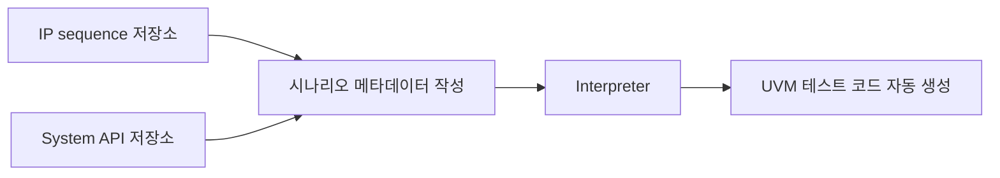

<!-- generated by yt-paper; edits will be overwritten -->

# Strategies to Maximize Reusability of UVM Test Scenarios in SoC Verification

[:material-open-in-new: 원문 보기](https://dvcon-proceedings.org/wp-content/uploads/1050-Strategies-to-Maximize-Reusability-of-UVM-Test-Scenarios-in-SoC-Verification.pdf){ .md-button .md-button--primary target=_blank }

> UVM 코드를 3단계 상속 구조로 나눠 IP 기능 코드와 시스템 제어 코드를 분리하고, 메타데이터 기반 인터프리터로 복합 시나리오를 자동 생성해 SoC 검증 TAT를 줄이는 방법을 제안한 논문.

| 항목 | 내용 |
|---|---|
| 저자/출처 | Hyeonman Park, Namyoung Kim, Kyoungmin Lee, Hongkyu Kim, Jaein Hong, Kiseok Bae (Samsung Electronics Inc.) / 학회명은 본문에 명시되지 않음 |
| 유형 | PAPER |
| 카테고리 | Verification |
| ID | `ref-20261018-912a` |

## 핵심 인사이트

- UVM 클래스를 1단계(IP 기능 및 VIP/인터페이스 핸들), 2단계(기능 활성화 및 sequence 라이브러리), 3단계(제품별 핸들·주소맵 연결)로 역할 분리하면, 제품 변경 시 수정 범위를 3단계 클래스로 국한할 수 있습니다.
- 시스템 리셋, 저전력, 파워 제어 같은 시스템 제어 코드를 'common task'에서 한 단계 더 나아가 kind 인자를 받는 API(예: system_reset(kind))로 추상화하면, 같은 하드웨어 계열 내 여러 제품에서 하드웨어 종속 부분을 숨기고 재사용할 수 있습니다.
- 시나리오를 sequence 나열이 아니라 metadata(순차 줄바꿈, '&' 병렬, '{}'와 ';' 조합)로 기술하고 인터프리터가 UVM 코드를 생성하도록 하면, 프레임워크 작성 없이 임의 순서의 복합 시나리오를 만들 수 있다는 점이 실무적으로 가치가 큽니다.
- 논문의 재사용률 수치(본문 86%, Table 4 기준 약 88%)와 시나리오 수 감소(87%)는 두 자동차용 SoC 제품 사례에 한정된 결과입니다. 또한 'same verification quality' 주장에 대한 정량적 근거는 본문 텍스트에 드러나 있지 않아, 적용 전 자체 프로젝트 기준으로 검증이 필요합니다.
- PSS 도구는 IP 단위 데이터 조작 재사용과 플랫폼 간 이식성에 강점이 있는 반면, 이 논문은 같은 플랫폼(시뮬레이션) 내 제품 간 재사용과 bring-up 초기 단계의 시스템 제어 시나리오 확보에 초점을 둡니다. 목적에 따라 접근법 선택이 달라집니다.

## 상세 요약

### 배경 및 문제 정의

대형 SoC에서 기능 검증은 전체 제품 개발 TAT의 큰 비중을 차지하며, 시장 출시 시기 경쟁 때문에 TAT 단축이 중요합니다. 논문은 TAT를 줄이는 두 방향 중 **테스트 시나리오 개발 기간을 코드 재사용으로 줄이는 접근**에 집중합니다.

저자들은 기존 PSS(Portable Test and Stimulus Standard) 기반 EDA 도구가 다음과 같은 한계를 가진다고 지적합니다.

- PSS 도구는 IP 단위 데이터 조작 sequence를 조합하는 데 강하지만, SoC 버그의 상당수가 IP 자체보다 **시스템 제어 로직**에서 발생한다는 점을 충분히 다루지 못합니다.
- 전원·리셋 제어 같은 시스템 제어 기능은 기본 제공되지 않아 수동 코딩이 필요하며, 이로 인해 제어 로직과 데이터 경로 조합 커버리지 확보가 번거롭습니다.
- PSS 도구는 시뮬레이터·에뮬레이터·실리콘 등 **플랫폼 간 이식성**에 초점이 있는데, 저자들은 bring-up 초기에 단순 시나리오를 기존 코드 재사용으로 빠르게 확보하고(shift left) 점차 복합 시나리오로 확장하는 것이 더 중요하다고 봅니다.
- SoC 검증은 외부 이벤트 제어가 많아 UVM 기반 SystemVerilog가 주로 쓰이므로, PSS 도구의 C 기반 테스트보다 UVM 기반 시나리오 생성 흐름이 더 가치 있다고 주장합니다.

결국 본 논문의 목표는 **같은 아키텍처 계열 제품들 사이에서 UVM 테스트 시나리오를 재사용**하고, 복합 시나리오 개발 효율을 높이는 것입니다.

### 핵심 아키텍처 및 방법론

**(1) 3단계 상속 기반 코드 구조**

IP 기능 코드(재사용 후보)와 시스템 제어 코드를 분리하기 위해 역할 기반 3단계 클래스 계층을 설계했습니다.

| 단계 | 역할 |
|---|---|
| 1단계 (base) | IP의 모든 기능 함수, 이를 활성화하는 변수, VIP·인터페이스 등 검증 컴포넌트 핸들 |
| 2단계 | 1단계 변수를 설정해 기능을 활성화하고, TX/RX 등을 sequence 클래스 라이브러리로 구현 |
| 3단계 | 제품별 실제 인스턴스(인터페이스, sequencer, register model 등)와 주소맵, CPU 정보를 매핑 (macro 사용) |

UART 예시에서 SoC에 UART가 4개, 각 UART마다 TX/RX 기능이 있으면 3단계에서 8개의 operation sequence가 생성됩니다. 제품 구성 변화(인스턴스 수, 레지스터 모델, 인터페이스 연결)는 3단계에서만 수정하면 됩니다.

**(2) 시스템 제어 기능의 API화**

시스템 리셋 같은 제어 코드는 IP 시퀀스에 직접 넣으면 코드 크기가 늘고 재사용도 어렵습니다. 논문은 이를 다음 순서로 일반화합니다.

1. 각 시나리오에 흩어진 system_reset1, system_reset2를 제품별 common task로 분리
2. 두 task를 `system_reset(kind)` 형태의 API로 통합
3. 실제 구현은 제품 종속이지만, 시나리오 개발자는 하드웨어 세부 정보 없이 동일 API를 호출

예를 들어 POR, WDT0, WDT1이 있는 SoC라면 `control_hardware_reset("POR")`, `control_hardware_reset("WDT0")` 등으로 호출합니다.

**(3) 메타데이터 기반 시나리오 생성 흐름**

기존 흐름(Fig. 4-a)은 프레임워크를 먼저 만들고 그 안에 sequence를 배치하는 방식입니다. 논문에 따르면 기존 프레임워크는 sequence를 4개 초과로 연결하거나 2개 초과를 동시에 실행하기 어렵고, 복합 시나리오마다 프레임워크를 추가해야 합니다.

제안 흐름(Fig. 4-b)은 다음과 같습니다.

메타데이터 문법은 다음과 같습니다.

- 줄바꿈: 직렬 실행
- `&`: 병렬 실행
- `{ a; b; c }`: 중괄호 안에서 `;`로 구분된 순차 실행

예를 들어 `{seq_b; seq_c; seq_d} & task_0`은 seq_b→seq_c→seq_d 순차 실행과 task_0 병렬 실행을 뜻합니다. 인터프리터는 이를 해석해 class 선언, task body의 fork/join 구조 등 UVM 문법을 갖춘 코드를 생성합니다.

### 실험 결과 및 결론

**실험 환경**: 동일 아키텍처 플랫폼에서 설계된 2개 자동차용 SoC 제품(2세대가 1세대보다 성능과 복잡도가 높음). 1세대 기존 시나리오는 제안 구조로 재구성했고, 2세대 시나리오는 1·2단계 클래스를 재사용해 작성했습니다.

**결과 요약**

- **코드 재사용률**: BLOCK1 예시(IP 5개)에서 평균 약 86%의 코드가 재사용 가능한 1·2단계 클래스에 속하며, 나머지 약 14%만 제품 구성에 맞게 수정하면 됩니다(Table 2).
- **시나리오 수 감소**: BLOCK1~BLOCK4(두 제품 통합)에서 동일 커버리지를 달성하는 데 전체 시나리오의 13%만 필요해, 약 87%를 줄였다고 보고합니다(Table 3).
- **전체 코드 분류**: 2세대 제품 시나리오 코드 중 약 88%가 수정 없이 재사용 또는 자동 생성되고, 약 14%만 수동 편집이 필요하다고 보고합니다(Table 4).

**결론**: 저자들은 IP 기능 시나리오를 SoC 설계 초기에 많이 확보할 수 있고, 복합 시나리오를 통해 복잡한 설계 버그를 찾을 수 있으며, 검증 시간 예산 안에서 검증을 마칠 수 있다고 결론짓습니다.

**독자 관점의 한계**: 재사용률과 시나리오 감소율은 2개 제품, 4개 블록이라는 제한된 사례에서 나온 값입니다. 또한 "same verification quality"라는 주장은 본문에서 정량 지표(예: 커버리지 수치 비교)로 뒷받침되지 않습니다. Table 2~4의 세부 수치는 본문 텍스트에 충분히 드러나 있지 않아 원문 표를 직접 확인해야 정확합니다. 인터프리터 자체의 구현 세부(오류 처리, 동시성 제약 등)도 본문에서 다루지 않습니다.

## 관련 영상

<iframe src="https://www.youtube-nocookie.com/embed/q6NioNTKDLs" title="[DVCON2023]Strategies to Maximize Reusability of UVM Test Scenarios in SoC Verification" loading="lazy" allow="accelerometer; clipboard-write; encrypted-media; gyroscope; picture-in-picture; web-share" referrerpolicy="strict-origin-when-cross-origin" allowfullscreen></iframe>

**[DVCON2023]Strategies to Maximize Reusability of UVM Test Scenarios in SoC Verification** — [YouTube에서 보기](https://www.youtube.com/watch?v=q6NioNTKDLs) · [영상 페이지](../../videos/q6NioNTKDLs.md)
