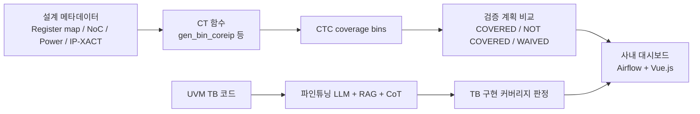

<!-- generated by yt-paper; edits will be overwritten -->

# An Early Stage Coverage Measurement Methodology For Common Features Of System-On-Chip Verification, Using Design Metadata And Large Language Models

[:material-open-in-new: 원문 보기](https://dvcon-proceedings.org/wp-content/uploads/1030.pdf){ .md-button .md-button--primary target=_blank }

> 설계 메타데이터로 공통 기능 커버리지 bin을 검증 계획 단계에서 생성하고, 로컬 파인튜닝 LLM(RAG+CoT)으로 UVM TB 구현 커버리지를 판정하는 CTC 방법론.

| 항목 | 내용 |
|---|---|
| 저자/출처 | Myeongwhan Hyun, Jaehyeok Lee, Jin Choi, Dongjoo Kim, Seonghee Yim, Youngsik Kim, Seonil Brian Choi (Samsung Electronics Co. Ltd.) |
| 유형 | PAPER |
| 카테고리 | Verification |
| ID | `ref-20261018-9206` |

## 핵심 인사이트

- 커버리지를 시뮬레이션 후가 아니라 검증 계획 단계에서 측정할 수 있도록, 레지스터 맵·NoC·전력 명세·IP-XACT에서 파생한 메타데이터로 coverage bin을 미리 정의한 점이 핵심 차별점이다.
- 검증 계획 대비 CT(Feature/Sub-feature/IP) 매칭을 COVERED / NOT COVERED / WAIVED 상태로 자동 판정하며, 갭 원인으로 'oversight 누락'이 Project A 58.36%, Project B 96.30%로 가장 컸다.
- 사내 보안 데이터 보호를 위해 외부 API 대신 로컬 오픈소스 LLM을 파인튜닝하고 FAISS 기반 RAG와 CoT 프롬프트를 결합했다.
- CT 가이드의 Test Implementation 섹션이 가장 중요했고, Design Overview와 Example 섹션 제거 시 정확도가 0.1 이상 떨어졌다는 실험 결과는 LLM 기반 검증 시 가이드 문서 품질의 중요성을 보여준다.
- 정확도 0.94 등 수치는 단일 프로젝트의 혼동행렬 기반이며 벤치마크 비교나 표본 다양성이 제시되지 않아 일반화에는 주의가 필요하다. 또한 리뷰 기간 7일 → 1–2일 단축은 정량적 비교 방법이 상세히 설명되지 않았다.

## 상세 요약

### 배경 및 문제 정의

SoC는 사전 검증된 IP와 서브시스템을 통합해 만들어지므로, SoC 레벨 검증의 핵심은 컴포넌트 간 통합을 확인하는 것이다. 이 논문은 클럭, 리셋, 보안, 전력 같은 **공통 기능(common features)** 과 CMU, PMU 같은 **공통 IP**를 검증하기 위해 정의된 **Common Task(CT)** 에 주목한다. 저자들은 CT가 UVM 기반 기능 검증 노력의 40% 이상을 차지한다고 밝힌다.

현행 커버리지 방식은 다음 두 가지 한계를 가진다.

1. 시뮬레이션 이후에만 적용 가능해 검증 후반부에야 갭이 드러난다. 이는 ASIC respin의 주요 원인인 논리/기능 결함의 위험을 키운다.
2. 전력·클럭 시나리오는 코드 커버리지로 측정하기 어렵고, 기능 커버리지 구성은 복잡하다.

또한 CT를 검증 계획 단계에서 빠뜨리는 경우가 잦아, RTL freeze 이후 버그로 이어진다는 문제가 제기된다.

### 핵심 아키텍처 및 방법론

**Common Task Coverage(CTC)** 는 세 단계 측정 구조를 가진다.

**(A) 메타데이터 기반 bin 정의.** 블록 내 IP 이름은 register map, 마스터는 NoC 명세, 전력 기능은 power 명세에서 가져오고, SoC 구현 세부 사항은 IP-XACT(IEEE 1685-2014)로 보완한다. CT 함수는 공통 IP(예: CMU_A)를 식별한 뒤, 그 외 Core IP를 대상 bin으로 생성한다. 예시에서 CLOCK / CLOCK_GATING_BY_SW 조합에 대해 BLK_A의 Core IP인 CPU_A와 DMA_A가 bin으로 생성된다.

**(B) 검증 계획 매칭.** 검증 계획에서 각 CT는 Feature, Sub-feature, 연관 IP 쌍으로 기록된다. 대시보드 API가 bin 데이터와 정확히 일치하면 `COVERED`, 불일치나 누락이면 `NOT COVERED`로 표시하며, 사유를 기록해 `WAIVED`로 변경할 수 있다.

**(C) LLM 기반 UVM TB 구현 커버리지.** TB는 팀 간 분리로 구현 불일치가 생길 수 있어, 이를 LLM으로 판정한다. 기밀 데이터 보호를 위해 외부 모델 대신 **DeepSeek-Coder-V2** 기반 로컬 모델을 선택했다. 파이프라인은 다음과 같다.

- Step 1: RTL, TB, 검증 계획, HDD로 파인튜닝
- Step 2: (검증 계획, uvm_test) 쌍을 임베딩해 FAISS 벡터 DB 구축
- Step 3: (uvm_test, uvm_sequence) 쌍을 별도 벡터 DB로 구축
- Step 4: 두 DB와 검증 계획 DB에서 FAISS로 컨텍스트 검색 (RAG)
- Step 5: 검색 결과와 CT 가이드를 넣은 프롬프트로 판정, CoT로 단계별 설명을 생성

CT 가이드는 Table III 구성(Purpose, Scope, Design Overview, Test Implementation, Example)을 따른다.

**(D) 대시보드.** Apache Airflow로 CTC bin을 주기적으로 동기화해 DB에 저장하고, 블록별 heat map, 상태 리포트, 사용자 검토 기반 waiver 기능을 제공한다. UI는 Vue.js로 구현했다.

### 실험 결과 및 결론

**검증 계획 갭 측정 (Table IV).**

| 프로젝트 | CT 수 | Bin 수 | 갭 수 | 갭 비율 | 신규 IP/기능 | 설계 변경 | 누락(oversight) |
|---|---|---|---|---|---|---|---|
| Project A (대형) | 39 | 10,641 | 293 | 2.75% | 117 | 5 | 171 |
| Project B (소형) | 35 | 4,325 | 216 | 4.99% | 4 | 4 | 208 |

갭 원인 비율은 Project A에서 누락 58.36%, 신규 IP 39.93%였고, Project B에서는 누락 96.30%, 신규 IP 1.85%였다. 저자들은 이를 통해 방법론이 여러 원인의 갭을 탐지하고 프로젝트 규모에 적응한다고 주장한다.

**LLM 판정 성능 (Table V, 단일 프로젝트).** Accuracy 0.94, Precision 0.89, Recall 0.98, F1 0.98. 혼동행렬은 TP 9,657 / FN 218 / FP 1,211 / TN 216으로 제시된다. 저자들은 GLUE, MT-Bench가 이진 커버리지 판정에 부적합하다고 설명한다.

**CT 가이드 구성 요소 ablation (6개 케이스).** 가이드가 상세할수록 점수가 높았고, Case 6(전체 섹션)이 최적이었다. Test Implementation만 포함한 경우가 가장 낮았지만 모든 지표는 0.65 이상이었다. Design Overview와 Example을 제외한 Case 4, 5에서는 정확도가 0.1 이상 떨어졌다. Scope 섹션을 뺀 Case 3은 Case 6과 비슷해, Scope 정보는 다른 섹션에서 유추 가능한 것으로 해석된다.

**리뷰 시간.** 기존 수동 검토는 최소 7일이 걸렸으나, CTC 도입 후 1–2일 이하로 단축되었다고 보고한다. 다만 측정 조건과 비교 방식은 자세히 기술되지 않았다.

**결론 및 한계.** 저자들은 CTC가 설계 메타데이터만으로 즉시 적용 가능하고, 사내 대시보드로 실시간 피드백을 제공하며, 상용 EDA 파트너 의존을 줄인다고 주장한다. 한계로는 메타데이터 품질과 완전성 의존, 시뮬레이션 중심이라 CDC/RDC 같은 정적 검증과의 통합이 제한적이라는 점, 복잡한 SoC에서 LLM 성능이 달라질 수 있다는 점이 명시된다. 향후 과제는 다양한 아키텍처 적응, 정적 검증 통합, 메타데이터 추출 자동화다.

**요약 평가.** 아이디어 자체는 메타데이터 기반 bin 생성과 검증 계획 단계 커버리지 측정으로 실용적이다. 다만 LLM 판정 정확도는 단일 프로젝트 결과이고 외부 벤치마크나 반복 실험이 없어, 정량적 근거는 제한적이다.

## 관련 영상

<iframe src="https://www.youtube-nocookie.com/embed/Z0j0T3lPedk" title="[DVCON2025]Early Stage Coverage Methodology Common Features SOC Verification Design Metadata, LLMs" loading="lazy" allow="accelerometer; clipboard-write; encrypted-media; gyroscope; picture-in-picture; web-share" referrerpolicy="strict-origin-when-cross-origin" allowfullscreen></iframe>

**[DVCON2025]Early Stage Coverage Methodology Common Features SOC Verification Design Metadata, LLMs** — [YouTube에서 보기](https://www.youtube.com/watch?v=Z0j0T3lPedk) · [영상 페이지](../../videos/Z0j0T3lPedk.md)
