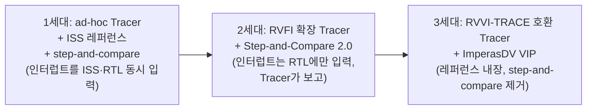

<!-- generated by yt-paper; edits will be overwritten -->

# The Evolution of RISC-V Processor Verification: Open Standards and Verification IP

[:material-open-in-new: 원문 보기](https://dvcon-proceedings.org/wp-content/uploads/1124-The-evolution-of-RISC-V-processor-verification-open-standards-and-verification-IP.pdf){ .md-button .md-button--primary target=_blank }

> OpenHW Group의 CORE-V-VERIF를 사례로, RISC-V 프로세서 검증 환경이 step-and-compare 1·2세대에서 RVVI 기반 3세대(ImperasDV VIP)로 진화한 과정과, 비동기 인터럽트 검증 버그 발견 사례를 정리한 논문.

| 항목 | 내용 |
|---|---|
| 저자/출처 | Lee Moore (Imperas Software), Aimee Sutton (Imperas Software), Mike Thompson (OpenHW Group) — 문서 내 발표 학회 정보는 명시되어 있지 않음 (문서 저작권 표기: © 2023 Imperas Software Ltd., © 2023 OpenHW Group Inc.) |
| 유형 | PAPER |
| 카테고리 | Verification |
| ID | `ref-20261018-921a` |

## 핵심 인사이트

- step-and-compare의 근본 한계는 ISS(명령 단위)와 RTL(클록 단위)의 추상화 차이에서 온다. 비동기 이벤트의 타이밍이 두 모델 사이에서 다르게 보이면 false-negative가 발생하고, 이벤트마다 코어별 특수 코드가 필요해 유지보수가 어려워진다.
- 2세대 RVFI 기반 Tracer는 인터페이스를 명세해 Tracer 요구사항을 정의했지만, 레퍼런스 모델이 비동기 이벤트를 직접 받지 않아 '우선순위에 따른 올바른 인터럽트 선택' 같은 독립적 검증이 불가능했다. 이것이 3세대 전환의 핵심 동기다.
- RVVI-TRACE는 명령 retirement 사이에 발생한 net 변화를 큐에 저장하고 시점 정보를 함께 제공한다. 이를 통해 레퍼런스 측이 인터럽트 응답을 독립적으로 검증할 수 있다. 기존 RVFI는 명령당 다중 레지스터 변경(Zc 확장 등)을 표현하지 못했다.
- RVVI-API의 volatile 영역 설정 기능으로 CSR·메모리 영역을 비동기적으로 변하는 것으로 표시하면, 레퍼런스 모델이 일관성을 유지하는 책임을 갖는다. 이는 testbench 측 비교 목록 관리 부담을 줄인다.
- CV32E40X 인터럽트 사례에서 staircase 파형의 인터럽트 입력에 대해 합법적 결과가 9가지(인터럽트 0~7 중 하나 또는 미수행)로 나타났고, DUT가 ebreak로 디버그 모드에 진입한 것은 어느 합법 시나리오에도 속하지 않아 버그로 판정됐다. 비동기 이벤트 검증을 '합법 시나리오 집합' 검사로 바꾼 접근이 실질적 버그를 잡았다는 점이 실무적으로 의미가 크다.

## 상세 요약

### 배경 및 문제 정의

RISC-V 프로세서 검증 수요가 늘면서, OpenHW Group의 Verification Task Group은 CORE-V 코어 패밀리를 산업 표준 수준으로 검증하는 것을 목표로 CORE-V-VERIF(오픈소스 UVM 환경)를 2019년 이후 발전시켜 왔다. 이 논문은 이 환경의 세대별 진화를 사례 연구로 정리한다.

1세대와 2세대 환경은 C 기반 레퍼런스 모델(Imperas OVPsim ISS)을 UVM 테스트벤치에 넣고, 명령 retirement마다 DUT와 상태를 비교하는 **step-and-compare** 방식을 사용했다. 핵심 문제는 다음과 같다.

- **추상화 수준 차이**: RTL은 클록 단위, ISS는 명령 단위로 동작한다. 두 모델을 동기화하려면 RTL 클록을 retirement 시점에 gap 처리하는 방식이 필요했다.
- **비동기 이벤트 타이밍**: 인터럽트·디버그 요청은 ISS에서는 명령 시작에 동기적으로 보이지만, RTL 마이크로아키텍처에 따라 명령 전후 어디서든 인식될 수 있다. 이로 인해 false-negative가 발생했다.
- **코어별 특수 코드**: 비동기 이벤트마다 코어 고유 처리 코드가 필요해 테스트벤치가 "버그를 만들기 쉬운" 상태가 되었다.
- **검증 공백**: 레퍼런스 모델이 DUT를 단순 미러링할 뿐이어서, 여러 인터럽트가 펜딩된 상황에서 우선순위에 맞는 인터럽트가 선택됐는지 독립적으로 검증할 수 없었다.

### 핵심 아키텍처 및 방법론

**세대별 구조 변화**

**2세대: RVFI 기반 Tracer**
- RVFI(RISC-V Formal Interface)를 기반으로 Tracer 인터페이스를 정의했다. CV32E40X 사용자 매뉴얼에 확장 내용이 있다.
- Tracer는 (1) 명령 retirement 식별, (2) 동기/비동기 trap 보고, (3) PC·GPR·CSR 상태 노출을 수행한다. 보통 SystemVerilog `bind`로 RTL에 붙인다.
- 디버그 진입은 명령 사이에서 일어나는 것으로 규정했다. `rvfi_dbg`, `rvfi_dbg_mode` 신호로 표현한다.
- 비동기 이벤트는 Tracer가 보고하고 Step-and-Compare 로직이 레퍼런스에 알려주는 방식이다. 이로써 레퍼런스가 RTL과 같은 명령에서 인터럽트를 받도록 맞췄지만, 레퍼런스가 독립적으로 판단하지는 못했다.

**RVVI (RISC-V Verification Interface)**
RVVI는 공통 컴포넌트를 표준 인터페이스로 분리하는 오픈 표준이며, 두 부분으로 구성된다.

1. **RVVI-TRACE**: 프로세서와 테스트벤치를 잇는 SystemVerilog interface다. 주요 특징은 다음과 같다.
   - RVFI가 formal 검증용으로 설계되어 dynamic 검증에 부적합하다고 판단했다.
   - RVFI는 명령당 여러 레지스터 변경(RISC-V Zc 확장 등)을 표현할 수 없었다. RVVI-TRACE는 이를 지원한다.
   - retirement 사이에 발생한 net 변화를 SystemVerilog queue에 저장하고, 발생 시점 정보를 함께 제공한다. 레퍼런스나 checker가 비동기 입력에 대한 응답을 검증할 수 있는 근거다.
   - 전체 RISC-V ISA 부분집합을 지원하므로 프로젝트마다 인터페이스를 수정할 필요가 없다.

2. **RVVI-API**: 레퍼런스 모델과 VIP가 구현해야 하는 함수 집합이다.
   - **Volatile 설정**: 특정 메모리 영역, 레지스터, 레지스터 필드를 volatile로 표시한다. 예: 매 클록 증가하는 카운터, 메모리 맵 주변장치 주소. 레퍼런스 모델은 instruction-accurate이므로 volatile 값은 DUT에서 전달받아 일관성을 유지해야 한다.
   - 예시 DPI-C 함수: `rvviRefCsrSetVolatile(hartId, csrIndex)`, `rvviRefMemorySetVolatile(addressLow, addressHigh)`.
   - volatile 영역 접근 데이터는 레퍼런스 모델 메모리로 전파되어 테스트 프로그램이 기대대로 실행되도록 한다.

**3세대 환경**
- CORE-V Tracer를 RVVI 호환 Tracer로 교체했다.
- Imperas 레퍼런스 모델을 **ImperasDV VIP**(레퍼런스 모델 내장, RVVI-API 구현)로 교체했다.
- Step-and-compare 로직을 제거했다. VIP가 RVVI-TRACE 정보로 내부 상태를 비교하고 내부 scoreboard에 결과를 기록한다.
- 비동기 이벤트가 RVVI-TRACE를 통해 VIP에 전달되므로, 프로세서의 응답을 독립적으로 검증할 수 있다.

**비동기 이벤트 검증: 합법 시나리오 집합 방식**
- 문제: 인터럽트 입력이 클록마다 계단 모양(staircase)으로 변할 때, 아키텍처 모델은 DUT가 샘플링한 시점의 최우선 인터럽트를 알 수 없다.
- 해결: 레퍼런스가 RVVI-TRACE의 net 변화 이력과 현재 상태로 **가능한 합법 결과 집합**을 계산하고, DUT가 그중 하나를 택했는지 검사한다. 논문 예시에서는 인터럽트 0~7 각각을 취하거나, 인터럽트를 취하지 않는 경우까지 총 9가지 합법 결과가 존재한다.
- 인터럽트 인식 조건은 `IRQ = MSTATUS.MIE && ((MIE & MIP) != 0x0)`로 표현된다.

### 실험 결과 및 결론

논문은 정량적 벤치마크 수치를 제시하지 않는다. 대신 실제 발견 사례 하나를 보고한다.

- **대상**: OpenHW CV32E40X 프로세서 코어
- **상황**: 무작위로 생성된 외부 인터럽트 신호가 인터럽트 핀에 전파되는 중 `mret` 명령이 실행되었다. 이 시점에 인터럽트 핀이 명령 사이에서 토글했기 때문에, 어떤 인터럽트가 활성이어야 하는지 명확하지 않았다.
- **관찰**: DUT는 인터럽트를 서비스하지 않고 `ebreak`를 실행해 디버그 모드로 진입했다.
- **판정**: 이 결과는 계산된 합법 시나리오 집합에 속하지 않아 오류로 플래그되었다. 이 버그는 OpenHW GitHub 이슈 #665(cv32e40x)로 등록되었다.

**결론**
- CORE-V-VERIF는 step-and-compare 중심 구조에서 RVVI 기반 VIP 중심 구조로 이동했다. 이로써 false-negative와 코어별 특수 코드를 줄이고, 비동기 이벤트 응답을 독립 검증할 수 있게 되었다.
- 향후 과제로는 retired 명령 기반 기능 커버리지 자동 생성을 제시한다. 이는 RVVI가 명령 커버리지에 필요한 정보를 모두 제공하고 RISC-V ISA 정의가 표준화되어 있다는 점에 기반한다.
- 본문은 3세대 환경을 "현재 최신 방법론(state-of-the-art)"으로 제시하지만, 마이그레이션(RVFI → RVVI)은 논문 집필 시점에 진행 중이었다고 명시한다.

## 관련 영상

<iframe src="https://www.youtube-nocookie.com/embed/jRK3zGUbXwc" title="[DVCON2023]The Evolution of RISC-V Processor Verification: Open Standards and Verification IP" loading="lazy" allow="accelerometer; clipboard-write; encrypted-media; gyroscope; picture-in-picture; web-share" referrerpolicy="strict-origin-when-cross-origin" allowfullscreen></iframe>

**[DVCON2023]The Evolution of RISC-V Processor Verification: Open Standards and Verification IP** — [YouTube에서 보기](https://www.youtube.com/watch?v=jRK3zGUbXwc) · [영상 페이지](../../videos/jRK3zGUbXwc.md)
