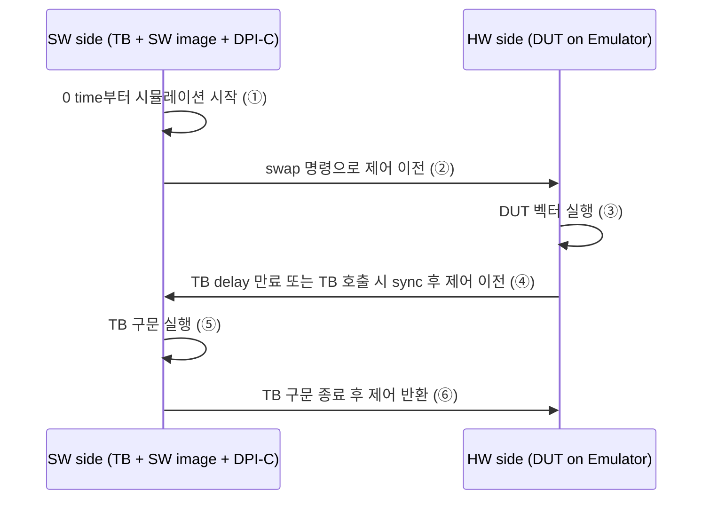

<!-- generated by yt-paper; edits will be overwritten -->

# UVM Acceleration Using Hardware Emulator at Pre-silicon Stage

[:material-open-in-new: 원문 보기](https://dvcon-proceedings.org/wp-content/uploads/uvm-acceleration-using-hardware-emulator-at-pre-silicon-stage.pdf){ .md-button .md-button--primary target=_blank }

> 기존 UVM 시뮬레이션 환경을 재사용하면서 HVL/HDL 이중 도메인 구조와 OOMR 신호 자동 추출 흐름으로 모바일 AP CPU 테스트를 에뮬레이터에서 17~21배 가속한 사례 보고.

| 항목 | 내용 |
|---|---|
| 저자/출처 | Sunil Roe, YunGi Um, Hyunwoo Koh, Hyunsun Ahn, Youngsik Kim, Seonil Brian Choi (Samsung Electronics Co., Ltd.). 본문에 발표 학회 정보는 없음. 제공된 저자 힌트(Laura Hyslop)는 본문 저자와 일치하지 않음. |
| 유형 | PAPER |
| 카테고리 | Verification |
| ID | `ref-20261018-979c` |

## 핵심 인사이트

- 에뮬레이터 자원이 제한적이므로 시뮬레이션 프로파일링으로 HW 실행 비중이 높은 테스트(본문 기준 L4 CPU 벡터 약 99.53%)를 우선 선정해야 ROI가 높아진다. 반대로 SW-HW 통신이 잦은 벡터(L2 약 94%)는 가속 효과가 떨어진다.
- HVL-HDL 경계 통신이 가속 성능의 주요 병목이다. 예로 PPMU 모니터처럼 매 클록마다 HVL과 HDL이 통신하는 구조는 성능을 크게 떨어뜨리므로, 카운터 로직을 HDL 쪽으로 옮기고 export 신호로 필요할 때만 읽도록 재설계해야 한다.
- 수동 OOMR 신호 목록 작성은 누락으로 인한 반복 빌드와 긴 파형 디버깅을 유발한다. 1차 빌드에서 TB가 접근하는 신호를 자동 추출해 2차 빌드에 반영하는 흐름으로 반복을 최소화할 수 있다. 다만 이 자동화도 이미지 빌드 1회는 필수다.
- liberty 파일이 없는 초기 설계 라이브러리는 합성 가능 모델을 수동 작성하지 않고 host 시뮬레이션 모델을 쓰는 방식으로 자동화 흐름의 컴파일 오류를 피했다. 호스트 통신 오버헤드로 성능은 떨어지지만 초기 단계에서는 영향이 작다고 판단했다.
- 보고된 속도 향상(일반 17x, 파워 인지 21x)은 약 100MG 규모 AP와 평균 시뮬레이션 시간 2~5시간의 결과다. 저자들은 시뮬레이션이 수일 걸리는 1000MG급 설계에서 가속 효과가 더 클 것으로 추정했으나 이는 본 논문에서 측정되지 않은 예측이다.

## 상세 요약

### 배경 및 문제 정의

모바일 SoC는 기능과 성능 요구가 늘면서 복잡도가 크게 증가했고, 같은 개발 기간 안에 검증을 끝내야 한다. 기존 UVM 시뮬레이션은 환경 구축은 빠르지만 SoC 레벨에서 실행 시간이 길다. 본문은 에뮬레이션이 시뮬레이션보다 10x~100x 빠르다고 인용([1])하지만, 기존 UVM 환경을 그대로 에뮬레이터에 올리기는 비효율적이라고 지적한다. 따라서 기존 UVM 환경을 재사용하면서 에뮬레이터 가속을 얻는 방법이 필요하다.

논문이 다루는 문제는 다음과 같다.
- **테스트 선별**: 에뮬레이터 자원은 비싸고 제한적이라 어떤 벡터를 먼저 돌릴지 정해야 한다. HW 부분 비중이 낮으면 가속 여지가 적다.
- **도메인 분할**: 단일 top 구조의 UVM 환경을 HVL과 HDL로 나눠야 한다. 이 과정에서 두 도메인 사이 통신 오버헤드가 생긴다.
- **OOMR 신호 누락**: TB(HVL)가 HDL의 내부 신호에 접근하려면 export 목록이 필요한데, 누락 시 테스트가 특정 지점에서 멈추고 긴 파형 디버깅이 필요하다.
- **라이브러리 및 구성**: liberty가 없는 설계 라이브러리, 전력 인지(UPF) 에뮬레이션, DFS(동적 주파수 스케일링) 구성 문제가 자동화를 막는다.

### 핵심 아키텍처 및 방법론

**1) 시뮬레이션 프로파일링 기반 후보 선정**
시뮬레이터의 프로파일링 도구로 신호 토글 비율(hit ratio)을 측정해 HW 실행 비중을 추정한다. CPU 중심 벡터 L4는 HW 비중 99.53%, CPU 없는 IP 벡터 L2는 약 94%로 나타났다. 가속 시간은 SW 실행, HW 실행, 통신 시간을 모두 더해 계산해야 한다.

**2) Dual Domain Framework (HVL/HDL 분리)**
- HDL_TOP: DUT와 인터페이스(synthesizable)
- HVL_TOP: UVM ENV(driver, monitor, sequencer 등, non-synthesizable)
- 두 도메인은 DPI-C 기반 인터페이스로 연결된다.

PPMU 예시에서 단일 top 구조의 모니터는 `aclk` 매 클록마다 `arvalid & arready`를 HVL에서 샘플링한다. 이는 도메인 경계 이벤트를 매 사이클 발생시켜 성능을 크게 떨어뜨린다. 논문은 카운터 로직(`rd_req_cnt`)을 HDL 인터페이스 쪽으로 옮기고, `$export_read`로 export한 값을 HVL에서 필요할 때만 읽는 방식으로 이를 해결했다. 같은 기능을 유지하면서 경계 통신을 줄이는 것이 핵심이다.

**3) 실행 흐름 (Simulation Acceleration Flow)**

이 과정을 시뮬레이션이 끝날 때까지 반복한다. HVL과 HDL 사이 신호 접근 권한(OOMR)을 HDL 쪽에서 파악해야 한다.

**4) OOMR 자동 삽입 흐름**
- **기존(수동)**: 파일 리스트 분석 → OOMR 정보 수동 입력 → HW 컴파일 → SW elaboration → 실행. 멈추면 파형으로 원인을 찾고 신호를 추가해 HW 컴파일을 반복한다.
- **제안(자동)**: 파일 리스트 분석 → HW 컴파일 및 SW elaboration을 1회 수행해 테스트가 실제로 쓰는 OOMR 정보를 추출 → 이 정보를 자동으로 2차 이미지 빌드에 입력 → 실행.

이미지 빌드 1회는 필수지만, 누락 신호 탐색 반복을 없앤다는 것이 장점이다.

**5) 기타 구성 기법**
- **Design library**: liberty가 없으면 합성 가능 모델을 만들지 않고 host에서 도는 시뮬레이션 모델을 사용한다. 통신 오버헤드로 성능은 떨어지지만 초기 단계에서 사용 빈도가 낮다.
- **Power aware emulation**: 컴파일 시간이 시뮬레이션의 2~3배이므로 불필요한 블록을 제거하고 스텁 처리한다. 이때 RTL과 UPF 정보 불일치로 생기는 오류를 도구가 black box 상에서 처리해야 한다.
- **DFS 구성**: 클록 인스턴스를 모두 top에 만들면 성능이 떨어진다. 하나의 인스턴스만 미리 만들고 PLL 파라미터에 따른 주파수를 local parameter로 정의해 할당한다.

### 실험 결과 및 결론

실험 대상은 모바일 AP이며, CPU 동작 중심 시나리오를 선택했다. 이유는 시간이 길고 TB 개입이 적기 때문이다. 총 137개 시나리오(파워 인지 시뮬레이션 16개 포함)를 테스트 수정 없이 에뮬레이터에서 실행했다.

| 구분 | 벡터 수 | 시뮬레이션(h) | 에뮬레이션(h) | 속도 향상 |
|---|---|---|---|---|
| Normal tests | 121 | 217.7 | 12.8 | x17 |
| Power aware tests | 16 | 90.5 | 4.4 | x21 |

(Normal 약 217.7/12.8 ≈ 17.0, Power aware 약 90.5/4.4 ≈ 20.6으로 표의 값과 일치한다.)

저자들은 이 결과가 인상적이지만 기대보다 낮다고 평가한다. 이유는 약 100MG 규모 AP이고 평균 시뮬레이션 시간이 2시간(파워 인지 5시간)으로 짧아서, 에뮬레이터 가속의 이점이 충분히 드러나지 않았기 때문이다. 시뮬레이션이 수일 걸리는 1000MG 이상 설계에서는 효과가 더 클 것으로 추정했다. 이 부분은 본 논문에서 측정되지 않은 예측이다.

**결론**: 본 연구는 (1) 프로파일링으로 가속 우선순위 선정, (2) 클록 관련 코드를 HDL로 옮겨 HVL-HDL 통신 감소, (3) 1회 반복으로 끝나는 OOMR 자동화 흐름, (4) 비합성 시뮬레이션 모델, 파워 인지 및 DFS 에뮬레이션 설정을 통해 pre-silicon UVM 가속 환경을 구축하는 방법을 제시했다. 테스트 벡터 수정 없이 17~21배의 가속을 얻었다.

## 관련 영상

<iframe src="https://www.youtube-nocookie.com/embed/xKAp0lC5BjI" title="[DVCON2018] UVM Acceleration Using Hardware Emulator at Pre-silicon Stage" loading="lazy" allow="accelerometer; clipboard-write; encrypted-media; gyroscope; picture-in-picture; web-share" referrerpolicy="strict-origin-when-cross-origin" allowfullscreen></iframe>

**[DVCON2018] UVM Acceleration Using Hardware Emulator at Pre-silicon Stage** — [YouTube에서 보기](https://www.youtube.com/watch?v=xKAp0lC5BjI) · [영상 페이지](../../videos/xKAp0lC5BjI.md)
