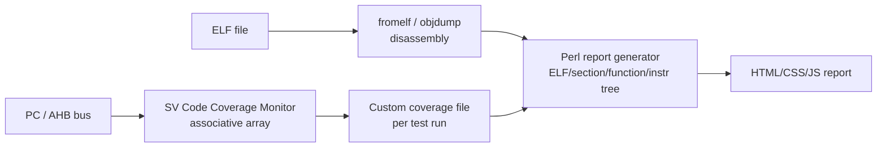

<!-- generated by yt-paper; edits will be overwritten -->

# A Metric-driven Methodology For Firmware Verification In Simulation/Emulation Environments

[:material-open-in-new: 원문 보기](https://dvcon-proceedings.org/wp-content/uploads/a-metric-driven-methodology-for-firmware-verification-in-simulation-emulation-environments.pdf){ .md-button .md-button--primary target=_blank }

> SystemVerilog 모니터로 PC와 AHB 버스를 추적해 펌웨어 명령/데이터 커버리지를 수집하고, Perl과 HTML/JavaScript로 ELF 기반 리포트를 생성하는 저비용 메트릭 주도 펌웨어 검증 방법론이다.

| 항목 | 내용 |
|---|---|
| 저자/출처 | Goran SAVIĆ (Elsys Eastern Europe d.o.o., Belgrade, Serbia) (DVCon Europe) |
| 유형 | PAPER |
| 카테고리 | Verification |
| ID | `ref-20261018-9cff` |

## 핵심 인사이트

- 표준 EDA 도구가 펌웨어(bootcode, test function 등) 소프트웨어 커버리지를 충분히 지원하지 못하는 공백을, PC와 AHB 버스를 직접 모니터링하는 자체 툴로 메운다는 점이 핵심 동기다.
- PC만으로는 데이터 접근을 잡을 수 없으므로 AHB 버스 read/write 추적을 함께 사용해야 하며, ARM에서는 PC가 실제 명령보다 4바이트 앞을 가리킨다는 특성을 보정해야 한다. GLS에서는 PC 대신 DWT IAEX 버스를 쓰는 것이 더 안정적이다.
- 주소 공간 전체(32비트)를 SystemVerilog associative array로 관리하고 주소마다 read/write/executed 카운터를 두는 구조는 단순하면서도 메모리 맵 전체(레지스터 접근 포함)로 확장 가능하다.
- 시뮬레이션 부하는 1% 미만이라고 보고되지만, 128KB 펌웨어 기준 HTML 리포트가 2~6MB까지 커질 수 있어 원시 데이터 + 동적 HTML 렌더링 방식을 택했다.
- FPGA 플랫폼에서는 주소당 1비트(16비트 명령/데이터 단위)만 기록하는 block RAM 기반 경량 구현으로 128KB 펌웨어에 8KB 블록 RAM을 사용하면 된다고 제시한다. 다만 본문에는 이 수치에 대한 실측 검증은 명시되어 있지 않다.

## 상세 요약

### 배경 및 문제 정의

최신 임베디드 시스템(ARM Cortex 계열 등)은 제어 기능의 상당 부분을 펌웨어가 담당하며, 하드웨어와 함께 철저히 검증되어야 한다. 그러나 하드웨어 기능/코드 커버리지는 여러 EDA 도구로 잘 지원되는 반면, 소프트웨어(펌웨어) 커버리지는 표준 도구가 부족하여 bootcode, test function 등 일부 영역에서 커스텀 구현이 필요하다.

SystemVerilog 내장 커버리지(covergroup 등)로 소프트웨어 커버리지를 구현할 수도 있지만 비효율적이며, 검증 엔지니어에게 대상 시스템에 대한 소프트웨어/하드웨어 지식을 상당히 요구한다. 또한 표준 도구의 커버리지 리포트는 원시적이고 해독이 어려운 정보만 제공한다. 본 논문은 이러한 격차를 메우기 위해 검증 엔지니어 누구나 활용할 수 있는 재사용 가능한 커스텀 도구와 메트릭 기반 방법론을 제안한다.

### 핵심 아키텍처 및 방법론

구현 대상은 여러 개의 ARM Cortex-M0+ 코어를 가진 저전력 SoC이며, Cadence SimVision 기반 검증 환경을 사용한다. 각 코어는 독립적인 메모리 공간, 펌웨어, 주변장치를 가진다.

전체 흐름은 다음과 같다.

**1. 추적 대상 두 가지**
- **PC(Program Counter)**: 실행된 명령 주소를 나타낸다. 단, 투기적 실행이 없다고 가정한다.
- **AHB 버스**: 데이터 영역 접근을 잡기 위해 필요하다. 명령 주소는 PC에 나타나지만 데이터 주소는 PC에 나타나지 않으므로 AHB를 함께 추적해야 한다.

**2. 시스템별 보정 사항**
- ARM에서 PC 값은 현재 실행 명령보다 4바이트 위를 가리킨다.
- GLS에서는 합성 최적화로 일부 비트가 사라질 수 있으므로, PC 대신 Cortex의 DWT IAEX 버스를 사용하는 것이 효율적이다.
- 멀티코어 설계에서는 코어별로 PC와 버스를 따로 추적하고, 어느 코어/메모리 공간에 속하는지도 함께 기록한다.

**3. 데이터 수집**
- 모니터 내부에 SystemVerilog associative array를 두어 32비트 전체 주소 공간을 다룬다.
- 각 주소 엔트리는 `read accesses`, `write accesses`, `executed` 세 카운터를 가진다.
- 새 주소가 등장하면 엔트리를 추가하며, 주소 해상도는 Thumb 명령어 지원을 위해 최소 2바이트다.

**4. 출력 포맷**
테스트 케이스별로 텍스트 파일을 생성한다. 블록 이름, 코어 번호, 베이스 주소를 헤더에 적고, 블록 내 오프셋마다 `r<횟수>w<횟수>x<횟수>` 형태로 기록한다. 디스크 사용량은 크리티컬하지 않다고 판단했다.

**5. Perl 리포트 생성기**
- ELF 파일을 fromelf 또는 objdump로 디스어셈블한 뒤 한 줄씩 파싱한다.
- ELF → 섹션 → 함수 → 명령/데이터 계층의 연관 배열 트리를 구성하며, 각 노드에 메모리 시작/끝, 명령 수 등의 메타데이터를 둔다.
- 회귀 테스트의 커버리지 파일들을 합산하여 주소별 접근 횟수를 디스어셈블 결과와 매칭한다. 커버리지 데이터 없이 ELF만으로도 리포트 생성이 가능하다.

**6. HTML 리포트**
- 원시 데이터와 동적으로 생성되는 HTML을 함께 사용해 리포트 크기를 줄인다. HTML 자체에 중복 데이터가 많아 그대로 생성하면 리포트가 지나치게 커지기 때문이다.
- ELF/섹션/함수/명령 수준의 커버리지 통계를 보여주며, 100% 미만 블록은 빨간색으로 표시하고 클릭 시 상세 창을 연다.
- 상세 뷰는 주소 순서의 기계어, 어셈블리 니모닉, C 소스(파일명 및 라인 번호), 접근 횟수를 함께 보여준다. 실행되지 않았거나 읽기만 되고 실행되지 않은 라인은 빨간색으로 표시된다.

**7. FPGA 경량 구현**
FPGA 보드에서도 block RAM을 사용해 주소별 접근 여부를 1비트로 기록하는 경량 커버리지 컴포넌트를 제안한다. 본문은 128KB 펌웨어에 8KB block RAM이면 충분하다고 기술한다. 회귀 테스트 간 RAM 내용을 유지해야 하며, 결과는 디버그 인터페이스로 읽어 동일한 도구로 분석한다.

### 실험 결과 및 결론

**적용 결과**
- 두 개의 프로젝트에 적용되었으며, 대상 컴포넌트 커버리지는 컴포넌트에 따라 95~100%였다고 보고된다.
- 시뮬레이션 부하는 성능과 메모리 측면에서 1% 미만이라고 보고한다.
- 128KB 펌웨어 기준 생성된 HTML 리포트는 약 2~6MB이며, C 소스 포함 여부에 따라 달라진다.

**한계 및 실무 시사점**
- 시뮬레이션은 속도가 느려 커버리지는 주로 핵심 펌웨어 컴포넌트에 한정된다. 전체 펌웨어 커버리지는 FPGA 보드에서 수행하는 것이 효율적이라고 설명한다.
- 시뮬레이션과 FPGA 양쪽에서 커버리지를 확보하면 특정 환경의 사각지대를 줄일 수 있다고 주장한다.
- 개발 비용은 SystemVerilog 모니터 100~200줄, Perl 리포트 생성기 400~800줄, HTML/CSS 50~250줄, JavaScript 150~300줄로 추정되며, 이는 대략적인 수치라고 저자가 명시한다.
- 향후 개선 항목으로 색상 코딩, 다중 브라우저 지원, 독점 fromelf 대신 objdump 사용, 필터링/정렬 등이 언급된다.

**결론**
표준 도구의 빈틈을 메우는 저비용 자체 도구로 펌웨어 커버리지 갭을 쉽게 식별할 수 있으며, 오픈 기술(SystemVerilog, Perl, HTML/JS)을 사용해 시뮬레이션 환경이나 리포트 소비자에 대해 플랫폼 독립적이라고 주장한다. 다만 본문에는 정량적 비교 대상(다른 도구와의 벤치마크 등)이 제시되어 있지 않다."

## 관련 영상

<iframe src="https://www.youtube-nocookie.com/embed/DDpWoJxADvE" title="[DVCON2016]A Metric-driven Methodology For Firmware Verification In Simulation/Emulation" loading="lazy" allow="accelerometer; clipboard-write; encrypted-media; gyroscope; picture-in-picture; web-share" referrerpolicy="strict-origin-when-cross-origin" allowfullscreen></iframe>

**[DVCON2016]A Metric-driven Methodology For Firmware Verification In Simulation/Emulation** — [YouTube에서 보기](https://www.youtube.com/watch?v=DDpWoJxADvE) · [영상 페이지](../../videos/DDpWoJxADvE.md)
