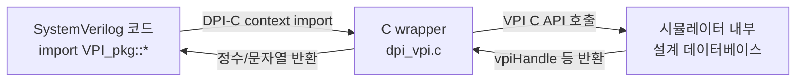

<!-- generated by yt-paper; edits will be overwritten -->

# INTROSPECTION INTO SYSTEMVERILOG WITHOUT TURNING IT INSIDE OUT.

[:material-open-in-new: 원문 보기](https://dvcon-proceedings.org/wp-content/uploads/introspection-into-systemverilog-without-turning-it-inside-out.pdf){ .md-button .md-button--primary target=_blank }

> SystemVerilog 자체에 introspection 기능이 없다는 한계를, DPI-C로 감싼 VPI 래퍼를 importable package로 제공해 SystemVerilog 코드 안에서 설계 구조를 질의할 수 있게 하는 방법을 제시한 논문.

| 항목 | 내용 |
|---|---|
| 저자/출처 | Dave Rich (Mentor Graphics) — 출처 힌트: LPI (논문, 발표 학회 정보는 본문에 명시되지 않음) |
| 유형 | PAPER |
| 카테고리 | Verification |
| ID | `ref-20261018-9f02` |

## 핵심 인사이트

- VPI는 C 라이브러리라 C 지식이 없는 검증 엔지니어에게 진입 장벽이 높다. 그래서 VPI 루틴 중 pointer 타입을 쓰지 않는 것만 DPI-C import로 감싸면 SystemVerilog에서 거의 같은 형태로 VPI 애플리케이션을 작성할 수 있다.
- s_vpi_value 같은 C 포인터 구조체는 DPI 경계를 넘을 수 없으므로 vpi_get_value를 포맷별 wrapper(논문 기준 8종, 예: int 반환형)로 바꿔야 한다. 이 변환 계층이 패키지 설계의 핵심이다.
- DPI 인자는 값으로 전달되므로 객체 핸들을 얻기 어렵다. 그래서 full path string으로 vpi_handle_by_name을 호출하는 우회가 쓰이며, 논문은 $get_handle 같은 시스템 함수나 svGetNameFromScope 기반 경로 조합을 개선 방향으로 제시한다.
- 패키지에서 모듈 계층 순회, 파라미터 출력, 타임스케일 확인, 넷 수집 같은 리포트성 작업은 실용적이다. 다만 논문은 이벤트 스케줄러 상호작용에는 사용하지 않았다고 명시하며, 벤더별 VPI 구현 차이를 사전 검증해야 한다고 경고한다.

## 상세 요약

### 배경 및 문제 정의

설계 엔지니어와 검증 엔지니어는 단순한 기능 동작 이상의 정보를 필요로 한다. 예를 들어 "이 설계에 메모리 비트가 몇 개인가", "클럭이 몇 곳에 팬아웃되는가" 같은 질문이다. 검증에서는 이런 분석 결과에 따라 테스트를 동적으로 바꾸고 싶어 한다. 저자는 이를 introspection, 즉 프로그램이 자기 자신에 대해 질의하고 그 결과에 따라 행동하는 능력으로 정의한다. 이 기능은 linting, 동적 프로그램 수정, 통계 리포팅 용도로 쓰인다.

논문에 따르면 SystemVerilog의 네이티브 기능은 파일명/라인 번호, 배열 크기와 인덱스 범위 정도로 제한된다. 그 이상은 VPI(Verification Procedural Interface)를 써야 하는데, VPI는 C/C++로 작성해야 하며 원래 툴 개발자를 위해 설계되어 모델 개발자에게는 번거롭다. DPI는 C 모델 통합이 간단하지만 VPI와 같은 설계 질의 기능은 제공하지 않는다. 저자는 언어에 네이티브 introspection을 추가하는 것은 현 단계에서 어렵다고 보고, 기존 DPI와 VPI를 결합한 패키지로 같은 목표를 달성하는 대안을 제시한다.

### 핵심 아키텍처 및 방법론

**VPI 객체 모델.** VPI는 객체지향 시스템처럼 구성되며, 모든 객체는 동일한 `vpiHandle` 타입을 공유한다. 핸들의 타입에 따라 사용 가능한 속성이 달라진다(예: net의 `vpiSize`는 module에 대해 호출할 수 없다). 모듈과 변수 사이는 1:N 관계이고, 변수에서 모듈로 가는 방향은 1:1이다. 주요 루틴은 `vpi_handle_by_name`, `vpi_handle`, `vpi_iterate`/`vpi_scan`, `vpi_get`/`vpi_get_str`, `vpi_get_value`/`vpi_put_value`이다.

**VPI의 한계와 DPI 비교.** 저자는 모델 통합 시 언어 경계를 넘는 데이터 전달이 복잡하고 성능 페널티가 크다고 지적한다. 구조체 합계 예제에서 VPI C 코드는 멤버 두 개의 값을 읽기 위해 여러 접근 루틴을 호출해야 한다. 같은 연산을 DPI로 작성하면 인자를 값으로 직접 받으므로 접근 루틴이 필요 없다. 이는 SystemVerilog의 타입 체계가 C 타입과 호환되기 때문에 가능하다.

**핵심 아이디어: DPI 위에 VPI를 올린다.** VPI 루틴을 그대로 import하기는 어렵다. 포인터 타입 인자가 SystemVerilog와 호환되지 않기 때문이다. 따라서 다음과 같은 변환이 필요하다.

- `vpiHandle`은 불투명 포인터이므로 DPI의 `chandle`에 그대로 매핑되어 직접 import 가능하다.
- `vpi_get_value(handle, s_vpi_value*)`는 포인터 출력 구조체를 쓰므로, 값 포맷마다 wrapper를 만들어 정수 등을 직접 반환하도록 바꾼다. 논문은 이를 8가지 포맷에 대해 필요하다고 설명한다.
- 객체 타입 상수(예: `vpiModule`)는 패키지 파라미터로 정의한다.
- 집합체(배열, 구조체)는 멤버를 순회하여 값을 얻는다.

이 wrapper들을 `VPI_pkg`라는 패키지에 모으면, SystemVerilog 안에서 C VPI 애플리케이션과 거의 같은 형태로 코드를 작성할 수 있다.

**알려진 제약: 인자 전달 방식.** DPI 인자는 값으로 전달되므로 객체 핸들을 얻을 수 없다. 논문의 예제는 `vpi_handle_by_name("top.A")`처럼 full path 문자열을 사용한다. 저자는 개선 방향으로 다음을 제시하지만 완전히 탐구되지 않았다고 밝힌다. (1) 객체 핸들을 반환하는 `$get_handle(obj)` 형태의 시스템 함수 추가, (2) DPI의 `svGetNameFromScope()`로 호출 컨텍스트의 인스턴스 경로를 얻어 이름 조회 wrapper에 접두사로 붙이는 방식. 패키지, typedef 이름처럼 인자로 넘길 수 없는 객체는 문자열 경로나 이름 기반 스캔으로 찾아야 한다. 최상위 모듈은 `vpi_handle(vpiModule, NULL)`로 얻는다.

**예제 구성.** 논문은 다음을 보여준다.
- Figure 8: 구조체 멤버 A, B를 합산하는 SystemVerilog 코드. 원래 C 예제와 같은 로직을 패키지로 수행한다.
- Complete Example: `top` 모듈에서 `vpi_handle_by_name`으로 변수 값을 읽고 쓰는 예제, 모든 모듈을 재귀적으로 순회하며 timescale, 파라미터, 시뮬레이션 넷(`vpiSimNet` 기준으로 그룹화)을 수집해 출력하는 예제.
- Appendix: `VPI_pkg` 패키지 선언과 C wrapper(`dpi_vpi.c`) 구현. 여기에는 `VPI_handle_by_name`, `VPI_get_value`, `VPI_get`, `VPI_iterate`, `VPI_scan`, `VPI_handle`, `VPI_get_str`, `VPI_put_value` 등이 포함된다.

참고로 본문의 Appendix 코드는 원문 추출 과정에서 일부 잘려 있다(객체 타입 상수 목록 일부만 보이고 나머지는 생략 표시). 또한 원문에도 `int32_t VPI_get`에서 반환 경로가 없는 등 세부 구현상의 불완전함이 보인다. 본 요약은 원문에 있는 설명 범위 안에서만 기술한다.

### 실험 결과 및 결론

논문은 정량적 벤치마크나 성능 측정 결과를 제시하지 않는다. 대신 다음을 결과로 보고한다.

- 해당 패키지는 여러 상용 환경(production environments)에서 모듈 파라미터화 보고서와 네트워크 통계를 출력하는 데 사용되었다.
- 이벤트 스케줄러와의 상호작용에는 사용되지 않았다.
- DPI와 VPI는 SystemVerilog 표준에 정의된 것만 사용하지만, 툴 벤더마다 VPI 구현 차이가 있을 수 있으므로 사전 검증이 필요하다.

**결론.** 저자는 VPI 래퍼 패키지가 C 지식이 부족한 검증 엔지니어의 빠른 프로토타이핑을 돕고, 설계 질의 기반 리포팅과 동적 테스트 제어를 가능하게 한다고 주장한다. 다만 이것은 언어에 네이티브 introspection을 추가하는 것이 아니라, 기존 표준(DPI-C, VPI)을 조합한 우회책이다. 따라서 인자 전달 제약에 따른 문자열 경로 의존, 벤더별 VPI 동작 차이, 그리고 스케줄러 수준 제어에 대한 미검증 상태를 실무 적용 시 고려해야 한다.

## 관련 영상

<iframe src="https://www.youtube-nocookie.com/embed/gZAx9-JKQNQ" title="[DVCON2016]INTROSPECTION INTO SYSTEMVERILOG WITHOUT TURNING IT INSIDE OUT" loading="lazy" allow="accelerometer; clipboard-write; encrypted-media; gyroscope; picture-in-picture; web-share" referrerpolicy="strict-origin-when-cross-origin" allowfullscreen></iframe>

**[DVCON2016]INTROSPECTION INTO SYSTEMVERILOG WITHOUT TURNING IT INSIDE OUT** — [YouTube에서 보기](https://www.youtube.com/watch?v=gZAx9-JKQNQ) · [영상 페이지](../../videos/gZAx9-JKQNQ.md)
