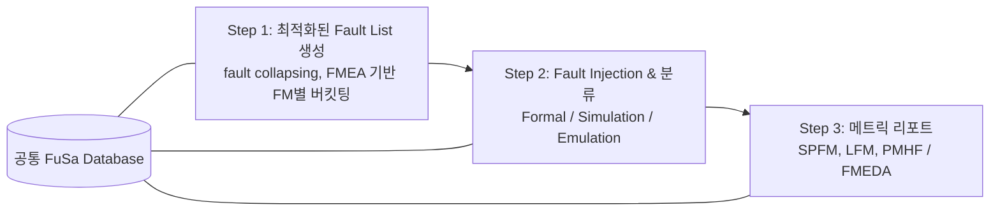

<!-- generated by yt-paper; edits will be overwritten -->

# Complex Safety Mechanisms Require Interoperability and Automation For Validation And Metric Closure

[:material-open-in-new: 원문 보기](https://dvcon-proceedings.org/wp-content/uploads/1048-Complex-Safety-Mechanisms-Require-Interoperability-For-Validation-And-Final-Metrics.pdf){ .md-button .md-button--primary target=_blank }

> 자동차 SoC의 안전 섬(safety island)을 대상으로, formal·simulation·emulation 엔진을 공통 FuSa 데이터베이스로 묶어 fault list 최적화부터 ISO 26262 메트릭(SPFM) 산출까지 닫는 워크플로를 제시한 사례 논문이다.

| 항목 | 내용 |
|---|---|
| 저자/출처 | Daeseo Cha, Vedant Garg, Ann Keffer, Arun Gogineni, James Kim, Woojoo Space Kim, Kunhyuk Kang, Seonil Brian Choi (DVCon Europe) |
| 유형 | PAPER |
| 카테고리 | Verification |
| ID | `ref-20261018-a877` |

## 핵심 인사이트

- 단일 엔진으로는 자동차 SoC의 수백만 fault를 처리하기 어렵다. 엔진별 강점에 맞춰 fault를 나누는 방식이 필요하다. CPU/캐시는 emulation, 버스 E2E 보호는 simulation, 안전 메커니즘 분류·Fault Management Unit은 formal로 배정하는 식이다.
- Formal 분석은 COI(Cone of Influence) 밖 fault를 안전(Safe)으로 빠르게 분류하는 데 쓰인다. 이 논문에서는 UU(Undetected Unobserved) 616개 중 대부분의 분류 근거로 활용됐다. 시뮬레이션 전후에 fault를 걸러내면 시뮬레이션 시간을 줄일 수 있다.
- Emulation은 RTL과 netlist 간 1-to-1 gate 매핑을 유지해 fault 주입·관찰 지점(FIN/FDN)을 골든 런과 비교한다. 대형 SoC에서 full software stack과 함께 쓰기에 적합하다.
- 통계적 랜덤 샘플링으로 Margin of Error를 계산하는 방식을 적용했다. 본문에서 MOE는 ±1.19%에서 Not Injected fault 제외 후 ±1.293%로 바뀌었다. 샘플링 결과를 해석할 때 모집단 정의 변경이 오차 범위에 영향을 준다는 점을 보여준다.
- 논문 결론은 모든 엔진을 쓰는 것보다 엔진 간 상호운용성과 공통 데이터베이스를 통한 결과 통합이 프로젝트 규모에서 필수라는 주장이다. 다만 본 실험에서는 Formal 적용과 BUS 블록 시뮬레이션이 아직 완료되지 않았으므로 최종 수치는 부분적인 결과로 봐야 한다.

## 상세 요약

### 배경 및 문제 정의

자율주행 차량에 탑재되는 반도체는 고집적·저전압화로 인해 수명 중 무작위로 발생하는 random hardware failure에 민감해지고 있다. ISO 26262 Part 5는 하드웨어 아키텍처의 안전 메커니즘이 random failure 확률을 정량적으로 분석하도록 요구하며, 대표 메트릭은 FIT, DC, SPFM, LFM, PMHF이다. 이 중 ASIL D는 SPFM ≥ 99%를 요구한다(ASIL B ≥ 90%, C ≥ 97%).

문제는 설계 규모가 커지면서 대상 fault 수가 수만에서 수백만 개에 이르고, 이를 수백 개 테스트에 걸쳐 주입·비교해야 한다는 점이다. 전수 fault campaign은 현실적으로 불가능하며, 단일 기술(simulation만, formal만, emulation만)로는 전체 검증이 어렵다. 또한 엔진별로 생성된 fault 분류 결과를 하나의 최종 메트릭으로 합치는 과정도 난제다.

### 핵심 아키텍처 및 방법론

논문은 fault 분류를 3단계 워크플로로 구성한다.

- **Step 1 (fault list 최적화)**: SafetyScope 같은 안전 분석 툴로 안전 메커니즘을 고려한 fault list를 만들고, FM(failure mode)별로 버킷팅한다. 안전 목표와 무관한 non-safety-critical fault는 제외한다.
- **Step 2 (주입 및 분류)**: ISO 26262 분류(SPF, RF, MPFL, MPFD, SF)에 따라 fault를 나눈다. 보호 장치가 없는 safety-related fault는 바로 SPF로 판정하고, 나머지를 엔진에 배정한다.
  - **Formal**: 주입 전후에 non-propagatable fault를 제거한다. 관찰 지점(observation point) 대비 기능 동작 차이를 증명 문제로 풀며, 어려운 fault는 중단한다. 실행 시간은 수 분에서 수 시간 규모로 보고된다.
  - **Simulation**: good simulation을 기준으로 faulty 동작을 비교하고, alarm 발화 여부와 관찰 여부를 함께 기록한다. 블록·소형 IP와 BUS 블록에 적용됐다.
  - **Emulation**: Veloce Fault App을 사용한다. 시뮬레이션으로는 런타임이 너무 긴 CPU 코어와 캐시 메모리에 적용되며, 골든 런에서 FDN 상태를 저장한 뒤 각 fault의 결과를 비교한다.
- **Step 3 (메트릭 산출)**: 세 엔진의 결과를 공통 데이터베이스에 기록해 FMEDA 기반 SPFM·LFM·PMHF를 계산한다.

실험 대상은 약 300만 게이트 규모 자동차 SoC의 safety island다. 역할 배분은 다음과 같다.

- CPU Core + Cache: emulation (STL로 CPU 보호, ECC로 캐시 보호)
- Bus interface: simulation (E2E 보호)
- Fault Management Unit: 이번 실험 제외, formal로 진행 예정

블록별 최적화 fault list를 FuSa DB에 세션 단위로 저장하고, 전체 fault에서 통계적 랜덤 샘플링을 수행했다. 샘플 하나를 emulation으로 끝까지 돌리는 방식을 설명하며, 전체 closure를 위해 N개의 샘플을 처리했다고 한다.

### 실험 결과 및 결론

**CPU + Cache (emulation, 랜덤 샘플 기준)**
- 전체 fault 636,046개 중 샘플 4,782개를 사용했다.
- 탐지된 fault는 3,125개이며, 탐지율은 65.35%다. 계산 식은 $3125 / 4782 \approx 65.35\%$다.
- 안전 메커니즘별 탐지 비율은 STL(SM1) 80.64%, ECC correctable(SM2) 16.86%, WDT(SM3) 1.76%, ECC uncorrectable(SM2) 0.74%다.
- 커버리지 목표 90% 기준 MOE는 초기 ±1.19%였다.

**Fault 분류 후처리**
- UU 616개는 formal COI 분석과 엔지니어 판단으로 Safe 또는 Residual로 나눴다. 10개의 Residual 중 10개를 Safe로 재분류했다.
- Not Injected 728개(최종 분석에서는 733으로 표기)는 시뮬레이션 모델에서도 주입되지 않아 모집단에서 제외했다. 그 결과 MOE는 ±1.293%로 갱신됐다.
- 최종 분류는 Detected Observed 3,125(모집단 4,049 기준 77.18%), Residual 69 + 280, Safe 234(dead logic) + 341(formal COI, configuration, 엔지니어 판단)이다. 합계는 4,049다.

**최종 메트릭**
- CPU + Cache 최종 SPFM은 91.38%다. 본문은 "over 90%"라고 서술한다.

**BUS 블록 (simulation, E2E SM)**
- 초기 테스트에서 NOC 관련 fault의 9.8%를 탐지했다. Test 1~4 탐지율은 3.27%, 5.50%, 9.80%, TBD다. 나머지 테스트는 진행 중이며 BUS 메트릭은 최종 값이 아니다.

**결론**
- 논문은 엔진 상호운용성, fault 최적화, 자동화 흐름이 결합되어 safety 분석에서 인증까지의 시간을 줄일 수 있음을 보였다고 주장한다.
- 프로젝트 규모에서는 여러 엔진을 쓰고 공통 FuSa DB에서 결과를 읽는 방식이 필수라고 결론짓는다.
- 한계: Formal 단계와 BUS 블록 시뮬레이션이 본 논문 시점에서 완료되지 않았다. 수치는 부분 결과로 해석해야 한다. 또한 Table 번호 참조가 일부 본문과 어긋나는 부분이 있어 원문 표를 직접 확인하는 것이 좋다.

## 관련 영상

<iframe src="https://www.youtube-nocookie.com/embed/fdWhjjj_lxs" title="[DVCON2023]Complex Safety Mechanisms Require Interoperability Automation Validation Metric Closure" loading="lazy" allow="accelerometer; clipboard-write; encrypted-media; gyroscope; picture-in-picture; web-share" referrerpolicy="strict-origin-when-cross-origin" allowfullscreen></iframe>

**[DVCON2023]Complex Safety Mechanisms Require Interoperability Automation Validation Metric Closure** — [YouTube에서 보기](https://www.youtube.com/watch?v=fdWhjjj_lxs) · [영상 페이지](../../videos/fdWhjjj_lxs.md)
