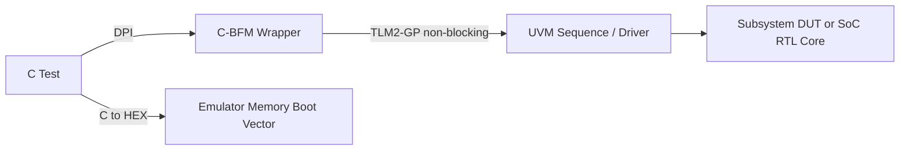

<!-- generated by yt-paper; edits will be overwritten -->

# A pragmatic approach leveraging portable stimulus from subsystem to SoC level and SoC emulation

[:material-open-in-new: 원문 보기](https://dvcon-proceedings.org/wp-content/uploads/a-pragmatic-approach-leveraging-portable-stimulus-from-subsystem-to-soc-level-and-soc-emulation-paper.pdf){ .md-button .md-button--primary target=_blank }

> 서브시스템에서 작성한 C 기반 테스트와 TB 인프라를 TLM 2.0 GP와 DPI 기반 C-BFM 래퍼로 구성해, SoC 시뮬레이션·에뮬레이션·GLS까지 그대로 재사용하는 방법론을 제시한 NXP 논문.

| 항목 | 내용 |
|---|---|
| 저자/출처 | Karandeep Singh, Aditya Chopra, Joachim Geishauser, Nitin Verma (NXP Semiconductors) — DVCon Europe 발표 논문 (제목 힌트 기준) |
| 유형 | PAPER |
| 카테고리 | Verification |
| ID | `ref-20261018-a8ba` |

## 핵심 인사이트

- 서브시스템 TB의 UVM 드라이버를 TLM 2.0 GP 포트와 DPI로 감싼 C-BFM 구조로, C 테스트는 SoC에서도 동일하게 실행되며 boot/clock/reset 같은 SoC 종속 동작은 context mapping으로 SoC API에 연결된다.
- C 테스트 코드는 DPI로 동적 링크되므로 C 수정 시 TB를 재컴파일하지 않아도 되고, 논문은 UVM 드라이버 경로가 C에서 코어를 실행하는 방식보다 최소 3배 빠르다고 보고한다(자체 실험 기준).
- Reset은 DUT 내부 생성(implicit)과 C 테스트 발생(explicit) 두 경로를 모두 샘플링하도록 reset env를 두고, 에뮬레이션에서는 TCL 기반 드라이버로 합성 가능한 리셋 드라이버를 구동한다.
- 인터럽트는 256단 semaphore 레벨 구조로 모델링해 ISR 진입 시 하위 레벨 트랜잭션 처리를 막는 방식을 사용한다.
- GLS에서는 netlist를 TB와 병렬 컴파일 후 super block으로 병합해 컴파일 시간을 줄이고, 비리셋 flop에 대한 랜덤 deposit을 적용한다. 정량적 성능 수치는 본문에 제시되지 않았다.

## 상세 요약

### 배경 및 문제 정의

SoC의 복잡도가 커지고 time-to-market 압박이 강해지면서 검증 closure가 어려워지고 있다. 서브시스템 수준에서 개발한 테스트를 SoC 시뮬레이션, 에뮬레이션으로 옮기는 포팅 작업 자체가 큰 난제이며, 논문은 모듈에서 SoC까지 여러 검증 레벨을 하나의 portable stimulus 기반 인프라로 잇는 것을 목표로 한다. 특히 C 기반 자극을 처음부터 작성하고, 재사용성·이식성·상호운용성을 확보하는 것이 핵심 문제 의식이다.

### 핵심 아키텍처 및 방법론

**1. 서브시스템 인프라 (C-BFM)**
- SV/UVM 기반 VIP를 C-BFM 래퍼로 감싸고, TLM 2.0 Generic Payload(TLM2-GP) 포트와 DPI로 언어 간 호출을 수행한다.
- 서브시스템에서는 UVM 드라이버가 실행 코어 역할을 하고, SoC에서는 이를 실제 RTL 코어로 대체한다.
- SoC 종속 동작(boot, clock configuration 등)은 서브시스템에서의 더미 함수를 context mapping으로 SoC API에 매핑해 처리한다.

**2. 통신 및 실행 흐름**
- SV가 테스트의 시작과 종료를 제어하고, sequence body에서 C 테스트를 DPI로 호출하며 병렬로 sequence를 실행한다.
- C의 WR/RD API는 trigger_event를 발생시켜 SV 측 대기 태스크를 깨우고, non-blocking TLM 포트를 통해 명령 하나를 처리한 뒤 C가 다음 명령으로 진행한다.
- 동기화는 DPI 레이어 내부의 여러 프로세스로 구현된다.

**3. 프로토콜 독립성 및 상호운용성**
- 프로토콜 드라이버/어댑터만 바꾸면 테스트와 시퀀스는 변경할 필요가 없다는 UVM register layer와 유사한 개념을 TLM2-GP에도 적용한다.
- 비표준 사이드밴드 신호는 TLM2-GP extension으로 추가한다.

**4. Reset 처리**
- implicit(DUT 생성)과 explicit(C 테스트 발생) reset을 모두 샘플링하도록 base reset env를 두고, 프로젝트별로 확장·override할 수 있게 한다.
- CBFM의 event 기반 analysis port가 reset env monitor에 연결된다.
- 에뮬레이션에서는 TCL 기반 드라이버가 합성 가능한 리셋 드라이버에 리셋을 삽입하며, POR/functional/destructive 등 리셋 종류별 assert/deassert 시퀀스를 파라미터로 제어한다.

**5. Vertical reuse**
- 서브시스템에서 active 모드인 AMBA UVM BFM은 SoC에서 factory override로 passive 모드로 바꿔 프로토콜 모니터링에 재사용한다.

**6. 인터럽트 모델링**
- 256-depth semaphore를 사용하며, 인터럽트 발생 시 L1 레벨 베이스 애플리케이션 레이어를 잠가 새 트랜잭션 처리를 막고 L1+1 레이어에서 ISR을 실행한다.

**7. CBFM vs 코어 실행**
- UVM 드라이버를 C 기반 DPI로 호출하는 방식이 실제 코어를 통해 실행하는 방식보다 최소 3배 빠르다고 보고하며, 처리 대부분을 SV에 두어 시뮬레이터 최적화의 혜택을 받도록 한다.

**8. GLS**
- 기능 검증에서 virtual SDF(입력 skew 불필요) 또는 timing wrapper(BE 데이터 기반 입력 skew) 중 하나로 샘플링한다.
- 비리셋 flop의 랜덤 deposit은 Perl 스크립트로 처리할 수 있다고 언급한다.
- netlist를 TB와 병렬 컴파일 후 super block으로 병합해 GLS 컴파일 시간을 줄인다.

**9. 에뮬레이션 직접 재사용**
- RTL 측 변경: 메모리 뷰를 behavioral에서 vendor 전용 뷰로, 라이브러리 셀 뷰를 필요 시 RTL로 교체한다.
- TB 측 변경: 시뮬레이션 클록 생성 로직을 벤더/툴의 클록 생성 방식으로, 리셋 생성 로직을 TCL 기반 방식으로 교체한다.
- C 테스트 파일로 hex 파일을 생성해 시스템 메모리의 코어 boot vector 주소에 로드하면, 리셋 후 코어가 첫 명령을 읽어 실행한다.

### 실험 결과 및 결론

- 논문은 UVM 기반 드라이버를 C-DPI로 호출하는 방식이 실제 코어 실행 대비 **최소 3배 빠르다**고 보고한다. 다만 실험 조건과 수치의 세부 내용은 본문에 제시되지 않았다.
- GLS에서는 "huge benefit of fast GLS closure"를 주장하지만, 정량 수치는 본문에 없다.
- 결론적으로 TB 아키텍처는 native UVM 검증에도 그대로 쓸 수 있어 별도 UVM TB가 필요 없고, 메모리와 TB 구조가 작아져 RTL 컴파일과 시뮬레이션이 빨라지며, 합성 가능한 Verilog slave memory 덕분에 에뮬레이션 이식성이 높아진다고 정리한다.
- 적용 분야로는 재사용 가능한 SoC 레벨 stimulus, L/M-BIST, GLS, 전력 분석용 VCD 생성, 에뮬레이터 직접 재사용, DFT 검증 등을 든다.
- 본문은 잘려 있는 부분이 있어(Figure 및 일부 세부 설명 누락) 구현 세부 사항과 정량 평가는 원문 확인이 필요하다."

## 관련 영상

<iframe src="https://www.youtube-nocookie.com/embed/hhA-6z-ySy0" title="[DVCON2019_INDIA]A Pragmatic Approach Leveraging Portable Stimulus from Subsystem to SoC  Emulation" loading="lazy" allow="accelerometer; clipboard-write; encrypted-media; gyroscope; picture-in-picture; web-share" referrerpolicy="strict-origin-when-cross-origin" allowfullscreen></iframe>

**[DVCON2019_INDIA]A Pragmatic Approach Leveraging Portable Stimulus from Subsystem to SoC  Emulation** — [YouTube에서 보기](https://www.youtube.com/watch?v=hhA-6z-ySy0) · [영상 페이지](../../videos/hhA-6z-ySy0.md)
