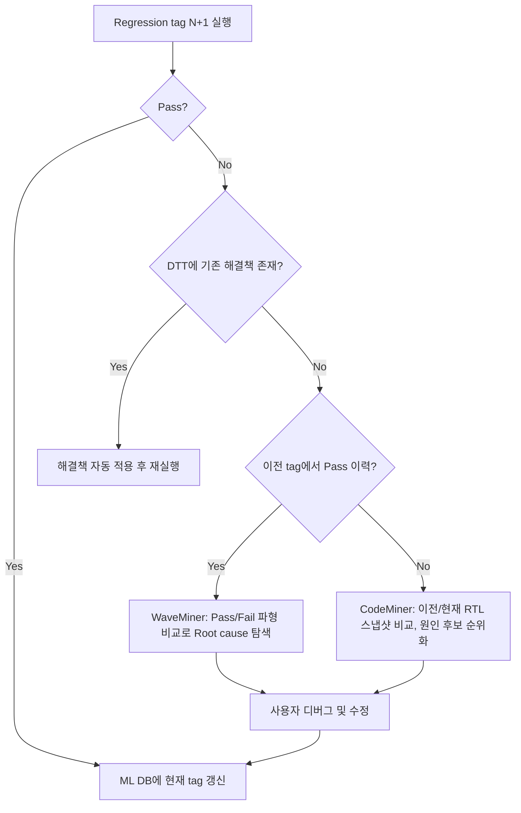

<!-- generated by yt-paper; edits will be overwritten -->

# A Novel AI-ML Regression Flow for SoC verification

[:material-open-in-new: 원문 보기](https://dvcon-proceedings.org/wp-content/uploads/1132.pdf){ .md-button .md-button--primary target=_blank }

> SoC 회귀 검증에서 실패 디버그를 AI/ML(CodeMiner, WaveMiner, 자체 DTT)로 자동화해 디버그 TAT를 크게 줄이는 흐름을 제안한 논문.

| 항목 | 내용 |
|---|---|
| 저자/출처 | Laura Leblanc (원문에 학회/출처 명시 없음) |
| 유형 | PAPER |
| 카테고리 | Verification |
| ID | `ref-20261018-aa86` |

## 핵심 인사이트

- 회귀 실패 디버그는 수작업·순차 진행이 병목이며, 실패 수가 많을수록 전체 TAT가 기하급수적으로 늘어난다는 문제의식에서 출발함.
- 과거 Pass/Fail 이력과 실패 시그니처를 DB에 축적해, 기존 해결책이 있는 실패는 사람 개입 없이 적용·재실행하도록 분기하는 것이 핵심 구조임.
- 이력이 있는 실패는 WaveMiner로 Pass/Fail 파형을 비교하고, 이력이 없는 실패는 CodeMiner로 이전/현재 Tag의 RTL 차이를 분석해 원인 후보를 순위화함.
- 성능 주장(최대 20배, 10~20배 등)은 소수 테스트에 대한 인적 비교 실험에 기반하며, 실험 설계·샘플 수·통계 처리가 자세히 공개되지 않아 재현성 판단은 어려움.
- IP에서 SoC로 갈수록 스냅샷 생성과 마이닝 시간이 길어지는 등 적용 확장성의 한계도 언급되어 있어, 도입 시 실행 비용과 라이선스 병렬성을 함께 고려해야 함.

## 상세 요약

### 배경 및 문제 정의

- SoC 검증에서 회귀(regression) 테스트 중 새 기능·IP 추가·테스트벤치 변경 등으로 기존에 통과하던 테스트가 실패하는 경우가 반복적으로 발생함.
- 문서는 실패 한 건의 디버그 TAT가 약 1주일에 이를 수 있고, 약 1만 개 테스트 규모의 회귀에서는 여러 엔지니어가 실패를 하나씩 순차적으로 디버그해야 해 수일이 걸린다고 주장함.
- 전체 검증 공수의 최대 65%, 그중 디버그가 50% 이상을 차지한다고 제시함. 다만 이 수치의 출처는 본문에 명시되어 있지 않음.
- 디버그는 파형 재생성(재실행), 신호 추출, 드라이버 추적 등 수작업 반복이 많아, 과거 해결 이력을 재활용하지 못하는 것이 근본 문제로 제기됨.

### 핵심 아키텍처 및 방법론

제안 흐름은 세 가지 엔진으로 구성됨.
- **DTT (Defect Tracking Tool)**: 자체 개발 ML 도구. 시뮬레이션 로그, Jira 등 버그 추적 정보, 과거 프로젝트 실패 리포트를 수집함. 내부적으로 ASD(다중 선형 회귀 기반 예상 런타임 탐지), DHF(Levenshtein 거리 기반 에러 유사도 매칭), DGS(BERT/XLNet/RandomForest 기반 에러 10개 카테고리 분류)로 구성됨.
- **CodeMiner (Verisium)**: 한 IP/SoC의 여러 소스 리비전을 비교해 변경을 분류하고, 시스템 동작에 가장 큰 영향을 주는 변경 순으로 버그 hotspot을 순위화함.
- **WaveMiner (Verisium)**: 전체 검증 테스트 스위트의 파형을 분석해, 어떤 신호가 어느 시점에 실패 원인일 가능성이 높은지 찾음.

회귀 흐름은 다음과 같이 진행됨.

- 계획(Planning), 실행(Execution), 디버그(Debug)의 3단계로 구성됨. 예시에서는 테스트 T2가 tag N-1에서는 통과했지만 tag N+1에서 실패함.
- 흐름 측면에서 실패를 "Old/known", "New(이력 있음)", "New(이력 없음)"으로 분류함. 수정 후에는 항상 DB에 tag를 갱신해 이력을 축적함.
- 적용 범위는 IP, 서브시스템, SoC이며, 여러 실패를 병렬로 디버그할 수 있다고 주장함(라이선스 수가 허용하는 범위 내).
- 부가적으로 향후 계획으로 DVChatBoat(문서 참조, 자주 발생하는 이슈, 작업 절차 안내 챗봇)을 추가할 예정이라고 언급함.

### 실험 결과 및 결론

- 실험 설정: 테스트를 두 범주로 나눔. 기본 시나리오(레지스터 접근, 연결성 확인)와 복합 시나리오(다중 블록·다중 트랜잭션, 예: back-to-back DRAM 접근, 카메라 캡처 후 ISP 처리). 주니어(5년 미만), 시니어(10년 이상), 신규 입사자(약 7년 경력) 세 그룹이 같은 테스트를 수작업으로 디버그함.
- Table I (디버그 공수, 시간 단위): Register Access Test는 저경력 3h / 중간 2h / 고경력 1h였고 AI/ML 흐름은 10분(약 91.6% 절감). Block-specific은 4h / 2h / 1h 대비 30분(약 78.6%). Power test는 5h / 3h / 2h 대비 45분(약 77.5%).
- Table II (TAT 이득, 평균 엔지니어 기준): 단순 테스트 디버그 시간 2~10x, 단순 테스트 전체 TAT 2~5x, 복합 테스트 디버그 시간 2~5x, 복합 테스트 전체 TAT 2~20x, 회귀 TAT 2~20x.
- 저자는 병렬 디버그 덕분에 회귀 전체 디버그 시간이 최대 20배 빨라진다고 결론 내림. 초록에서는 복잡도에 따라 10~20배라고 기술함.
- 한계: 실험 대상 테스트 수, 반복 횟수, 통계적 유의성, 사용된 Verisium 버전이나 DTT 학습 데이터 규모가 명시되지 않음. 또한 Table I의 "AI/ML Flow" 시간에 DB 구축·스냅샷 생성 등 선행 비용이 포함되었는지 불분명함. 'Time taken to generate snapshot'은 SoC에서 IP보다 느리다고 언급되어 있어, 대규모 SoC에서의 이득은 과대평가될 가능성이 있음.
- 결론: 과거 회귀 결과 데이터셋을 활용한 AI/ML 디버그 흐름은 known failure의 재디버그를 줄이고, 엔지니어가 실제 RTL 버그에 집중하게 해 디버그 TAT를 줄인다고 주장함. 다만 이러한 주장은 저자 내부 실험과 사례에 기반하며, 독립적 검증 결과는 제시되지 않음.
- 참고: 본문은 Verisium 마케팅 수치(최대 32배 디버그 절감, [2])를 인용하고 있으며, 일부 문장은 원문 자체가 불완전하거나 잘려 있음(예: Future Scope 절이 중간에 끝남).

## 관련 영상

<iframe src="https://www.youtube-nocookie.com/embed/jy4eXWjStE8" title="[DVCON2025]A Novel AI-ML Regression Flow forSoC verification" loading="lazy" allow="accelerometer; clipboard-write; encrypted-media; gyroscope; picture-in-picture; web-share" referrerpolicy="strict-origin-when-cross-origin" allowfullscreen></iframe>

**[DVCON2025]A Novel AI-ML Regression Flow forSoC verification** — [YouTube에서 보기](https://www.youtube.com/watch?v=jy4eXWjStE8) · [영상 페이지](../../videos/jy4eXWjStE8.md)
