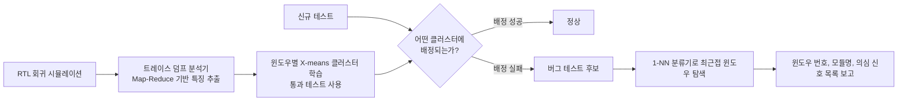

<!-- generated by yt-paper; edits will be overwritten -->

# Guiding Functional Verification Regression Analysis Using Machine Learning and Big Data Methods

[:material-open-in-new: 원문 보기](https://dvcon-proceedings.org/wp-content/uploads/guiding-functional-verification-regression-analysis-using-machine-learning-and-big-data-methods.pdf){ .md-button .md-button--primary target=_blank }

> 통과한 회귀 테스트의 트레이스 윈도우를 X-means 클러스터링으로 학습해 실패 테스트를 이상치로 탐지하고, Map-Reduce로 대용량 트레이스 특징 추출을 가속해 버그의 트레이스 구간·모듈·신호를 좁히는 회귀 디버그 자동화 프레임워크.

| 항목 | 내용 |
|---|---|
| 저자/출처 | Eman El Mandouh (Mentor Graphics Siemens Business), Laila Maher, Moutaz Ahmed, Yasmin ElSharnoby, Amr G. Wassal (Cairo University) (DVCon Europe) |
| 유형 | PAPER |
| 카테고리 | Verification |
| ID | `ref-20261018-ade1` |

## 핵심 인사이트

- 회귀 디버그에서 '정상 동작 학습'을 비지도 방식으로 수행하는 접근이다. 레이블된 버그 데이터 없이 통과 테스트만으로 클러스터를 만들고, 클러스터 배정에 실패하는 테스트를 버그 후보로 본다는 점이 실무 적용 측면에서 흥미롭다.
- 특징(feature)은 트레이스 윈도우(100 cycle) 내 신호의 0→1 전이 횟수이며, COI(Cone of Influence) 기반 신호 선택으로 2342개 신호 중 임계값 10 이상인 신호만 남겨 모델 복잡도를 줄였다. 신호 수를 줄이는 것이 트레이스 기록 부담과 클러스터링 비용을 함께 낮춘다.
- X-means는 BIC 기준으로 클러스터 수를 자동 결정하지만 본 논문은 상한을 20으로 두었다. 클러스터 수 상한과 윈도우 크기 같은 하이퍼파라미터가 탐지 민감도에 직접 영향을 줄 것이므로 다른 설계에 적용할 때는 튜닝 근거가 필요하다.
- Map-Reduce(Hadoop, 4노드)로 트레이스 인코딩·특징 추출을 병렬화해 순차 처리 대비 약 2.7배 가속을 보고했다. 수 GB 규모 트레이스가 병목인 환경에서 전처리 파이프라인 설계의 참고가 된다.
- 평가는 단일 설계(Ethmac Ethernet MAC)와 mutation 기반 버그 주입에 한정되어 있고, 타 기법과의 직접 비교는 없다. 보고된 81% full success는 이 조건에서의 수치로 해석해야 하며, 일반화 가능성은 추가 검증이 필요하다.

## 상세 요약

### 배경 및 문제 정의

설계 규모가 커지면서 회귀 테스트 수가 급증하고, 각 테스트의 시뮬레이션 트레이스는 수 GB에 달한다. 회귀 실패가 발생했을 때 검증 엔지니어는 방대한 트레이스에서 버그가 발생한 사이클, 모듈, 관련 신호를 수동으로 찾아야 하며 이는 시간이 많이 드는 작업이다. 본 논문은 두 가지 문제를 다룬다.

- **디버그 노력 감소**: 같은 설계의 HW 모델 반복(iteration) 간 변경이 만든 회귀 실패의 원인 구간(trace window), 모듈, 신호를 자동으로 지목하는 것.
- **대용량 트레이스 처리**: 긴 테스트에서 생성되는 트레이스를 ML 입력으로 인코딩하는 비용을 줄이는 것.

기존 연구는 동적 분석 기반 버그 위치 추정(Inferno의 least astonishment 기반 체커 생성, zamiaCAD 기반 통계적 ranking, 회귀 스위트 결과를 이용한 문장 suspicion ranking 등)을 제시했지만, 본 논문은 통과 테스트 전체로 정상 동작 클러스터를 학습하고 이탈 테스트를 찾는 방향을 택한다.

### 핵심 아키텍처 및 방법론

전체 흐름은 RTL 회귀 시뮬레이션 → 트레이스 덤프 분석기(Map-Reduce) → 클러스터 모델 → 실패 테스트 탐지 → 최근접 이웃 분류 → 신호 목록 도출 순서이다.

**1) 특징 정의 및 윈도우 분할**
- 트레이스를 고정 길이(본 실험 100 cycle) 윈도우 $w_i$로 나누고, 윈도우마다 별도의 클러스터링 모델을 만든다.
- 특징은 윈도우 내 각 신호가 $1'b1$으로 전이한 횟수다. 값이 변하지 않은 신호는 특징 추출에서 제외된다.

**2) 신호 선택 (정적 분석 + COI)**
- RTL elaboration으로 신호 타입, 카운터, 메모리, 클록/리셋 등의 속성을 얻는다.
- 각 신호의 COI를 재귀적으로 구해 연결 그래프를 만들고, 신호 $s$를 루트로 한 DFS 트리의 자식 노드 수를 influence score로 사용한다. 점수가 임계값을 넘는 신호만 특징으로 쓴다.
- 임계값은 점수 분포의 중간값부터 시작해 반복적으로 조정하며, 감소율과 커버리지를 함께 본다. 실험에서는 Ethmac 설계의 2342개 신호 중 임계값 10을 선택했다.

**3) Map-Reduce 기반 특징 추출**
- 트레이스 덤프를 128MB 블록으로 나눠 Mapper에 분배하고, 신호 헤더 파일은 모든 노드가 공유한다.
- Mapper는 윈도우 ID를 key, 1'b1 전이 횟수를 value로 하는 (key, value) 쌍을 내보낸다.
- Shuffle 단계에서 같은 윈도우의 데이터를 같은 노드로 모으고, Reducer가 전이 횟수를 합산한다.

**4) 클러스터링 및 이상 탐지**
- 기본 알고리즘은 k-means이지만, 클러스터 수 k를 정하기 어려우므로 X-means를 사용한다. X-means는 하나의 클러스터에서 시작해 k-means 실행 후 BIC 점수로 클러스터 분할 여부를 결정한다.
- 신규 테스트의 윈도우가 어떤 클러스터에도 배정되지 않으면 버그 후보로 판정한다.
- 1-NN 분류기로 버그 윈도우의 최근접 이웃을 찾고, 두 특징 벡터의 차이로 의심 신호 목록을 얻는다.

> 참고: 논문은 거리 척도를 Euclidean distance라고 설명하지만, 본문에 제시된 식(1)은 $\sum_{i=1}^{D} X_q[i]\cdot X_k[i]$ 형태로 제곱차 합이 아니다. 추출 과정의 오류일 가능성이 있으므로 원문 확인이 필요하다.

**5) 버그 주입 방식**
- 테스트 데이터는 mutation 기반 기법으로 RTL에 버그를 주입해 만든다. 논리 연산자, 상수, 관계 연산자, 단항 연산자 치환/삽입/제거를 사용하며, 한 버전에 하나의 결함을 넣는다.

### 실험 결과 및 결론

**실험 설정**
- 대상: Opencores의 Ethernet MAC(Ethmac) IP. Wishbone 버스와 PHY 사이의 MAC 블록.
- 학습 데이터: 5개 테스트 클래스(Register Access, Register Reset, TX Packet, TX CRC, RX/TX)의 회귀 테스트 1,500개(표 기준 클래스별 합계는 1,550). 제약 랜덤 SystemVerilog 테스트벤치에 다른 시드를 주어 생성.
- 테스트 길이: 약 1,167 ~ 200만 cycle. 트레이스 크기: 40MB ~ 5.5GB.
- 윈도우 크기 100 cycle, X-means 최대 클러스터 수 20.
- Hadoop 클러스터: 4노드 (3.4GHz Quad Core i7, 16GB 메모리).

**주요 결과**

| 항목 | 보고 값 |
|---|---|
| Map-Reduce 가속 (특징 추출·인코딩) | 순차 처리 대비 약 2.7배 |
| 정확 탐지 (Success) | 평균 81% |
| 부분 탐지 (Partial, 상위 신호 집합 포함) | 평균 13% |
| 실패 | 평균 6% |
| 버그 주입 사이클과 같은 사이클에 탐지 | 평균 83% |

Partial success는 실제 버그 신호를 포함하되 영향을 받지 않은 신호도 함께 포함한 집합을 가리킨다.

**결론 및 한계**
- 통과 테스트만으로 정상 동작 클러스터를 학습해 실패 테스트를 찾는 접근은 레이블 없이 회귀 디버그를 보조할 수 있음을 보였다.
- 신호 선택과 Map-Reduce를 결합해 대용량 트레이스 처리 부담을 낮췄다.
- 한계: 단일 설계(Ethmac)와 mutation 버그에 대해서만 평가했으며, 기존 기법과의 정량 비교가 없다. 81%라는 수치는 이 설정에서의 값이다. 또한 X-means 상한, 윈도우 크기, COI 임계값 등 하이퍼파라미터의 민감도 분석은 제시되지 않았다.
- 본문 일부(Figure 5~8, Table 1·2 세부 값)는 텍스트로 추출되지 않아 해당 그림에 담긴 세부 수치는 확인하지 못했다.

## 관련 영상

<iframe src="https://www.youtube-nocookie.com/embed/jhJqVpl1BAI" title="[DVCON2018] guiding functional verification regression analysis machine learning big data methods" loading="lazy" allow="accelerometer; clipboard-write; encrypted-media; gyroscope; picture-in-picture; web-share" referrerpolicy="strict-origin-when-cross-origin" allowfullscreen></iframe>

**[DVCON2018] guiding functional verification regression analysis machine learning big data methods** — [YouTube에서 보기](https://www.youtube.com/watch?v=jhJqVpl1BAI) · [영상 페이지](../../videos/jhJqVpl1BAI.md)
