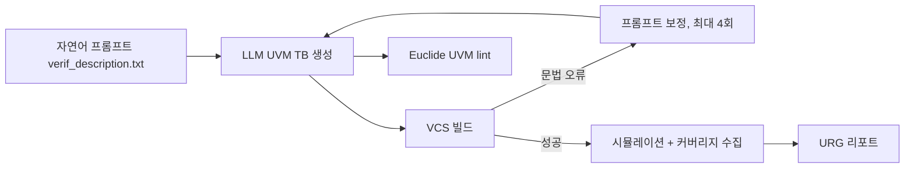

<!-- generated by yt-paper; edits will be overwritten -->

# VerifLLMBench: An Open-Source Benchmark for Testbenches Generated with Large Language Models

[:material-open-in-new: 원문 보기](https://dvcon-proceedings.org/wp-content/uploads/1059.pdf){ .md-button .md-button--primary target=_blank }

> 검증된 RTL DUT 5종에 대해 ChatGPT-4o, Gemini 1.5 Pro, Llama3.2가 생성한 UVM 테스트벤치를 빌드 성공률·커버리지·lint로 평가하는 오픈소스 벤치마크 방법론을 제시하며, LLM이 line/toggle은 잘 채우지만 FSM·branch·group 커버리지와 scoreboard 정확성에서 한계를 보임을 보고한다.

| 항목 | 내용 |
|---|---|
| 저자/출처 | Nishanth Somashekara Murthy, Eldon Nelson, Sachin S. Sapatnekar, John Sartori (University of Minnesota / Synopsys Inc.) |
| 유형 | PAPER |
| 카테고리 | Verification |
| ID | `ref-20261018-b468` |

## 핵심 인사이트

- TB 벤치마킹은 DUT 벤치마킹과 달리 '테스터를 테스트하는' 문제이므로, 검증된 DUT를 기준점으로 삼아 생성기(LLM)와 TB 요인을 분리해 평가하는 설계가 핵심이다.
- 인터페이스·top 모듈을 사전 고정하고 UVM 클래스 기반 TB만 LLM이 생성하도록 범위를 좁혀, 모델 간 직접 비교 가능성을 확보했다.
- VCS 빌드 → 최대 4회 프롬프트 재시도 → coverage 수집 → Euclide UVM lint의 자동화 파이프라인(Makefile)으로 재현 가능한 평가를 구성했다.
- VCS의 Coverage 점수는 0이 아닌 값만 평균하므로, 특정 메트릭이 0인 경우 실제 취약점을 가릴 수 있어 개별 메트릭 분석이 필요하다.
- Line/toggle 커버리지는 높지만 FSM, branch, conditional, group 커버리지와 scoreboard 정확성은 낮아, 제약 랜덤화·directed test 생성과 긴 컨텍스트 및 UVM 특화 학습이 과제로 남는다.

## 상세 요약

### 배경 및 문제 정의

RTL 생성을 자연어 프롬프트로 수행하는 LLM 연구([1] RTLLM, [2] VerilogEval)는 활발하지만, 생성된 RTL을 검증할 UVM 테스트벤치(TB)를 평가할 공개 벤치마크는 부족하다. 본 논문은 UVM TB 생성 품질을 다차원으로 평가할 수 있는 MIT 라이선스 오픈소스 벤치마크와 방법론을 제시한다.

TB 벤치마킹은 DUT 벤치마킹(입력 자극에 대한 출력을 기대값과 비교)과 달리 자극의 품질과 DUT 기능 탐색 능력을 평가해야 하므로, 논문은 이를 "테스터를 테스트하는" 재귀적 문제로 규정한다.

### 핵심 아키텍처 및 방법론

**1. 평가 흐름**

**2. 실험 설정**
- 고정 요소: interface(`accu_if.sv`), top 모듈, 가상 인터페이스 설정(`uvm_config_db`), 파형 덤프. 인터페이스·top을 고정해 LLM이 UVM 클래스 TB 구현에만 집중하도록 했고, 컨텍스트 한계도 줄였다.
- DUT 5종: `accu`(8비트 4입력 누적), `adder_8bit`, `adder_16bit`(full adder 구성), `fsm`(시퀀스 검출), `alu`(32비트 MIPS ISA CPU용). 검증된 RTL은 [1]에서 가져왔다.
- 커버리지 cover-group/cover-point는 interface에 포함된다.

**3. LLM 선정**
Table I의 후보(ChatGPT-4o, Gemma2, Gemini 1.5 Pro, Llama3.1, Llama3.2) 중 비용 효율과 계산 자원을 고려해 ChatGPT-4o, Gemini 1.5 Pro, Llama3.2 세 모델을 선택했다. 모든 실행은 클라우드 chat 기능으로 수행했고 각 반복은 메모리 없이 독립적으로 진행했다.

**4. 프롬프트 설계**
프롬프트에는 DUT 동작 설명, I/O 포트(트랜잭션 모델링용), UVM phase 요구사항, TLM 포트 방향을 포함하며, Transaction, Sequence, Sequencer, Driver, Monitor, Agent, Scoreboard, Environment, Test 클래스 생성을 요구한다. 저자들은 지나치게 상세한 프롬프트는 응답이 잘리는 문제가 있었고, 컴포넌트 목록이 불완전하면 scoreboard가 빠지는 등 불완전한 구현이 나왔다고 보고한다.

**5. 빌드·커버리지·lint**
- 빌드: Synopsys VCS 2022.06. 문법 오류 시 최대 4회 반복 수정하며, 초과 시 실패로 간주한다.
- 커버리지: line, condition, toggle, FSM, branch, functional(covergroup). 시뮬레이션 런타임 에러가 난 실행은 커버리지 분석에서 제외한다.
- lint: Synopsys Euclide 2024.09. LLM이 생성한 UVM 코드에만 적용하며, Fatal과 Error를 합쳐 "Errors", 나머지를 "Warnings"로 집계한다.

**6. 자동화**: 빌드, 커버리지, lint 전 과정을 Makefile로 자동화해 여러 LLM에 대해 재현 가능한 실행을 보장한다.

### 실험 결과 및 결론

**Table III 요약 (5개 DUT, 3개 LLM)**

| 모델 | 평균 Build (회) | 평균 Coverage | 평균 Lint Errors/Warnings |
|---|---|---|---|
| ChatGPT-4o | 84% | 70.6% | 1.8 / 6.6 |
| Gemini 1.5 Pro | 88% | 79.3% | 7 / 2.8 |
| Llama3.2 | 64% | 46.8% | 0 / 9.8 |

(표의 Build 평균은 원문 표기 그대로 옮긴 값이다. 원문 표에서 Build 열은 성공 빌드 횟수로 정의되어 있어 단위 해석에 주의가 필요하다.)

**메트릭별 관찰**
- **Line**: 대부분 완전 또는 거의 완전 커버. ALU 기준 line 96%, branch 76%.
- **Conditional/Branch**: 조건·분기 경로 탐색이 약하며, 저자들은 LLM이 설계 맥락을 충분히 이해하지 못한다고 해석한다. 조건문이 없는 adder의 0%는 기능 부재이지 TB 실패가 아니라고 명시한다.
- **Toggle**: line과 유사하게 높으나, 복잡한 로직과 FSM 요소를 충분히 자극하지 못한다.
- **FSM**: 가장 어려운 메트릭이다. Llama3.2는 FSM에서 성능이 급락했다.
- **Group**: adder_8bit는 135,705개 bin 중 평균 0.18%(ChatGPT-4o)와 0.20%(Gemini)만 커버했다. adder_16bit(165 bin)는 Gemini 22.7%, Llama3.2 33.5%다.
- **Assertion**: DUT에 assertion이 없어 전 케이스 0%이며 평가에서 제외된다.

**모델별 평가**
- ChatGPT-4o: line, branch, toggle이 고르게 좋으며 가장 안정적이라고 평가됨.
- Gemini 1.5 Pro: toggle과 전체 커버리지·빌드 수렴에서 소폭 우세. 1M 토큰 컨텍스트의 이점을 언급.
- Llama3.2: 빌드 수렴과 기능 커버리지 모두 최하위. 제약 랜덤화를 넣자 빌드 수렴이 저해되어 커버리지가 떨어졌다.
- 저자들은 파라미터 수와 성능 사이에 명확한 상관관계가 없다고 보고한다.

**주요 한계 (Challenges)**
- Scoreboard 정확도: 검증된 DUT임에도 생성된 scoreboard가 테스트 실패를 보고하는 경우가 잦았다. 인터페이스 객체 결합 오류로 고임피던스(z) 값이 나타나는 문제가 있었다.
- 복잡도 한계: 제약 랜덤화나 directed test를 프롬프트에 넣으면 문법 오류와 불일치가 늘었다.
- 빌드 이슈: UVM agent·environment의 connect phase 누락, scoreboard의 변수 타입 오용, TLM 포트 타입 불일치가 반복되었다.
- 컨텍스트: DUT 동작 설명이 길어지면 토큰이 늘어 TB 품질이 떨어질 수 있다.

**결론**: LLM은 line·toggle 중심의 기본 TB 생성에는 효율적이지만, FSM·branch·group 커버리지와 정확한 scoreboard 모델링에는 한계가 있다. 저자들은 더 큰 컨텍스트 윈도우, UVM 특화 학습, 제약 랜덤화 및 directed test 지원이 필요하다고 결론짓는다. 다만 DUT가 5개의 단순한 설계이고 반복 실행 수가 적어(각 메트릭 5회 빌드 기준) 일반화에는 주의가 필요하다. 논문 본문이 잘려 있어 벤치마크 공개 저장소의 세부 구성은 확인할 수 없다.

## 관련 영상

<iframe src="https://www.youtube-nocookie.com/embed/LnieLz-qAFw" title="[DVCON2025]VerifLLMBench:An Open-Source Benchmark forTestbenches Generated with Large LanguageModels" loading="lazy" allow="accelerometer; clipboard-write; encrypted-media; gyroscope; picture-in-picture; web-share" referrerpolicy="strict-origin-when-cross-origin" allowfullscreen></iframe>

**[DVCON2025]VerifLLMBench:An Open-Source Benchmark forTestbenches Generated with Large LanguageModels** — [YouTube에서 보기](https://www.youtube.com/watch?v=LnieLz-qAFw) · [영상 페이지](../../videos/LnieLz-qAFw.md)
