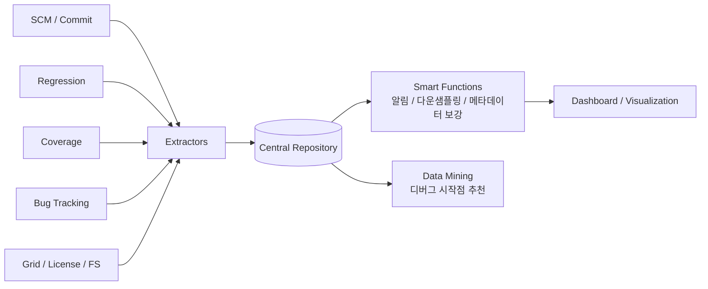

<!-- generated by yt-paper; edits will be overwritten -->

# Improving Verification Predictability and Efficiency Using Big Data

[:material-open-in-new: 원문 보기](https://dvcon-proceedings.org/wp-content/uploads/improving-verification-predictability-and-efficiency-using-big-data.pdf){ .md-button .md-button--primary target=_blank }

> 검증 환경의 흩어진 메트릭(커버리지, 버그, 코드 변경량, 회귀, 라이선스, 컴퓨트 자원)을 중앙 저장소에 모아 Big Data 방식(capture, process, analyze)으로 분석하면 sign-off 시점 예측과 디버그 시작점 제안이 가능하다는 제안 논문.

| 항목 | 내용 |
|---|---|
| 저자/출처 | Darron K. May (Mentor Graphics Inc.). 본문에 학회/저널명은 명시되지 않음. 제목 힌트의 'Laura Hyslop'은 본문 저자 표기와 일치하지 않음. 참고문헌 [2], [4]가 DVCon 발표 논문이며, Acknowledgment에 Joe Larabell 특허 관련 감사 표기가 있음. |
| 유형 | PAPER |
| 카테고리 | Verification |
| ID | `ref-20261018-c017` |

## 핵심 인사이트

- 검증 프로세스에서 대부분 버려지는 데이터(라이선스 사용량, 자원 로딩, 버그 상태 전이, 커버리지 bin 수 등)를 프로젝트 전반에 걸쳐 중앙에 보관하는 것이 예측 분석의 전제 조건이다.
- 버그 종료 누적곡선과 code churn은 프로젝트 전반에서 S-curve를 따르는 경향이 있어, 커버리지 추세와 함께 보면 sign-off 진척도 판단에 활용할 수 있다. 다만 본문은 '매우 높은 정확도'라고 주장할 뿐 구체적 수치 근거는 제시하지 않는다.
- code coverage와 functional coverage를 같은 시간축에 겹쳐 보면 테스트 부족, 커버리지 모델 미흡, 불필요한 설계 영역 등을 구분할 수 있다. 커버리지 bin 수도 함께 저장해야 모델 변경에 따른 수치 하락을 해석할 수 있다.
- 회귀 결과와 커버리지 포인트의 pass/fail 상관관계를 계산해 failure 원인 후보를 좁히는 데이터 마이닝 기법을 제안하며, 이 접근은 특허([5])로 보호된다고 명시되어 있다. 원리 설명은 있으나 알고리즘 세부나 정량 검증은 본문에 없다.
- 클라우드형 백엔드 기술 선택(RDBMS, NoSQL, Hadoop 등)보다 메타데이터를 충분히 기록하고 도구·데이터 간 교차 참조(bug ID ↔ commit ↔ regression)를 설계하는 것이 분석 가능성을 좌우한다.

## 상세 요약

### 배경 및 문제 정의

현대 검증 환경은 칩 규모 증가, 지리적으로 분산된 팀, 시장 출시 압박으로 인해 하드웨어(컴퓨트 자원), 소프트웨어(라이선스), 인력을 모두 효율적으로 써야 하는 상황이다. 논문은 이러한 환경에서 생성되는 데이터 중 상당수가 프로젝트 중에 수집·보관되지 않는다는 점을 문제로 제기한다.

- 검증 흐름: 설계 스펙 → testplan → testbench/RTL(SCM 관리) → 빌드·회귀 시스템 → 버그 추적 시스템 → 커버리지 측정 및 testplan 대조
- 컴퓨트 자원은 load-sharing 시스템, 라이선스는 licensing 시스템이 관리하지만 이 데이터도 보통 수집되지 않는다.
- 기존 도구들의 이력 저장 기능은 메트릭을 개별적으로만 보여준다는 한계가 있다.
- 논문은 Big Data의 3V(volume, velocity, variety)와 machine learning, digital footprint로 확장된 정의를 소개하면서, 검증 데이터도 "capture, process, analyze" 파이프라인에 적용할 수 있다고 주장한다.

### 핵심 아키텍처 및 방법론

논문이 제시하는 플랫폼은 다음 구성 요소로 이해할 수 있다.

1. **저장소 및 백엔드**: 관계형 DB(SQL Server, Oracle, PostgreSQL, DB2)와 NoSQL(MongoDB, Cassandra, CouchDB, HBase, Redis), Hadoop(HDFS + MapReduce) 등을 언급한다. 특정 기술을 추천하지는 않으며, 상용 도구는 여러 DB 유형을 지원하고 web-ready 기술 스택을 갖춰야 한다고 본다.
2. **프론트엔드**: HTML5, JavaScript 라이브러리(Angular, React, Bootstrap, Node.js), 대시보드 소프트웨어를 활용한 시각화. 서버 측 프레임워크로 Ruby on Rails 또는 Python/Django를 언급하며, Ruby on Rails 기반 회귀 메트릭 시스템 사례 [4]를 인용한다.
3. **추출기(Extractors)**: 주기적 실행 또는 이벤트 기반 실행을 지원한다. 예를 들어 컴퓨트 로딩과 라이선스 상태는 분 단위로, SCM은 커밋마다, 회귀는 실행 시마다 샘플링한다.
4. **메트릭 분류 (Table 1)**: Meta data(마일스톤), Requirements/Testplan(요구사항 검증 상태), SCM(LOC 종류, code churn), Regression(pass/fail, queue/CPU/run time, MTBR), Grid(host 로딩·메모리), Licensing(feature checkout), File system(저장량), Coverage(code/functional/testplan, bin 수), Bug tracking(open/closed/in-progress, MTBF) 등을 프로젝트·사용자·파일·설계 단위로 나눈다.
5. **단일 및 교차 메트릭 분석**
   - 추세 분석: 커버리지와 버그 종료의 시계열 곡선으로 sign-off까지 남은 시간을 추정한다. 버그 종료와 code churn은 S-curve를 따른다고 설명한다.
   - 교차 분석: code coverage 높음 + functional coverage 낮음 → 테스트 추가 필요. 반대면 커버리지 모델 보강이나 불필요한 설계 영역 점검. 커버리지 bin 수를 함께 보면 모델 변경으로 인한 수치 하락을 설명할 수 있다.
   - 스마트 기능: 실시간 리더보드, 게이지, 규칙 기반 알림(예: 커버리지가 특정 기간에 일정 이상 떨어지거나 버그 수명이 임계치를 넘을 때 이메일/알림).
   - 데이터 관리: 자원 메트릭을 다운샘플링하여 추세는 유지하고 저장량은 줄인다.
   - 도메인 분석: RTL/HVL의 functional·comment·whitespace LOC 계산, 사용자별 추가/삭제/수정 라인 계산, 파일 간 동시 변경 확률 분석을 통한 리팩토링 후보 탐지.
   - 상호 참조: 커밋 메시지의 bug ID와 버그 DB의 발견/해결 revision을 연결하면 에러 재현과 버그-코드-방법론 관계 분석이 가능해진다.
6. **데이터 마이닝 및 디버그 지원 (Section VI)**
   - 분석 성숙도 모델: descriptive → diagnostic → predictive → prescriptive.
   - 디버그 시작점 추천 원리: 특정 커버리지 포인트를 커버한 테스트가 모두 통과했다면 그 포인트가 원인일 가능성은 낮다. 그 포인트를 커버한 테스트가 모두 실패하고, 커버하지 않은 테스트는 실패하지 않았다면 원인일 가능성이 높다. 각 커버리지 포인트에 대해 "해당 포인트를 커버한 테스트가 실패할 확률"을 계산하고, 포인트별 pass/fail 시그니처와 회귀 전체 시그니처의 상관관계를 평가한다. 상관이 가장 높은 포인트가 실패 원인에 가장 가까울 것으로 본다.
   - 전제 조건: 충분한 수의 pass/fail 테스트, 100% 미만의 커버리지, 테스트 간 커버리지 중첩이 적어야 한다.

### 실험 결과 및 결론

본 문서는 **정량적 실험 결과나 벤치마크를 제시하지 않는다.** 논문의 주장은 산업 관행, 개념 설명, 예시 그래프 설명에 기반하며, 다음과 같은 수치·주장은 본문에 인용된 형태 그대로이다.

- IBM(2013)의 "세계 데이터의 90%가 최근 2년간 생성됨" 및 "데이터 증가율 연 40~50%"라는 일반 통계 인용.
- 버그 종료 및 code churn의 S-curve 관계를 여러 프로젝트에서 연구하면 "매우 높은 정확도"로 활용 가능하다는 서술 (근거 수치 없음).
- 디버그 시작점 추천 기법은 특허 [5]로 보호되며, 구체적 성능 평가는 제시되지 않음.

결론적으로 논문은 (1) 검증 메트릭을 통합 저장하는 Big Data 플랫폼, (2) 교차 메트릭 시각화와 알림, (3) 데이터 마이닝 기반 디버그 지원과 예측 분석이 검증 효율성과 예측 가능성을 높인다고 주장한다. 다만 구현 사례의 정량 평가가 없으므로, 실무 적용 시에는 자체 데이터로 상관관계와 예측 정확도를 검증해야 한다. 참고로 제목 힌트의 저자명('Laura Hyslop')은 본문과 달리 Darron K. May로 확인되었다.

## 관련 영상

<iframe src="https://www.youtube-nocookie.com/embed/M0AezW85SRg" title="[DVCON2018] Improving Verification Predictability and Efficiency Using Big Data" loading="lazy" allow="accelerometer; clipboard-write; encrypted-media; gyroscope; picture-in-picture; web-share" referrerpolicy="strict-origin-when-cross-origin" allowfullscreen></iframe>

**[DVCON2018] Improving Verification Predictability and Efficiency Using Big Data** — [YouTube에서 보기](https://www.youtube.com/watch?v=M0AezW85SRg) · [영상 페이지](../../videos/M0AezW85SRg.md)
