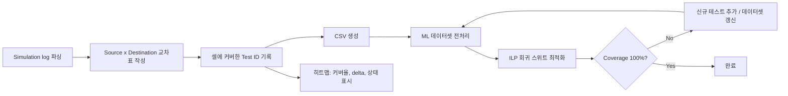

<!-- generated by yt-paper; edits will be overwritten -->

# Enhancing SDC Verification in SoCs: Heatmap Visualization and Machine Learning Approaches for Optimal Coverage Closure

[:material-open-in-new: 원문 보기](https://dvcon-proceedings.org/wp-content/uploads/1031-2.pdf){ .md-button .md-button--primary target=_blank }

> RTL 시뮬레이션 기반 SDC 검증에 커버리지 히트맵 시각화와 PuLP(ILP) + Random Forest 기반 회귀 테스트 축소를 결합해, 한 IP 사례에서 회귀 TAT를 27시간에서 10시간(약 63% 감소)으로 줄인 방법론 제안.

| 항목 | 내용 |
|---|---|
| 저자/출처 | Seungkyu Baek, Jaein Hong, Moonki Jun, Sungcheol Park (Samsung Electronics Inc.). 원문에 학회명은 명시되어 있지 않음. 제공된 힌트의 저자 'Laura Leblanc'은 원문에서 확인되지 않음. |
| 유형 | PAPER |
| 카테고리 | Verification |
| ID | `ref-20261018-c3f8` |

## 핵심 인사이트

- SDC 검증을 GLS 대신 X-propagation을 켠 RTL 시뮬레이션으로 앞당기면, GLS 이전에 timing exception 정의 오류(잘못된 지점 지정, 클록 관계 오해)를 잡을 수 있다는 점이 실무적으로 가장 실용적인 포인트이다.
- 히트맵은 source×destination 교차표이며 각 셀에 커버하는 test ID를 기록한다. 이 구조화된 표가 커버리지 갭 식별뿐 아니라 ML 학습용 CSV 데이터셋의 원천이 되는 이중 역할을 한다.
- 회귀 스위트 축소는 '최소 테스트 수 선택'을 이진 변수 ILP로 푸는 set-cover 문제로 정식화(PuLP)하고, 새 테스트 추가 여부는 Random Forest의 predict_proba>0.5 기준으로 판단해 재최적화를 트리거하는 구조다.
- 성과 수치(78→19 벡터, 27h→10h)는 단일 IP의 timing exception 경로 387개 대상 결과이며, 블록/칩 레벨 확장이나 Random Forest 선택의 우위는 검증되지 않았다. 특히 ML 기여도에 대한 비교 실험(ILP 단독 대비 등)은 본문에 없다.
- 히트맵 행/열 수가 수천 단위로 커지는 블록·칩 레벨에서는 시각적 리뷰 기반 커버리지 클로저가 어려워질 수 있어, 자동화된 갭 판정과 스케일링이 후속 과제로 남아 있다.

## 상세 요약

### 배경 및 문제 정의

SDC(Synopsys Design Constraints)는 동작 조건, 타이밍 제약, timing exception(MCP, False Path 등)을 정의하며 PPA 목표를 좌우한다. SDC와 설계 의도가 어긋나면 성능 저하나 오동작으로 이어지므로 철저한 SDC 검증이 필요하다.

기존 방식인 Gate-Level Simulation(GLS)은 물리 구현 이후에야 시작되고 런타임이 길어, 타이밍 문제가 실리콘 단계에서 발견되어 re-spin을 유발하는 경우가 많다. 논문은 이 문제를 두 축으로 접근한다.

- **Shift-left**: RTL 시뮬레이션에서 SDC를 인지하는 검증(SDC-aware simulation)을 수행해 검증 시작 시점을 앞당긴다.
- **Gap 식별과 회귀 최적화**: SDC 커버리지 갭을 히트맵으로 시각화하고, ML과 정수 계획법으로 회귀 스위트를 줄인다.

### 핵심 아키텍처 및 방법론

**1. RTL SDC-aware 검증 + X-propagation**

RTL 기능 검증에서 재사용한 테스트 벡터로 MDV(Metric-Driven Verification) 회귀를 돌린다. RTL 시뮬레이션의 X-optimism 문제는 X-propagation 기능으로 완화하며, 이때 GLS와 유사한 X-pessimism이 적용되어 setup 위반이 나타난다. 실패 테스트는 우선순위가 높은 이슈로, 통과 테스트의 메시지는 검토 후 waive 대상이 된다.

**2. 히트맵 시각화**

- 셀 색상은 커버 여부와 리뷰 결과를 반영한다. 초기에는 gray/red이고, 리뷰 후 red가 green 또는 blue로 바뀌어 최종적으로 gray와 green만 남는다.
- 히트맵은 uncovered 경로를 찾아 directed test를 추가하거나 기존 테스트의 제약을 수정하는 데 쓰인다.
- SDC 경로가 설계와 맞지 않는 경우(예: 버전 불일치)나 dead code에 대한 waiver 판단에도 활용된다.

**3. 특징 추출 (ML 데이터셋)**

히트맵에서 추출한 CSV 특징은 다음과 같다.
- 서로 다른 테스트가 커버하는 비동기 경로 수
- 테스트별 고유(unique) 경로 수
- counter register 경로 등 waive 가능한 경로 수
- 시뮬레이션 시간, skippable 영역 범위

**4. ILP 기반 최소 테스트 선택 (PuLP)**

기본 목적함수는 선택된 테스트 수의 최소화다.

$$\min \sum_{i=1}^{n} x_i$$

가중치를 반영한 목적함수는 다음과 같다. 여기서 $w_i$는 고유 경로, skippable 경로, 시뮬레이션 시간으로 계산되는 테스트별 가중치다.

$$\min \sum_{i=1}^{n} w_i x_i$$

제약은 다음과 같다.

$$x_i \in \{0,1\}, \quad \forall i \in \{1,\dots,n\}$$

$$\sum_{i:\, j \in S_i} x_i \ge 1, \quad \forall j \in A$$

여기서 $A$는 커버해야 할 전체 경로 집합, $S_i$는 테스트 $i$가 커버하는 경로 부분집합이다. 논문은 명시적 제약(binary, path coverage)만 다루고 암묵적 제약은 제외했다고 밝힌다. 구현은 PuLP의 `LpProblem`, `LpVariable(cat="Binary")`, `lpSum`을 사용한다.

**5. Random Forest 분류기 (scikit-learn)**

- 학습 레이블: ILP로 얻은 최적 스위트에 포함되면 1, 아니면 0.
- 입력 특징: 실행 시간, 커버 포인트 수, 고유 영역 목록, skipability 합계.
- 새 테스트 시나리오가 추가되면 `predict_proba` 값을 보고, 0.5를 넘으면 최적화를 재실행해 스위트를 갱신한다.
- 선택 근거로 견고성, 해석 가능성, feature importance 제공, 적은 하이퍼파라미터 등을 들었으나, 이는 정성적 주장이며 다른 모델과의 정량 비교는 없다.

### 실험 결과 및 결론

**실험 대상**

- CPU 블록: HPC 목적, 4nm 공정, 1.5 GHz, 약 10M 게이트, Cortex-M3 및 Cortex-A55 쿼드코어 포함.
- SDC: 1,069개 제약, 37개 명령(set_multicycle_path, set_false_path 등), 82,554개 경로 영향.
- 기능 회귀: 554개 시나리오.

**발견된 SDC 오류 (X-propagation 활용)**

1. **잘못된 지점에 정의된 timing exception**: 'fail' 테스트 디버깅에서 발견. 클록 관계 오해로 인해 발생하며, SDC 또는 설계 수정과 전체 회귀 재실행이 필요하다. 우선순위가 가장 높다.
2. **클록 관계 오해에 따른 timing exception**: 'pass' 테스트 메시지 정리 과정에서 발견. 비동기 경로 정의 오류로, 기능에는 즉시 영향이 없고 아키텍처 리뷰에서 waive 가능하다.

**정량 결과 (특정 IP 1개, timing exception 경로 387개)**

| 항목 | 기존 방식 | 제안 방식 |
|---|---|---|
| 회귀 테스트 벡터 수 | 78 | 19 |
| 회귀 TAT | 27시간 | 10시간 |

- 커버리지: timing exception 경로 100% 달성.
- 시간 감소율: $(27-10)/27 \approx 63\%$로 본문 수치와 일치한다.
- 참고 비교: 기존 GLS 기반 sign-off는 단일 벡터로 0.3% 커버리지였다. 제안 방식의 단일 최적화 벡터는 SS 블록 레벨에서 203개 타이밍 경로를 검증해 SDC 경로의 약 60%를 커버했다고 보고된다.

**한계 및 향후 과제**

- 평가는 서브시스템 수준의 제한된 IP에 한정되며, 블록/칩 레벨에서는 수천 행·열의 히트맵과 커버리지 판정의 어려움이 예상된다.
- 진행 중인 LPDDR5X 컨트롤러·PHY 블록 적용에서는 318개 제약에서 파생된 64,202개 경로를 대상으로 하며, TAT 감소가 확인되었다고만 서술되고 구체 수치는 없다.
- 향후 과제로 full-system 확장, AI 기반 예측으로 테스트 스위트를 동적으로 정제하는 방향이 제시되었다.

**결론**

히트맵 시각화로 커버리지 갭을 구조적으로 드러내고, ILP와 Random Forest로 회귀 스위트를 축소하는 조합이 SDC 검증의 커버리지 확보와 런타임 단축에 유효하다는 것을 단일 IP 사례로 보였다. 다만 일반화 가능성과 ML 기여도의 정량적 분리는 본문에서 충분히 검증되지 않았다.

## 관련 영상

<iframe src="https://www.youtube-nocookie.com/embed/67KjBs3Uw-Q" title="[DVCON2025]Enhancing SDC Verification in SoCs: Heatmap Visualization  Machine Learning Approaches " loading="lazy" allow="accelerometer; clipboard-write; encrypted-media; gyroscope; picture-in-picture; web-share" referrerpolicy="strict-origin-when-cross-origin" allowfullscreen></iframe>

**[DVCON2025]Enhancing SDC Verification in SoCs: Heatmap Visualization  Machine Learning Approaches ** — [YouTube에서 보기](https://www.youtube.com/watch?v=67KjBs3Uw-Q) · [영상 페이지](../../videos/67KjBs3Uw-Q.md)
