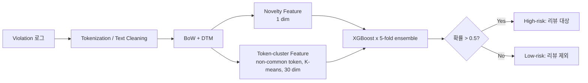

<!-- generated by yt-paper; edits will be overwritten -->

# Check Low-Power Violations by Using Machine Learning Based Classifier

[:material-open-in-new: 원문 보기](https://dvcon-proceedings.org/wp-content/uploads/1027-Check-Low-Power-Violations-by-Using-Machine-Learning-Based-Classifier.pdf){ .md-button .md-button--primary target=_blank }

> 시뮬레이션 기반 low-power 검증에서 생성되는 violation 로그를 텍스트로 보고 BoW + 엔지니어링 피처 + XGBoost 앙상블로 "고위험(high-risk)" violation을 선별해, 설계 팀의 수동 리뷰 대상을 최대 50%(A 설계 기준), 최소 12%(B 설계 기준) 줄인 연구.

| 항목 | 내용 |
|---|---|
| 저자/출처 | Chi-Ming Lee, Chung-An Wang, Cheok-Yan Goh, Chia-Cheng Tsai, Chien-Hsin Yeh, Chia-Shun Yeh, Chin-Tang Lai (MediaTek Inc., Hsinchu, Taiwan) |
| 유형 | PAPER |
| 카테고리 | Verification |
| ID | `ref-20261018-c426` |

## 핵심 인사이트

- violation 로그의 토큰(신호명)을 텍스트로 보고 스팸 필터링과 같은 지도학습 이진 분류 문제로 정식화한 점이 핵심 아이디어이며, 도메인 특화 신호명이라 사전학습 NLP 모델 대신 BoW + XGBoost를 택했다.
- 학습 데이터에 없는 새 설계의 토큰(non-common tokens)을 버리지 않기 위해 문자 단위 BoW를 K-means로 클러스터링한 'token-cluster feature'와, 과거 waived 위반에 없던 토큰을 표시하는 'novelty feature'를 도입해 일반화를 높였다.
- 리뷰 절감률이 아니라 recall=1(모든 실제 설계 이슈 포착)을 제약 조건으로 두고 리뷰 대상을 줄이는 방식으로 평가했으며, 이 점이 실무 적용 시 가장 중요한 평가 기준이다.
- 테스트 설계 3개(A, B, C)에 대한 결과가 각각 50%, 12%, 18% 리뷰 감소로 편차가 크고, 실험 설계가 3개 설계/단일 체크 항목(Isolation clamp value)에 한정되어 일반화 주장은 제한적으로 읽어야 한다.
- 학습 파이프라인이 약 3분(2-core CPU)에 끝나고 validated 라벨로 incremental learning이 가능해, 기존 시뮬레이션 검증 흐름에 저비용으로 덧붙일 수 있는 구조다.

## 상세 요약

### 배경 및 문제 정의

시뮬레이션 기반 검증에서 low-power 체크는 매 반복(iteration)마다 많은 violation을 생성하며, 각 violation은 waivable(오탐)이거나 반드시 고쳐야 하는 실제 설계 이슈다. 설계가 복잡해질수록 violation 수가 늘고, 설계 도메인 지식이 필요한 수동 리뷰가 시간 내에 끝나지 못해 RTL freeze 이후에야 이슈가 발견되며 ECO(Engineering Change Order)와 tape-out 지연으로 이어질 수 있다.

저자들은 스팸 메일 필터링 문제를 참고해 violation 리뷰를 **지도학습 이진 분류 문제**로 정식화했다. violation 신호명이 텍스트로 구성되어 있고 그 단어가 물리적 특성을 반영한다는 관찰에 기반한다. 대상 체크 항목은 두 power domain 사이에서 올바른 isolation cell 타입을 검사하는 **Isolation clamp value check**다.

### 핵심 아키텍처 및 방법론

전체 흐름은 학습 단계에서 과거 설계의 violation과 검증 라벨로 "AI Checker"를 학습하고, 추론 단계에서 violation을 waivable / high-risk로 분류해 리뷰 대상을 줄이는 구조다. 검증된 라벨은 incremental learning에 다시 사용된다.

**1) 데이터 전처리**
- 신호명을 단어 단위로 토큰화하고(예: `Common1_Common2_A1_B2_[C3]_[D4]_[E5]` → 토큰 목록), 소문자화, 공통 prefix 제거, 숫자·대괄호 제거를 수행한다.
- 토큰 집합으로 BoW 벡터를 만들고 이를 Document-Term Matrix(DTM)로 구성한다.
- 학습 데이터와 테스트 데이터의 **common token**만 DTM 차원으로 사용한다.

**2) 피처 엔지니어링**
- **Novelty feature**: 새 설계의 토큰 중 과거 waived violation에 없던 토큰(novelty token)이 하나라도 있으면 1, 없으면 0인 이진 피처다. 학습 데이터에서는 실제 설계 이슈와 waived violation의 토큰 차이로 같은 피처를 만든다. 새로운 신호가 나타나면 실제 이슈일 위험이 높다는 관찰에 근거한다.
- **Token-cluster feature**: DTM에서 버려지는 non-common token을 활용하기 위해, 각 토큰을 알파벳 문자 단위 BoW로 인코딩한 뒤 K-means로 묶는다. 각 violation에서 클러스터별 출현 횟수를 세어 피처로 쓴다. 철자 구조가 비슷한 토큰은 물리적 의미도 비슷하다는 가정이다.

**3) 앙상블 모델**
- 기본 모델은 XGBoost이며, 도메인 특화 신호명에는 사전학습 NLP 모델이 적합하지 않다고 판단했다.
- n-fold(실험에서는 5-fold) 교차검증으로 여러 모델을 학습하고, 각 모델의 예측 확률 중 **최댓값**을 최종 값으로 쓴다. 임계값은 0.5이며, 0.5를 넘으면 high-risk로 판정한다.

**4) 벤치마크 및 평가 지표**
- 비교 기준(baseline)은 SVM이다.
- 평가 지표는 다음과 같이 정의된다.
  - Recall rate = (예측 high-risk 중 실제 이슈 수) / (전체 실제 이슈 수)
  - Review reduction rate = 리뷰 프로세스에서 제외된 low-risk violation의 비율
- 원 논문은 recall = 1을 유지하는 조건에서 리뷰 감소율을 최대화하는 다목적 관점을 채택한다.

### 실험 결과 및 결론

**데이터셋(Table IV)**: 학습 데이터는 과거 설계 7,000개 violation(실제 이슈 284개)이며, 테스트는 설계 A(2,002개, 166개 이슈), B(1,001개, 117개 이슈), C(3,177개, 539개 이슈)다. 표 상의 "Total violations"와 "True design issues" 열 배치가 원문 추출에서 다소 뒤섞여 있어, 위 수치는 행 순서를 기준으로 해석했다.

**Ablation 구성(Table VI)**: 5가지 구성으로 비교했다. (1) SVM + 전처리, (2) XGBoost + 전처리, (3) XGBoost + novelty feature 추가, (4) XGBoost + novelty + token-cluster 추가, (5) Ensemble XGBoost + 전체 피처. 각 구성은 5개 seed로 실행해 평균을 보고했다.

**주요 결과(Fig. 8, 본문 기준)**
- 제안 방식(구성 5)은 세 테스트 설계 모두에서 recall rate 1을 달성했다.
- 피처와 모델 구성요소가 추가될수록 recall은 1에 가까워지지만 review reduction rate는 낮아지는 트레이드오프가 관찰되었다.
- recall = 1을 유지하는 조건에서 설계 A, B, C의 리뷰 감소율은 각각 **50%, 12%, 18%**다.
- 학습 + 추론에 설계당 약 3분(2-core CPU)이 걸린다.

**결론 및 한계**
- 논문은 "최소 12%의 리뷰 공수를 줄이면서 모든 실제 이슈를 유지"하고, 오탐을 줄이며, 실제 이슈를 더 일찍 발견하는 shift-left 효과를 주장한다.
- 다만 평가는 Isolation check 하나, 설계 3개에 한정되어 있다. 다른 체크 항목으로의 일반화는 "가능할 것"이라는 기대 수준으로 제시되며 실험적으로 검증되지 않았다.
- 원문 발췌에 일부 표 레이블과 참고문헌 서지 정보가 깨져 있어, 세부 수치는 본문 서술을 우선해 해석했다.

## 관련 영상

<iframe src="https://www.youtube-nocookie.com/embed/0cEVwOlM79M" title="[DVCON2023]Check Low-Power Violations by Using Machine Learning Based Classifier" loading="lazy" allow="accelerometer; clipboard-write; encrypted-media; gyroscope; picture-in-picture; web-share" referrerpolicy="strict-origin-when-cross-origin" allowfullscreen></iframe>

**[DVCON2023]Check Low-Power Violations by Using Machine Learning Based Classifier** — [YouTube에서 보기](https://www.youtube.com/watch?v=0cEVwOlM79M) · [영상 페이지](../../videos/0cEVwOlM79M.md)
