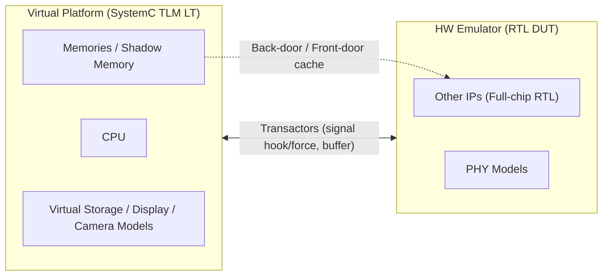

<!-- generated by yt-paper; edits will be overwritten -->

# EARLY SOFTWARE DEVELOPMENT AND VERIFICATION METHODOLOGY USING HYBRID EMULATION PLATFORM

[:material-open-in-new: 원문 보기](https://dvcon-proceedings.org/wp-content/uploads/early-software-development-and-verification-methodology-using-hybrid-emulation-platform.pdf){ .md-button .md-button--primary target=_blank }

> 모바일 AP의 RTL 설계 초기 단계에서 CPU·메모리·주변장치를 TLM LT 기반 ESL 가상 플랫폼에, 나머지 IP를 하드웨어 에뮬레이터에 배치하는 하이브리드 에뮬레이션 플랫폼으로 Android 부팅을 54분 내에 완료하고 실리콘 보드 이전에 SW 개발을 가능하게 한 방법론.

| 항목 | 내용 |
|---|---|
| 저자/출처 | Woojoo Kim, Haemin Park, Hyundon Kim, Seonil Brian Choi, SukWon Kim (Samsung Electronics Co., LTD.) |
| 유형 | PAPER |
| 카테고리 | Verification |
| ID | `ref-20261018-c6c6` |

## 핵심 인사이트

- 핵심 아이디어는 SW 부팅에 빈번한 CPU·메모리·스토리지·디스플레이를 빠른 TLM LT 가상 플랫폼에 두고, 나머지 RTL IP는 에뮬레이터에 두는 것입니다. 에뮬레이터 동기화 빈도를 줄이는 것이 성능의 핵심입니다.
- Transactor는 AMBA ACE, sideband, eMMC/UFS/Display/Camera PHY 신호를 시그널 hooking/forcing으로 TLM과 pin-level 사이에서 변환하며, 내부 버퍼로 속도 격차를 완충합니다. DUT 기능을 바꾸지 않는다는 점이 중요합니다.
- Memory shadowing과 cache 방식 동기화로 에뮬레이터 백본을 거치는 메모리 접근을 줄여, 부팅 시 대량 메모리 트랜잭션의 병목을 완화했다고 보고합니다.
- 플랫폼 구축 시간은 수동 방식 대비 자동화 흐름으로 37% 단축되었다고 보고되나, 본문 표(Table 1)의 Total 수치는 380→390분으로 순수 에뮬레이션 대비 약 3% 증가라고 기술되어 있어 수치 해석에 주의가 필요합니다.
- 성능 비교는 Android 부팅 기준 Pure Emulator 762분 대비 하이브리드 54분(약 14배)이며, 리눅스 커널 부팅 기준 48배로 보고됩니다. 시뮬레이션 수치는 추정치이며, 단일 플래그십 모바일 AP(2.5B gate) 사례 한 건에 기반한 결과입니다.

## 상세 요약

### 배경 및 문제 정의

모바일 AP 개발에서 SW 개발·검증 TAT 단축이 전체 TAT 단축의 핵심이지만, 기존에는 RTL이 완성되어도 개발 보드가 나온 뒤에야 SW 개발이 시작되는 경우가 많았습니다. 문서는 이 원인을 RTL 시뮬레이션의 극히 낮은 속도에서 찾습니다.

- RTL 시뮬레이션: 수 개 KHz~수십 KHz 수준으로, 실리콘 대비 약 $10^6$배 느립니다. 문서 기준 실리콘에서 1초인 SW 실행이 시뮬레이션에서는 약 11.6일이 됩니다.
- RTL 에뮬레이션: 수백 KHz~수 MHz로 시뮬레이션보다 빠르지만 실리콘 대비 약 $10^3$배 느리며, Linux/Android 부팅에 10시간 이상 걸린다고 기술합니다. 드라이버 개발 수준에는 적합하지만 OS 개발에는 부족합니다.
- FPGA 프로토타입: 약 10 MHz이나 대규모 모바일 AP 이식이 어렵고 재합성 부담이 큽니다.
- 기존 ESL co-emulation 연구([10], [11])는 GPU 드라이버 검증 또는 CPU 코어 중심이었으며, VIP 기반 외부장치 모델의 SFR 전체 모델링 한계로 실제 모바일 AP 전체 Android 개발에 적용하기 어렵다고 지적합니다.

따라서 문서는 RTL 설계 단계에서 SW 개발에 충분한 실행 속도를 주면서, 실리콘 보드와 동일한 환경(외부 저장장치·디스플레이·카메라 포함)을 제공하고 플랫폼 구축 오버헤드를 줄이는 방법을 목표로 합니다.

### 핵심 아키텍처 및 방법론

**1) 역할 분할**
- CPU, 메모리, 주변장치(외부 스토리지, 디스플레이)를 TLM LT 모델의 가상 플랫폼에 배치합니다. 이 블록들은 Android 부팅 중 트랜잭션을 많이 발생시키기 때문입니다.
- 나머지 IP는 에뮬레이터에 둡니다. 가상 플랫폼 입장에서는 에뮬레이터가 TLM 모델처럼 보이고, 에뮬레이터 입장에서는 가상 플랫폼이 RTL 모듈처럼 보입니다.

**2) Transactor (도메인 변환)**
- 에뮬레이터 내부에 구현되며, 신호 hooking/forcing만으로 데이터를 전달해 DUT 원래 기능은 바꾸지 않습니다.
- TLM 프로토콜과 pin-level 프로토콜을 변환하고, 내부 버퍼로 두 플랫폼의 속도 차이를 완충합니다.
- 대상: AMBA ACE 인터페이스, sideband 신호, eMMC, UFS, Display, Camera의 PHY.

**3) 타이밍 동기화**
- 매 사이클 동기화 시 에뮬레이터 속도에 시스템이 묶이는 문제를 피하기 위해, transactor 내부 버퍼의 cache 방식으로 동기화 빈도를 줄입니다.

**4) Memory Shadowing**
- CPU 등 가상 플랫폼 측의 메모리 요청이 에뮬레이터 메인 백본을 거치면 전체 속도가 에뮬레이터 속도로 제한됩니다.
- 이를 피하기 위해 가상 플랫폼과 에뮬레이터 사이에 shadow memory를 두고, back-door/front-door 트랜잭션을 cache 방식으로 처리합니다.

**5) 자동화 플로우**
- 수동 구축 시 메모리 맵(접근 제어), 인터럽트 맵(GIC 동작), CPU/메모리/클록/리셋/주변장치 연결이 필요하며, 에뮬레이터 측 IP는 black-box 처리하고 testbench를 다시 작성해야 합니다. 문서는 이 과정이 시간이 많이 들고 오류가 쉽다고 봅니다.
- 미리 정의된 입력 포맷(IP 정보, transactor 정보, memory/interrupt map)으로 에뮬레이터 DB 생성 스크립트와 가상 플랫폼 생성을 자동화합니다.

### 실험 결과 및 결론

**대상**: 2.5B logic gates, 주변장치 30개, 외부 스토리지 7개를 가진 최신 플래그십 모바일 AP 전체 칩.

**플랫폼 구축 시간 (Table 1, 원문 수치 그대로)**

| 항목 | Pure Emulation | Hybrid (Manual) | Hybrid (Automatic) |
|---|---|---|---|
| Env./Test Bench | 20 min | 60 min | 20 min |
| DB Compile | 360 min | 360 min | 360 min |
| Virtual Platform Build | 0 min | 200 min | 10 min |
| Total | 380 min | 620 min | 390 min |

자동화 흐름은 수동 대비 구축 시간을 37.1% 줄였다고 보고됩니다. 순수 에뮬레이션 대비 자동화 하이브리드 구축 시간은 약 3% 증가(약 10분)라고 기술합니다.

**SW 부팅 성능 (Table 2, Simulation 값은 추정치)**

| 단계 | Simulation (est.) | Pure Emulator | Hybrid | 개선 |
|---|---|---|---|---|
| Environment Init | 4 min | 5 min | 5 min | ×1 |
| Linux Kernel | 125,867 min* | 96 min | 2 min | ×48 |
| Android Platform | 741,517 min* | 661 min | 47 min | ×14.1 |
| Total | 867,384 min* | 762 min | 54 min | ×14.1 |

원문은 Android 부팅 시간의 약 87%가 전체 동작 시간을 차지하므로 전체 이득이 Android 부팅 이득과 같다고 설명합니다. Android 이득(14배)이 Linux 커널(48배)보다 낮은 이유는, Android 단계에서 초기화·레지스터 프로그래밍·IP 실제 기능 처리가 에뮬레이터에서 많이 일어나고 측면 통신이 많기 때문이라고 설명합니다.

**정성적 결과**
- Android 홈 화면이 가상 LCD에 표시되었으며, 디스플레이 모듈의 프레임 데이터는 에뮬레이터에서 생성되어 frame buffer에 저장되고 display PHY transactor로 읽힙니다.
- 커널 부팅 약 7분으로 하루에 여러 번 디버그 반복이 가능하다고 보고합니다. 개발 보드와 큰 차이가 없다고 설명하지만, Android 부팅은 보드보다 느립니다.
- 결론적으로 Android 플랫폼은 칩셋 fab-out 전, 보드 인도 전에 개발이 완료되었다고 보고합니다.

**한계 및 해석 시 유의점**
- 시뮬레이션 기준값은 cycle 수와 cps로 계산한 추정치이며, 실측 비교가 아닙니다.
- 단일 칩·단일 사례 검증이며, 통계적 반복이나 다른 설계에 대한 일반화 데이터는 제시되지 않았습니다.
- 본문은 "37%"를 자동화 효과로, Table 1 기준 "3% overhead"를 순수 에뮬레이션 대비 증가로 기술합니다. 두 수치가 서로 다른 기준임을 감안해야 합니다.
- 향후 과제로 IP-XACT 기반 통합과 가상-에뮬레이션 간 통신 오버헤드 분석을 제시합니다.
- 원문은 시뮬레이션 속도가 "10^6배 느리다"고 하지만, 본문 계산(10^6 초 = 11.6일)과 cps 기반 추정 방식 등 일부 수치는 구체적 조건이 명시되지 않았습니다.

## 관련 영상

<iframe src="https://www.youtube-nocookie.com/embed/X_GWjG3jBPc" title="[DVCON2017]EARLY SOFTWARE DEVELOPMENT AND VERIFICATION METHODOLOGY USING HYBRID EMULATION PLATFORM" loading="lazy" allow="accelerometer; clipboard-write; encrypted-media; gyroscope; picture-in-picture; web-share" referrerpolicy="strict-origin-when-cross-origin" allowfullscreen></iframe>

**[DVCON2017]EARLY SOFTWARE DEVELOPMENT AND VERIFICATION METHODOLOGY USING HYBRID EMULATION PLATFORM** — [YouTube에서 보기](https://www.youtube.com/watch?v=X_GWjG3jBPc) · [영상 페이지](../../videos/X_GWjG3jBPc.md)
