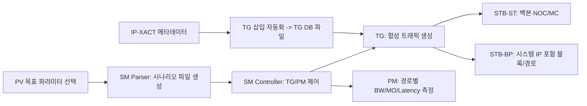

<!-- generated by yt-paper; edits will be overwritten -->

# Synthetic Traffic based SOC Performance Verification Methodology

[:material-open-in-new: 원문 보기](https://dvcon-proceedings.org/wp-content/uploads/1063-1.pdf){ .md-button .md-button--primary target=_blank }

> RTL 확정 전 에뮬레이션에서 Traffic Generator 기반 합성 트래픽(STB-ST/STB-BP)으로 SOC 버스·메모리 성능 버그를 조기에 걸러내, 실제 IP 기반 RTB-PV 이전에 대부분 수정할 수 있게 한 방법론.

| 항목 | 내용 |
|---|---|
| 저자/출처 | Jeonggu Lee, Taewon Park, Hyungtae Park, Taeyoung Jeon, Hyunjae Woo, Youngsik Kim, Seonil Brian Choi (Samsung Electronics Co., LTD.). 원문에 발표 학회명은 명시되지 않음 (참고문헌에 DAC, DVCon 발표 논문이 인용됨) |
| 유형 | PAPER |
| 카테고리 | Verification |
| ID | `ref-20261018-c74a` |

## 핵심 인사이트

- RTB-PV(실제 IP 기반)는 RTL 성숙 이후에야 가능하고 시나리오 준비에 1개월 이상 걸려, 발견된 성능 버그가 RTL freeze 이전에 수정되지 못해 silicon re-spin으로 이어질 수 있다. 버스 토폴로지와 메모리 서브시스템을 프로젝트 초기에 검증하는 것이 핵심이다.
- 에뮬레이터-호스트 간 PCIe 통신은 대역폭보다 transaction당 latency 오버헤드가 병목이다. 따라서 HW 버퍼에 트랜잭션을 모아 한 번에 전송하고, raw data 대신 HW에서 계산한 결과만 전송하는 설계가 필수적이다.
- 평균 BW만 맞는 트래픽은 성능 문제를 드러내지 못한다. 실제 IP의 시간적 트래픽 패턴과 address trace를 재생(replay)하는 TG가 있어야 MMU 등 주소 민감 블록의 성능 버그를 찾을 수 있다.
- IP-XACT 메타데이터 기반 자동화로 TG 삽입 및 시나리오 생성 시간을 대폭 줄여(원문 기준 16시간 → 20분) 수작업 오류를 줄이고 검증 커버리지를 크게 늘렸다(원문 기준 최대 50 → 4150 시나리오).
- STB-ST(NOC/메모리 컨트롤러 백본)와 STB-BP(SysMMU, up/down sizer 등 시스템 IP 포함 경로 전체)를 단계적으로 적용해, 버스 토폴로지가 바뀌면 영향이 큰 백본을 먼저 안정화하는 흐름이 실무적으로 유효하다.

## 상세 요약

### 배경 및 문제 정의

- SOC 유스케이스는 20개 이상의 기능 IP(CPU/GPU/NPU/CAM/DPU 등)가 상호작용하는 형태로 복잡해지고 있으며, IP 하나라도 성능을 만족하지 못하면 시나리오 다운그레이드, spec-out, 또는 silicon re-spin이 발생할 수 있다.
- 기존 성능 검증은 실제 RTL IP를 동작시키는 **RTB-PV(Real Traffic based)** 에 의존한다. 하지만 RTB-PV는 RTL이 성숙한 뒤에야 가능하고, 20여 개 IP의 시나리오를 준비하는 데 한 달 이상이 걸린다. 그 결과 RTL freeze 직전에 발견된 버그는 제때 수정되지 못한다.
- 버스 토폴로지와 메모리 서브시스템은 변경 시 다른 IP 전반에 영향을 주므로 프로젝트 초기에 안정화·검증되어야 한다. 그러나 RTB-PV는 모든 corner case를 커버할 수 없고, 주요 worst-case 시나리오만 검증 가능하다.
- 이를 해결하기 위해 저자들은 2018년 말 **STB(Synthetic Traffic based)-PV**를 도입했다. 초기 STB는 DRAM utilization만 측정했고, TG 동작 자체가 wall-clock 시간을 늘려 느렸다. 이에 실제 트래픽을 모사하는 TG 강화와 PV 워크플로우 개선이 필요했다.

### 핵심 아키텍처 및 방법론

전체 흐름은 다음과 같다.

**1. TG/PM 구조 (HW/SW 분리)**
- SW 파트는 호스트에서 동작하며 TG 설정 입력과 성능 요약 출력을 담당한다. HW 파트는 에뮬레이터에서 트래픽 생성(TG)과 성능 계산(PM)을 수행한다. 둘은 DPI 인터페이스로 통신한다.
- 통신 횟수가 성능을 좌우한다. 저자들은 PCIe 대역폭(최대 32GB/s)은 병목이 아니지만 transaction당 latency(사양 5~7µs, 실제 최선 약 14µs)가 문제라고 분석했다. 원문 예시에서 4B read를 1G회 하면 7시간 이상, 64B read로 바꾸면 약 10분이 걸린다고 한다. 따라서 HW 버퍼에 여러 transaction을 모아 전송하고, HW에서 결과만 계산해 전송한다.
- PM은 프레임 단위(예: 1ms)로 BW, MO, latency의 average/min/max를 계산해 DPI 호출 빈도를 줄인다.
- TG는 frequency, target BW, burst length, address pattern 등을 설정할 수 있으며, 기존의 평균 BW 트래픽 대신 시간적 변화가 있는 다양한 패턴을 지원한다. 또한 실제 트래픽에서 추출한 address trace를 재생하는 replay 기능을 제공하여 MMU, LLC처럼 주소 패턴에 민감한 IP를 검증한다.

**2. SM(Scenario Manager)**
- synthesizable SystemVerilog와 DPI로 구현된다. SM Parser는 BW, address pattern, burst length/size, QoS 등 사용자 제약을 받아 scenario descriptor 파일을 자동 생성한다. SM Controller는 descriptor를 바탕으로 모든 TG/PM을 제어하고 상태를 모니터링하며, 각 PM은 scenario index별로 성능 데이터를 분리 저장한다.

**3. IP-XACT 기반 TG 삽입 자동화**
- 검증 대상 목록을 입력받아 설계에서 TG 부착 지점을 찾고, IP-XACT 메타데이터에서 신호 정보를 얻어 TG DB 파일을 생성한다. IP-XACT는 전체 설계보다 데이터량이 작아 파싱 시간이 짧다. 생성된 DB 파일은 에뮬레이션 이미지 빌드에 사용된다.

**4. STB-ST (Stress Test)**
- 대상: NOC 버스와 메모리 컨트롤러 등 백본. 여러 TG로 시나리오에 맞는 트래픽 조합을 만든다.
- 확인 항목: 목표 BW, non-real-time IP의 BW, latency, DRAM utilization, real-time IP(디스플레이, 카메라)의 보장 성능, 그리고 QoS 동작(우선순위 조정, urgent 이벤트) 적합성.

**5. STB-BP (Bus Performance)**
- 대상: 기능 IP의 AXI master 포트에 TG를 붙이고, SysMMU, up/down sizer, 로컬 버스 등 시스템 IP를 포함해 DRAM까지 경로 전체를 검사한다. 시스템 IP는 MO, 버퍼, BW 부족, 긴 latency로 성능을 막을 수 있는데, 이는 기능 수정이나 metal ECO로 고치기 어려우므로 초기에 검증해야 한다.
- 확인 항목: 경로별 목표 BW, latency 요구사항, AXI MO 소진 여부, MMU hit rate(replay 사용 시).

### 실험 결과 및 결론

**정확도 (Figure 9, STB-ST 결과)**
- 각 IP에 대해 RTL과 Model의 BW를 비교하고 RTL/Model 비율을 Pass/Fail로 판정한다. 대부분 97.6~100%로 Pass이며, 원문은 BW, latency, MO 지표에서 오차 5% 미만이라고 설명한다.
- 두 IP에서 RTL/Model이 82.0%로 Fail이 나왔고, 원인은 **ARQ buffer 크기 버그**로 보고되었다. 또한 clock gating에 의한 긴 latency 문제도 발견되었다. 저자들은 이런 버그가 RTL과 Model 비교 없이는 발견하기 어려웠다고 주장한다.

**검증 커버리지와 효율 (Figure 10)**

| 항목 | 기존(수작업) | 현재(IP-XACT+자동화) | 차이 |
|---|---|---|---|
| TG automation | 8시간 | 10분 | 약 98% 감소 |
| 시나리오 생성 | 8시간 | 10분 | 약 98% 감소 |
| 총 소요 시간 | 16시간 | 20분 | 약 98% 감소 |
| 시나리오 수 | 최대 50 | 4150 | 83배 |

※ 위 수치는 원문 Figure 10에 기재된 값이다.

**결론**
- 방법론은 플래그십 모바일 AP SOC 프로젝트에 적용되었다. RTL freeze 이전에 STB-ST/STB-BP로 2000개 이상의 시나리오 실험을 완료했고, RTB-PV 시작 전 거의 모든 시스템 성능 버그가 수정되었다고 보고한다. 자동화 플로우로 400개의 TG/PM을 에뮬레이션 플랫폼에 삽입하고 2000개 시나리오를 일정에 맞춰 실행·분석했다.
- 향후 과제는 실제 시나리오를 더 현실적으로 모사하는 TG 개선이다.

**검토 시 유의점 (원문 기준)**
- 원문은 4GB 데이터를 4B read 1G회로 전송할 때 "7시간 이상"이라고 하지만, 4B transaction을 14µs로 계산하면 약 3.9시간이다. 측정 조건 차이로 보이나 원문에 설명이 없어 수치를 그대로 인용할 때 주의가 필요하다.
- 정확도 평가는 RTL과 Model 비교 기반이며, 대상 IP와 시나리오 수, 공개된 지표 범위가 제한적이다. 일반화 가능성은 원문만으로 판단하기 어렵다.

## 관련 영상

<iframe src="https://www.youtube-nocookie.com/embed/BCdN7iCwOqU" title="[DVCON2024]Synthetic Traffic based SOC Performance Verification Methodology" loading="lazy" allow="accelerometer; clipboard-write; encrypted-media; gyroscope; picture-in-picture; web-share" referrerpolicy="strict-origin-when-cross-origin" allowfullscreen></iframe>

**[DVCON2024]Synthetic Traffic based SOC Performance Verification Methodology** — [YouTube에서 보기](https://www.youtube.com/watch?v=BCdN7iCwOqU) · [영상 페이지](../../videos/BCdN7iCwOqU.md)
