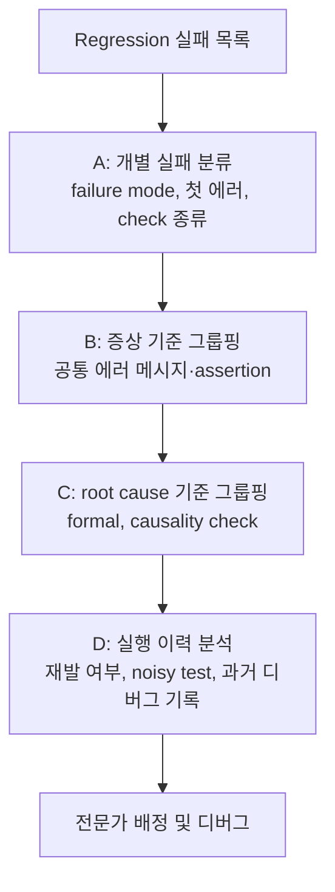

<!-- generated by yt-paper; edits will be overwritten -->

# Evolution of Triage: Real-time Improvements in Debug Productivity

[:material-open-in-new: 원문 보기](https://dvcon-proceedings.org/wp-content/uploads/evolution-of-triage-real-time-improvements-in-debug-productivity.pdf){ .md-button .md-button--primary target=_blank }

> 반도체 regression 실패를 triage(분류·우선순위·담당자 배정)하는 과정을 4가지 유형으로 체계화하고, 실패 그룹핑과 이력 분석으로 debug 생산성을 높이는 기법을 정리한 논문이다.

| 항목 | 내용 |
|---|---|
| 저자/출처 | Gordon Allan (Mentor Graphics Corporation, Fremont, California; gordon_allan@mentor.com) — 학회/출처 명시 없음 |
| 유형 | PAPER |
| 카테고리 | Verification |
| ID | `ref-20261018-ca4e` |

## 핵심 인사이트

- Triage는 도구만으로 완전 자동화하기 어렵고, 데이터 수집·그룹핑·리포팅은 도구가 돕되 최종 판단은 경험 있는 엔지니어가 해야 한다는 것이 저자의 핵심 주장이다.
- 실패 분석의 첫 단계는 첫 번째(earliest) 에러 메시지를 기준으로 failure mode를 분류하는 것이며, 후속 에러는 root cause에서 멀어져 있어 보통 무시한다.
- UVM 등 구조화된 에러 메시지와 assertion을 사용하면 메시지 기반의 프로그램적 그룹핑이 가능해지고, assertion은 신호 위치와 시간을 정확히 알려준다는 장점이 있다.
- 여러 실패 증상이 하나의 root cause에서 비롯될 수 있으므로, symptom signature가 아닌 root cause signature 기준으로 묶으면 한 번에 많은 실패를 해결할 수 있다(causality check 등 활용).
- 테스트의 실행 이력(run history)을 보면 해당 실패가 새로운 회귀인지, 취약한(brittle) 테스트인지, 과거에 누가 어떻게 디버그했는지 판단할 수 있어 담당자 배정의 정확도가 높아진다.

## 상세 요약

### 배경 및 문제 정의

- 대규모 SoC 검증에서 regression 한 번에 수백~수천 건의 실패가 발생하며, 이를 개별적으로 디버그하면 시간과 자원이 낭비된다.
- 저자는 업계 데이터를 인용해 엔지니어링 시간의 약 40%가 디버그에 쓰이며, triage는 각 디버그의 초기 20~50%를 차지한다고 추정한다(저자 추정치).
- 의료 triage와 달리 설계 검증의 실패는 반복성과 그룹핑 가능성이 있으므로, 이력과 공통성을 활용하면 효율을 높일 수 있다.
- 문서는 triage를 "공통 기원을 가진 이슈 집합을 분석하고, 우선순위와 분석 방법을 정해 가장 효과적으로 자원을 쓰는 과정"으로 정의한다.

### 핵심 아키텍처 및 방법론

triage의 유형을 네 가지로 나눈다.

- **A. 단일 실패 테스트 분류**: 실패 하나를 RTL/GLS 버그, 테스트환경 버그(false negative), 펌웨어/SW 버그, 스펙 모호성 중 하나로 분류한다.
- **B. 이력 기반 분석**: 과거 실패 시점과 반복 패턴을 보고 장기 개선안을 도출한다.
- **C. 다중 실패 분석**: regression에서 자원 집중과 우선순위를 결정한다. 가장 흔한 형태다.
- **D. 시스템적 실패 식별**: 프로젝트 간 공통 root cause를 찾아 프로세스와 검증 환경을 개선한다.

주요 기법은 다음과 같다.

1. **개별 실패 분류(A)**: failure mode(build-time/run-time, testbench timeout, golden-reference mismatch 등)를 구분한다. 로그에서 첫 번째 에러 메시지와 어떤 check(designer assertion, env assertion, scoreboard, protocol check)가 실패시켰는지 기록한다.
2. **N개 실패의 공통 증상 분석(B)**: 첫 번째 에러 메시지가 여러 테스트에서 같은지 비교하고, 난수 등 무관한 부분은 필터링하여 유연하게 비교한다. 같은 assertion이 여러 실행에서 언제 발생했는지도 본다. 증상 기준으로 묶은 뒤 각 bin에서 대표 1건을 (A) 방식으로 분류한다.
3. **N개 실패의 공통 root cause 분석(C)**: 증상은 멀리 떨어져 있을 수 있으므로 root cause 기준으로 묶는다. 두 가지 방법을 제시한다.
   - formal 도구로 실패 지점 주변 영역을 분석해 공통 설계 규칙 위반을 찾는다.
   - debug 도구의 causality check를 사용한다. 신호 이름과 시뮬레이션 시각만 주면 fan-in cone을 시간 역순으로 추적해 root cause 신호와 값을 얻는다.
4. **단일 테스트의 실행 이력 분석(D)**: 같은 테스트(같은 seed/config)의 과거 실행 결과로 정상 상태를 정의하고, 다음을 판단한다.
   - 실패 모드가 과거에 있었는지, 이번이 새로운 회귀인지, 테스트가 취약한 것인지
   - 지속 실패인지 간헐적 실패인지(Noisy Test 여부)
   - 과거 디버그 세션의 기록과 root cause
   - 해당 유형을 과거에 디버그한 담당자

최종 목표는 실패 테스트를 적합한 전문가에게 배정하는 것이다. 배정 기준은 필요한 전문성, 과거 경험, 프로젝트에 대한 중요도다.

문서는 도구의 역할을 다음과 같이 정리한다. 도구는 데이터 수집, 리포팅, 초기 분석을 도울 수 있고, 최종 판단은 사람이 한다. 또한 triage 결과를 다음 엔지니어에게 전달할 때 판단 근거를 명확히 적는 것이 중요하다.

### 실험 결과 및 결론

이 문서는 정량적 실험이나 벤치마크 결과를 제시하지 않는다. 주장은 여러 SoC 프로젝트에서 관찰된 경험에 근거한다. 문서에 나오는 수치(40% 디버그 시간, triage 20~50%)는 업계 데이터 또는 저자 추정이며, 측정 방법은 설명되지 않는다.

결론은 다음과 같다.

- 현재 시점에서 네 가지 triage 유형을 모두 자동화한 도구는 존재하지 않는다. 도구는 보조 역할에 머문다.
- 실패의 증상 그룹핑과 root cause 그룹핑, 실행 이력 데이터를 잘 축적하면 디버그 생산성을 높일 수 있다.
- 구조화된 에러 메시지, 명확한 assertion, 그리고 이력 데이터베이스가 triage 효율의 기반이다.

문서 본문에는 Type C/D를 위한 Results Analysis 도구, 빅데이터 기반 이상 탐지 등 개념적 언급이 있으나, 구체적 알고리즘 평가나 구현 결과는 포함되어 있지 않다. 또한 본문 일부 섹션 번호(VI, V, VIII)와 본문 내 'Figure 4~7'의 세부 내용은 원문 텍스트 추출 과정에서 일부 누락되었을 수 있다.

## 관련 영상

<iframe src="https://www.youtube-nocookie.com/embed/Ck6qeC80QMs" title="[DVCON2016] Evolution of Triage Real time Improvements in Debug Productivity" loading="lazy" allow="accelerometer; clipboard-write; encrypted-media; gyroscope; picture-in-picture; web-share" referrerpolicy="strict-origin-when-cross-origin" allowfullscreen></iframe>

**[DVCON2016] Evolution of Triage Real time Improvements in Debug Productivity** — [YouTube에서 보기](https://www.youtube.com/watch?v=Ck6qeC80QMs) · [영상 페이지](../../videos/Ck6qeC80QMs.md)
