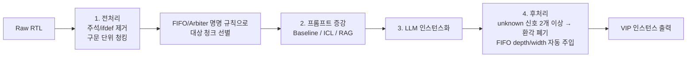

<!-- generated by yt-paper; edits will be overwritten -->

# Towards Automated Verification IP Instantiation via LLMs

[:material-open-in-new: 원문 보기](https://dvcon-proceedings.org/wp-content/uploads/1016-2.pdf){ .md-button .md-button--primary target=_blank }

> FIFO/Arbiter VIP 인스턴스화를 RTL 청킹 + RAG + 후처리 파이프라인으로 자동화하며, Llama-3-70b+RAG가 ICL/Baseline보다 크게 높은 정확도를 보였지만 평가 규모가 작음(FIFO 7개, Arbiter 12개 인스턴스).

| 항목 | 내용 |
|---|---|
| 저자/출처 | Ghaith Bany Hamad, Michael Marcotte, Syed Suhaib (Nvidia Corp., Santa Clara, USA). 학회명은 문서에 명시되지 않음 |
| 유형 | PAPER |
| 카테고리 | Verification |
| ID | `ref-20261018-ccb0` |

## 핵심 인사이트

- RAG의 가치는 모델 파인튜닝 없이 VIP 문서·예제 벡터DB를 추가하는 것만으로 도메인 지식을 주입할 수 있다는 점이다. 새 VIP는 DB 항목 추가로 확장 가능하다는 설계 장점이 있다.
- 대형 RTL을 LLM 컨텍스트 창에 맞추는 전처리(주석/ifdef 제거, 구문 단위 무중첩 청킹)와 FIFO·Arbiter 명명 규칙 기반 청크 선별이 실용적 런타임 최적화의 핵심이다. 다만 선별 규칙이 오탐(false positive)을 만들 수 있다.
- 후처리에서 LLM이 unknown으로 표시한 신호가 2개 이상이면 환각으로 간주해 버리는 휴리스틱을 사용한다. 이 임계값의 근거와 민감도는 문서에서 충분히 검증되지 않았다.
- 결과 표의 샘플 규모(FIFO 7, Arbiter 12 인스턴스)와 단일 DUT 계열 실험으로는 일반화 성능을 판단하기 어렵다. 'Correct'의 정의는 '모든 신호가 맞는 완전한 인스턴스'로 엄격하다.
- 문서 내 모델 표기가 일관되지 않다(본문은 ICL 베이스라인이 Llama 계열 내부 파인튜닝 모델이라 하고, 표는 chipmixtral_8x7b로 표기). 재현 시 모델 구성을 명확히 확인해야 한다.

## 상세 요약

### 배경 및 문제 정의

- 포멀 검증(FV)은 ASIC 설계 시간의 평균 56%를 차지하는 것으로 문서에 인용되며, 테스트벤치와 보조 collateral을 전문가가 수작업으로 만들어야 해서 확장성이 떨어진다.
- VIP(Verification IP)는 자주 쓰이는 체커를 패키징한 재사용 자산이지만, 일정 압박과 최적 사용법에 대한 전문성 부족으로 설계자가 배포하기 어렵다. 이로 인해 지연과 버그 누락 위험이 생긴다.
- 기존 LLM 기반 assertion 생성 연구([11], [12] 등)는 품질이 사람 수준에 못 미쳐 FV 팀에서 실사용하기 어렵다는 한계가 있다. 저자들은 assertion 생성 대신 **VIP 인스턴스화**라는 상대적으로 덜 탐구된 과제에 LLM을 에이전트로 적용한다.
- 범용 LLM은 VIP 관련 사전학습 데이터가 부족하고, 파인튜닝은 데이터 생성과 학습에 수 주가 걸리고 비용이 크다. 또한 Llama2는 2048 토큰 컨텍스트 창을 가지므로 대형 RTL 파일을 통째로 넣을 수 없다.

### 핵심 아키텍처 및 방법론

전체 흐름은 4단계(전처리 → 프롬프트 증강 → LLM 인스턴스화 → 후처리)로 구성된다.

**1) RTL 전처리**
- 결정론적 알고리즘으로 주석, `ifdef`/`ifndef`, `defines`/`includes` 관련 선언, 빈 줄 등 VIP 인스턴스화와 무관한 요소를 제거한다.
- 독자적 알고리즘으로 코드를 최대 토큰 수 이하의 파티션으로 재귀 분할한다. 파티션은 구문적으로 완전해야 하며 중첩이 없고 전체 파일을 덮는다.
- 청크 선별: FIFO·Arbiter 인스턴스 이름 규칙을 이용해 해당 모듈이 있을 법한 청크만 처리해 런타임을 줄인다. 저자들은 수십만 라인 규모 파일에서 전수 처리 시 추론 시간이 수 시간이 된다고 언급한다. 선별 과정에서 오탐이 생길 수 있으며, 이는 후처리에서 걸러진다고 설명한다.

**2) 프롬프트 증강 (세 가지 비교 조건)**
- **Baseline**: 코드 파티션만 입력한다.
- **ICL**: FIFO/Arbiter별 전문가 규칙셋과 모듈별 one-shot 인스턴스 예제를 추가한다.
- **RAG**: 내부 FV 문서, 모듈 코드–VIP 인스턴스 쌍 예제를 벡터DB에 저장하고, 질의 시 관련 청크를 검색해 프롬프트에 덧붙인다. 규칙셋은 ICL과 동일하게 적용된다.

**3) LLM 인스턴스화**
- 신호가 청크에 없으면 `unknown`으로 표시하도록 지시한다.
- Baseline/ICL은 내부 코드 문서 및 Verilog로 파인튜닝된 Llama 계열 모델을 사용한다고 본문에 기술되어 있다. RAG는 오픈소스 Llama3-70b-instruct 엔드포인트를 사용하여, 도메인 파인튜닝 없이도 정확한 인스턴스화가 가능함을 보이려 했다.

**4) 후처리**
- `unknown` 신호가 2개 이상이면 환각으로 판단해 폐기한다(드문 예외에서는 엔지니어가 수동 확인).
- FIFO의 depth·data width처럼 코드에 없을 수 있는 필수 파라미터는 소스 모듈에서 자동 추출해 주입한다.
- 최종 결과를 파일로 집계한다.

**아키텍처상 주요 특징**: 이 방법은 모델 가중치를 바꾸지 않고 DB 항목만 추가하면 새로운 VIP 지식을 넣을 수 있다. 저자들은 전처리 드라이버 함수에 규칙을 추가하는 방식으로 임의의 VIP로 확장 가능하다고 주장하지만, 실제 검증된 VIP는 FIFO와 Arbiter 두 가지뿐이다.

### 실험 결과 및 결론

Table I 결과 (Correct = 모든 신호가 올바른 완전 인스턴스, Incorrect = 신호 누락/오류, Missing = 인스턴스 누락):

| VIP | 모델 | 증강 | Correct | Incorrect | Missing | Total |
|---|---|---|---|---|---|---|
| assert_vip_fifo | chipmixtral_8x7b | Baseline | 0 | 0 | 7 | 7 |
| assert_vip_fifo | chipmixtral_8x7b | ICL | 4 | 1 | 2 | 7 |
| assert_vip_fifo | Llama-3-70b | RAG | 7 | 0 | 0 | 7 |
| assert_vip_arb | chipmixtral_8x7b | Baseline | 0 | 0 | 12 | 12 |
| assert_vip_arb | chipmixtral_8x7b | ICL | 1 | 4 | 7 | 12 |
| assert_vip_arb | Llama-3-70b | RAG | 11 | 1 | 0 | 12 |

**주요 관찰**
- Baseline은 두 VIP 모두 정답을 하나도 만들지 못했다. 단순 코드 입력만으로는 부족하다는 것을 보여준다.
- ICL은 FIFO에서 어느 정도 개선되었지만 Arbiter에서는 일관성이 떨어졌다(Correct 1, Missing 7).
- RAG(Llama-3-70b)는 FIFO 7/7, Arbiter 12개 중 11개 정답으로 가장 높았다. 저자들은 이를 근거로 RAG가 파인튜닝 모델보다 더 나은 효율을 보인다고 주장한다.

**한계 및 해석 시 유의점**
- 평가 규모가 매우 작다(FIFO 7, Arbiter 12 인스턴스). 여러 DUT에서 수행되었다고 서술되어 있으나 DUT별 세부 분해는 제시되지 않았다. 통계적 신뢰구간이나 반복 실험 결과도 없다.
- 오탐 필터(unknown 2개 이상)의 임계값 근거나 민감도 분석이 없다.
- Table I 표기의 모델명(chipmixtral)과 본문의 "내부 파인튜닝 Llama" 서술이 일치하지 않는다.
- 결과 표의 정답 기준이 엄격하지만 비교 실험에서 후처리가 모든 조건에 동일하게 적용되었는지 명시되지 않았다.
- 본문에 Llama2 2048 토큰 제한이 언급되지만, RAG 실험에 사용된 Llama3-70b의 컨텍스트 길이와 청크 크기 설정은 문서에 제시되지 않았다.

**결론**: 저자들은 RAG 기반 프롬프트 증강이 RTL 해석의 견고성을 높이고, 구문·논리적으로 타당한 VIP 인스턴스를 생성한다고 결론짓는다. 다만 본 문서의 증거는 소규모 FIFO/Arbiter 사례에 한정되므로, 실무 적용을 위해서는 더 많은 VIP 종류와 DUT에서의 재현 및 오탐/미탐 정량 평가가 필요하다.

## 관련 영상

<iframe src="https://www.youtube-nocookie.com/embed/-yYSOj4vjM8" title="[DVCON2025]Towards Automated Verification IP Instantiation via LLMs" loading="lazy" allow="accelerometer; clipboard-write; encrypted-media; gyroscope; picture-in-picture; web-share" referrerpolicy="strict-origin-when-cross-origin" allowfullscreen></iframe>

**[DVCON2025]Towards Automated Verification IP Instantiation via LLMs** — [YouTube에서 보기](https://www.youtube.com/watch?v=-yYSOj4vjM8) · [영상 페이지](../../videos/-yYSOj4vjM8.md)
