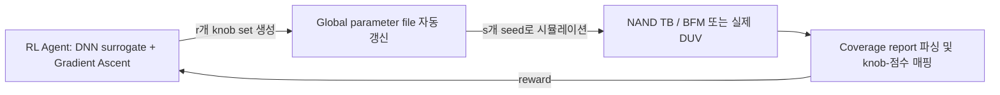

<!-- generated by yt-paper; edits will be overwritten -->

# Stimulus Diversification and Coverage Closure of 3D NAND Flash with Artificial Intelligence

[:material-open-in-new: 원문 보기](https://dvcon-proceedings.org/wp-content/uploads/1063-2.pdf){ .md-button .md-button--primary target=_blank }

> DNN 기반 강화학습 에이전트가 테스트벤치 knob 설정과 coverage 점수의 관계를 학습하고 gradient ascent로 최적 knob을 찾아 3D NAND 검증의 coverage closure를 가속하는 방법으로, proof-of-concept에서 동일 시뮬레이션 수 대비 약 2% 높은 coverage 또는 38% 적은 시뮬레이션으로 같은 coverage를 보고했다.

| 항목 | 내용 |
|---|---|
| 저자/출처 | Goutham Pallela, Peiyao Shi, Srinivas Deshmukh, Vaishnavi Venkatesh (Micron Technology, Inc.), Bill Hughes, Rohit Suvarna, Sandeep Srinivasan (VerifAI Inc.). 학회/출처는 원문에 명시되지 않음 (논문 형식 프리프린트로 보임) |
| 유형 | PAPER |
| 카테고리 | Verification |
| ID | `ref-20261018-cee6` |

## 핵심 인사이트

- 핵심 구조는 'knob → 시뮬레이션 → coverage DB → 파싱 → DNN surrogate → gradient ascent로 knob 갱신'의 폐루프이며, RL 에이전트가 실제 DUV 없이 BFM/블랙박스 모델로 반복 학습할 수 있다는 점이 시뮬레이션 비용 절감의 핵심 설계 포인트다.
- 보상(reward)을 절대 coverage가 아닌 '기존 대비 새로 hit한 bin 수'(relative coverage)로 설계하고, cover group별로 에이전트를 병렬 학습시키는 방식을 제안했다. 보상 설계가 성능을 좌우하므로 DV 엔지니어의 통제가 필수라고 명시한다.
- 수동 knob 튜닝이 전체 검증 주기의 10~20%를 차지하고 수 주가 걸린다는 문제 인식은 실무적으로 공감되는 지점이지만, 논문의 정량 결과는 단일 proof-of-concept 프로젝트의 ~2% coverage 향상과 38% 시뮬레이션 절감에 그쳐 일반화 근거는 제한적이다.
- gradient ascent 페널티 식 P(X)=Σ(Xi−1)²는 본문이 설명하는 '변수 합이 1이 되도록 하는 제약'과 일치하지 않는다(각 성분을 1에 맞추는 형태). 구현 시 제약 정의를 다시 확인해야 한다.
- 최종 knob 선택 시 마지막 iteration이 아닌 coverage가 가장 높았던 iteration의 설정을 수동으로 골라 실제 DUV에 적용한다는 점은 학습 불안정성을 보여주며, 자동화 파이프라인 설계 시 고려할 부분이다.

## 상세 요약

### 배경 및 문제 정의

3D NAND Flash 설계는 성능 요구가 높아지면서 복잡도가 급증하고, tape-out 전 full-chip 기능 검증과 coverage 목표 달성이 큰 부담이 되고 있다. 저자들이 제시한 현황은 다음과 같다.

- 검증 방식: 업계 표준인 coverage-driven constrained random verification(SystemVerilog 기반)을 사용한다.
- 규모: 현재 NAND 테스트벤치는 약 **500k bin**을 random sequence로 채워야 하며, cover point 교차(cross)로 bin 수가 지수적으로 증가한다.
- 수작업 병목: 수백 개의 knob(SV parameter)을 엔지니어가 판단으로 조정하고 targeted regression을 반복한다. knob 간 상호작용과 knob-to-coverage 상관관계가 복잡해 결과가 불확실하며, 이 과정이 수 주 걸리고 전체 검증 주기의 **10~20%**를 차지한다.
- 최종 tape-out 넷리스트에서는 coverage가 0으로 리셋되어 마감 직전 closure가 더 어려워진다.

목표는 ML로 knob 설정을 자동 탐색해 적은 검증 사이클로 coverage를 최대화하고, 엔지니어가 더 깊은 검증 범위 확장에 시간을 쓰도록 하는 것이다.

### 핵심 아키텍처 및 방법론

전체 흐름은 다음과 같이 요약된다.

**1. 필요 조건 (4가지)**
- stimulus 제어 knob (SV parameter, plusargs, UVM cmdline processor 활용)
- DUV의 블랙박스 모델 (BFM 또는 행동 모델)
- coverage DB에서 RL 에이전트로 가는 피드백 경로
- RL 에이전트

**2. Knob 제어 예시**: `MODE_X_EN`, `MODE_Y_EN`, `MODE_Z_EN` 가중치 파라미터로 `mode` 분포를 제어한다. 특정 모드를 집중 검증하려면 나머지 가중치를 0으로 설정한다. knob은 전역 파일로 옮겨 자동 갱신한다.

**3. 보상(reward) 설계**: 절대 coverage 점수 또는 기존 hit coverage 대비 상대 coverage 중 선택한다. 저자들은 새로 hit된 bin 수를 늘리는 상대 보상이 더 효과적이라고 본다. cover group별로 독립 에이전트를 병렬 학습시킬 수 있다.

**4. RL 에이전트 (VerifAI 개발)**: 입력 knob X(연속 범위 또는 열거형)와 출력 reward Y를 가진 DNN을 맞춘 뒤, 출력에 대한 입력의 gradient로 knob을 갱신한다. 넓은 네트워크, batch normalization, Leaky ReLU, 'dist-perturbation' 기법을 언급한다.

Gradient ascent 갱신식은 다음과 같다.

$$\theta^{(t+1)} = \theta^{(t)} + \eta \nabla f(\theta^{(t)})$$

제약은 페널티 항으로 처리하며, 최소화 형태의 손실은 다음과 같다.

$$L(X) = -f(X) + \lambda \cdot P(X), \quad P(X) = \sum_{i=1}^{n}(X_i - 1)^2$$

여기서 $f(X)$는 모델 예측, $\lambda$는 페널티 가중치다. 다만 본문은 $P(X)$를 "변수 합이 1이 되도록 하는 페널티"로 설명하지만, 수식은 성분별 편차 제곱합이어서 두 설명이 정확히 일치하지 않는다.

**5. 학습 절차 (n iteration)**
1. 모델이 r개의 고유 knob set을 생성한다.
2. 각 knob set에 대해 s개의 시뮬레이션을 돌리고 coverage를 누적한다.
3. knob set을 다양성(hit한 bin의 수 등)으로 순위화하여 reward로 피드백한다.
4. 에이전트가 신경망을 갱신하고 다음 knob set을 생성한다.
5. 전 iteration 종료 후 coverage가 가장 높았던 knob set을 수동으로 골라 실제 DUV 회귀에 사용한다. 마지막 iteration이 최고가 아닐 수 있기 때문이다.

TB가 프로젝트 중 계속 바뀌므로 에이전트는 새 knob과 bin이 추가될 때마다 주기적으로 재학습해야 한다. 실제 DUV 대신 BFM을 쓰면 라이선스와 연산 비용도 줄어든다.

**6. 안전장치**: 엔지니어가 reward를 신중히 정의하고, 실제 DUV 적용 전 knob 설정과 coverage 점수를 검토해야 한다고 강조한다. 저자들은 전면 실패 가능성을 "거의 0"이라고 주장하지만 근거는 제시하지 않는다. 최악의 경우에도 기존 수동 설정과 다른 고유한 knob 조합을 만들어 corner bug를 찾을 수 있다고 주장한다.

### 실험 결과 및 결론

결과는 한 개의 진행 중인 **proof-of-concept 프로젝트**의 학습 iteration에서 나왔다. 그림 7(coverage ramp 비교)이 핵심 결과이나, 본문 텍스트만으로는 절대 수치와 기준선(baseline) 상세를 확인할 수 없다.

- 동일한 **1000회 시뮬레이션**에서 coverage가 약 **2%** 더 높다.
- 동일한 coverage 도달에 필요한 시뮬레이션 수가 **38%** 적다.

저자들은 이 결과를 수동 노력 대비 유망하다고 평가하고, 향후 과제로 다음을 제시한다.
- 보상 지표 미세 조정
- 'r'(고유 knob set 수)과 's'(set당 seed 수)의 최적 균형 탐색
- 학습 iteration을 줄이기 위한 고급 RL 알고리즘 적용

결론적으로 이 작업은 기존 DV 흐름에 통합된 자동화 RL 프레임워크를 제안하며, 향후 NAND 제품 검증에 확장 배포할 계획이라고 밝힌다. 다만 정량 근거가 단일 프로젝트 수준이고, 기준선 세부와 통계적 반복 실험이 제시되지 않아 일반화 가능성은 추가 검증이 필요하다.

## 관련 영상

<iframe src="https://www.youtube-nocookie.com/embed/WfdqMw4b1bo" title="[DVCON2025]Stimulus Diversification and Coverage Closure of 3D NAND Flash Artificial Intelligence" loading="lazy" allow="accelerometer; clipboard-write; encrypted-media; gyroscope; picture-in-picture; web-share" referrerpolicy="strict-origin-when-cross-origin" allowfullscreen></iframe>

**[DVCON2025]Stimulus Diversification and Coverage Closure of 3D NAND Flash Artificial Intelligence** — [YouTube에서 보기](https://www.youtube.com/watch?v=WfdqMw4b1bo) · [영상 페이지](../../videos/WfdqMw4b1bo.md)
