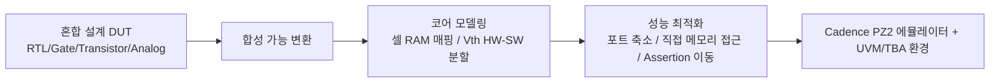

<!-- generated by yt-paper; edits will be overwritten -->

# Accelerated Verification of NAND Flash Memory using HW Emulator

[:material-open-in-new: 원문 보기](https://dvcon-proceedings.org/wp-content/uploads/1090-Accelerated-Verification-of-NAND-Flash-Memory-using-HW-Emulator.pdf){ .md-button .md-button--primary target=_blank }

> NAND Flash 혼합 설계(RTL·트랜지스터·아날로그 모델)를 Cadence PZ2 에뮬레이터용으로 합성 가능하게 변환하고 포트 축소·직접 메모리 접근 등을 적용해 5,000 케이스 기준 시뮬레이션 대비 약 101배 빠른 실행 시간을 달성한 사례.

| 항목 | 내용 |
|---|---|
| 저자/출처 | Seyeol Yang, Byungwoo Kang, Seoyeon Bae, Choi Jaehyeon, Jintae Kim, Dongeun Lee, Junho Ahn (Samsung Electronics, Hwaseong-si, Korea) |
| 유형 | PAPER |
| 카테고리 | Verification |
| ID | `ref-20261018-cf3b` |

## 핵심 인사이트

- 에뮬레이터는 tranif0/1, # 지연, 다중 드라이버, non-synthesizable 행동 모델을 지원하지 않으므로 nmos/pmos 변환, 양방향 포트의 단방향 분리(D-FF 활용), 지연을 카운터로 대체하는 등 사전 합성 가능화 작업이 필수적이다.
- 100G바이트 이상의 메모리 셀 배열은 합성 대신 에뮬레이터 내장 RAM으로 매핑해 로직 크기를 줄였고, Vth 모델은 HW/SW 분할(인덱스 기반 읽기/쓰기)로 처리했다.
- 시뮬레이터-에뮬레이터 간 통신 병목은 포트 수에 비례하므로, 동작 옵션 신호를 강제(forcing) 노드로 바꾸고 assertion을 DUT 내부로 옮기는 것이 성능에 직접적인 영향을 준다(약 5배 개선 보고).
- 메모리 직접 접근(direct register/memory access)과 셀 프리셋으로 데이터 I/O 상호작용을 줄여 추가 속도 향상(약 4배)을 얻었다. 단, I/O 데이터패스의 타이밍 정확도 검증은 여전히 시뮬레이션이 더 적합하다는 점을 전제로 한다.
- 컴파일 시간은 시뮬레이션 대비 약 8배(0.3h→2.5h) 길어 설계 변경이 잦은 개발 단계에서는 컴파일 비용을 함께 고려해야 한다. 논문 수치는 단일 테스트 세트(5,000케이스) 기준이므로 일반화에는 주의가 필요하다.

## 상세 요약

### 배경 및 문제 정의

NAND Flash 메모리는 세대가 거듭될수록 로직이 복잡해지고 검증해야 할 테스트 케이스도 지수적으로 늘어나지만, 개발·검증 기간은 크게 줄지 않았다. 기존 Verilog 시뮬레이션은 자원 제약과 장시간 테스트(긴 시뮬레이션 시간) 때문에 주어진 검증 기간 안에 모든 케이스를 돌리기 어렵다. 저자들은 회귀 검증 턴어라운드 타임을 줄이고 더 복잡한 동작을 검증하기 위해 HW 에뮬레이션 도입을 검토했다.

문제는 DUT가 단일 스타일이 아니라는 점이다. RTL, 게이트, 트랜지스터, 아날로그 행동 모델이 혼합되어 있어 에뮬레이터에 바로 올릴 수 없다. 또한 셀 동작 확인을 위한 코어 모델(메모리 셀, 데이터 래치)이 별도로 필요하다.

### 핵심 아키텍처 및 방법론

전체 흐름은 다음과 같이 요약할 수 있다.

**1. 합성 가능 모델 개발**
- **1-1 양방향 트랜지스터 → 단방향**: `tranif0/tranif1`은 에뮬레이터에서 지원되지 않으므로, 소스/드레인 방향을 확인해 `nmos`/`pmos`로 수정한다.
- **1-2 양방향 포트 분리**: `#` 지연으로 순서가 정해지는 inout 피드백 루프는 시뮬레이션에서만 올바르게 동작한다. 에뮬레이터는 지연을 무시하고 합성하므로 오동작이 생기며, D-FF를 삽입해 분리한다.
- **1-3 아날로그 유닛 합성 가능화**: 지연 유닛(DELAY10), 펌프, 전압 발생기 등 non-synthesizable 행동 모델을 클럭 기반 카운터로 대체한다.
- **1-4 다중 드라이버 제거**: 동일 신호를 여러 출력이 구동하던 구조를 단일 출력 또는 상위 레벨 OR 게이트로 정리한다.

**2. 코어 동작 행동 모델**
- **페이지 버퍼/데이터 래치**: 원래 Verilog 모델은 `always @(SET_A)` 등 비동기 이벤트 기반이라 합성이 불가하다. 이를 대체하기 위해 **Scheduler 모듈**을 새로 설계했다. Synchronizer는 `SO_PRECHARGE`, `MON_S`, `SET_S`, `RESET_S` 같은 비동기 제어 신호를 Clock/Reset에 동기화하고, Re-timer는 동기화된 출력들이 상호 배타적이 되도록 한다.
- **메모리 셀**: 저장 공간은 $\text{Blocks} \times \text{Word line} \times \text{String} \times \text{Bit line}$ 비트로 계산되며, 게이트·플립플롭으로 합성하지 않고 에뮬레이터 RAM으로 매핑한다. 프로그램된 셀은 0, 소거된 셀은 1로 표현한다.
- **Vth 모델**: 셀마다 16비트 차원을 추가해 Vth를 모델링했으나, 전체를 로직으로 합성하기엔 너무 크다. 따라서 Erase/Program/Read Processor가 Vth 값을 계산하고, 하드웨어는 인덱스 N으로 Vth 셀 모델을 읽고 쓰는 방식으로 HW/SW를 분할했다.

**3. 성능 개선 기법**
- **3-1 포트 축소**: NAND는 IO, ALE, CLE 등 다수의 포트와 많은 동작 옵션을 가진다. 시뮬레이터–에뮬레이터 간에는 포트 하나가 바뀔 때마다 전체 포트 상태를 임시 메모리에 저장해 전달하므로 포트 수가 곧 병목이다. 동작 옵션 신호는 해당 노드에 대한 forcing으로 바꾸고, assertion은 DUT 내부(top 모듈에서 합성 가능한 신호)로 옮겼다.
- **3-2 직접 레지스터/메모리 접근**: I/O 데이터패스는 타이밍 정확도가 중요하므로 에뮬레이터보다 시뮬레이션에 적합하다. 그래서 WRITE/READ 동작에서 I/O 포트를 통한 데이터 입출력 대신 메모리 직접 접근 방식을 사용해 통신량을 줄였다. 중복 검증을 피하기 위한 **셀 프리셋**도 함께 사용했다.

**TBA(Transaction-Based Acceleration)**: 초록에서 언급된 기법이다. 다만 본문에서 TBA의 구체적 구성(트랜잭션 정의, 전송 방식)에 대한 상세 설명은 없어, 본 요약에서는 수치 결과와 연계된 범위에서만 다룬다.

### 실험 결과 및 결론

**실행 시간 비교 (5,000 테스트 케이스, Table 1)**

| 구성 | 실행 시간 | 속도 향상 |
|---|---|---|
| Verilog 시뮬레이션 (18KB, I/O 인터페이스) | 3751h | 기준 |
| 에뮬레이션 (I/O 인터페이스) | 749h | ×5 |
| + 메모리 직접 접근 | 186h | ×20.2 |
| + 메모리 직접 접근 + 인터페이스 최적화 | 42h | ×89.3 |
| + 메모리 직접 접근 + 인터페이스 최적화 + Assertion Checker 이동 | 37h | ×101.4 |

**컴파일/덤프 시간 비교 (Table 2)**
- 컴파일 시간: 시뮬레이션 0.3h vs 에뮬레이션 2.5h (약 8배 느림)
- 실행 시간: 3751h vs 37h (약 101배 빠름)
- 덤프 시간: 5179h vs 283h (약 18배 빠름)

**결론**
- 혼합 설계 NAND Flash를 에뮬레이터에서 동작시키기 위한 변환 규칙(트랜지스터·지연·다중 드라이버·비동기 로직·아날로그 모델)을 정리했다.
- 포트 축소, 메모리 직접 접근, assertion 이동이 주요 성능 개선 요인이었다.
- 저자들은 긴 시뮬레이션이 가능해져 시스템 레벨 NAND 동작 검증을 앞당길 수 있다고 주장한다.

**한계 및 주의점**: 본 논문은 단일 NAND 설계와 하나의 5,000 케이스 테스트 세트에 대한 결과다. 컴파일 시간 증가, 직접 메모리 접근으로 인한 타이밍 검증 공백, 그리고 TBA 세부 구현에 대한 설명 부족은 독자가 고려해야 할 부분이다. 또한 초록에 "transistor/gate/analog behavior models" 등 혼합 설계를 강조하지만, 각 모델의 검증 정확도(시뮬레이션 대비 일치도)를 정량적으로 제시하지는 않는다.

## 관련 영상

<iframe src="https://www.youtube-nocookie.com/embed/vumYRdATl74" title="[DVCON2023]Accelerated Verification of NAND Flash Memory using HW Emulator" loading="lazy" allow="accelerometer; clipboard-write; encrypted-media; gyroscope; picture-in-picture; web-share" referrerpolicy="strict-origin-when-cross-origin" allowfullscreen></iframe>

**[DVCON2023]Accelerated Verification of NAND Flash Memory using HW Emulator** — [YouTube에서 보기](https://www.youtube.com/watch?v=vumYRdATl74) · [영상 페이지](../../videos/vumYRdATl74.md)
