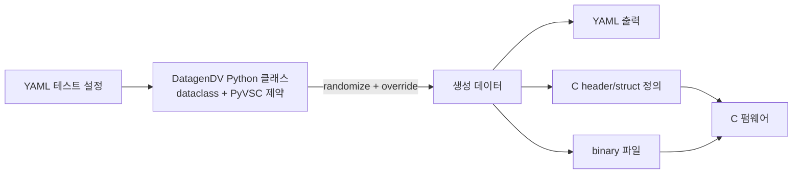

<!-- generated by yt-paper; edits will be overwritten -->

# DatagenDV: Python Constrained Random Test Stimulus Framework

[:material-open-in-new: 원문 보기](https://dvcon-proceedings.org/wp-content/uploads/1044-Datagen-Python-Constrained-Random-Test-Stimulus-Framework.pdf){ .md-button .md-button--primary target=_blank }

> DatagenDV는 YAML 기반 테스트 설정을 dataclasses·ruamel.yaml·PyVSC·ctypes로 묶어, SystemVerilog 제약조건을 재사용해 C 펌웨어용 랜덤 스티뮬러스를 Python에서 생성하는 프레임워크이다.

| 항목 | 내용 |
|---|---|
| 저자/출처 | Jonathan George, James Mackenzie (Microsoft Corporation) |
| 유형 | PAPER |
| 카테고리 | Verification |
| ID | `ref-20261018-d08e` |

## 핵심 인사이트

- C 펌웨어 테스트의 랜덤 제약을 C로 구현하면 기능이 제한되고 DUT 자체로 데이터를 생성하게 되어 유효성 검증이 모호해진다. 이를 Python 전처리 단계로 옮기는 것이 핵심 설계 동기이다.
- PyVSC가 SystemVerilog 문법과 유사해 블록 레벨 UVM 제약을 칩 레벨로 거의 그대로 이식할 수 있다. 보고된 사례에서 60개 필드·300줄 제약을 하루 만에 재작성했다.
- dataclasses를 기반으로 @rand_dataclass 데코레이터가 rand_ 접두사 필드와 일반 필드를 자동 매핑하고, YAML 값이 제공되면 오버라이드 제약을 생성해 같은 스크립트를 코드 수정 없이 여러 테스트에 재사용하게 한다.
- ctypes로 C 구조체 헤더와 바이너리 파일을 생성해 C 펌웨어와의 데이터 불일치 위험을 줄이지만, 컴파일러 패킹 정책을 반드시 맞춰야 하며 비정렬(non-byte aligned) 패킹과 중첩 구조는 아직 지원이 제한적이다.
- PyVSC의 randomize 속도와 분포 균일성은 시뮬레이터 내장 엔진보다 떨어지며, 논문에서도 10000회 randomize에 약 5분이 걸렸다고 보고한다. 프로젝트 도입 전 규모에 맞춰 검증이 필요하다.

## 상세 요약

### 배경 및 문제 정의

C 펌웨어 기반 칩 레벨 검증에서는 테스트 데이터 생성이 핵심이지만, 기존 방식에는 한계가 있었다. 저자들은 다음을 문제로 든다.
- C에서의 랜덤 제약 표현력은 SystemVerilog보다 제한적이다.
- DUT 자체를 이용해 데이터를 생성하면 생성 데이터의 유효성에 대한 모호함이 생긴다.
- 생성된 데이터가 테스트 기대값과 맞는지 검증하기 어렵다.
- 사전 실리콘(pre-silicon) 검증에서는 시뮬레이터 사이클을 데이터 생성에 쓰는 것이 비효율적이다.

이를 해결하기 위해 데이터 생성 단계를 C에서 Python 전처리 단계로 옮기는 것이 DatagenDV의 출발점이다. 저자들은 한 복합 커맨드 구조(40개 상호 연결 필드)를 기존 SystemVerilog 블록 제약을 변환해 며칠 만에 Python에서 랜덤화한 경험을 계기로 이 프레임워크를 만들었다고 밝힌다.

### 핵심 아키텍처 및 방법론

DatagenDV는 기존 오픈소스 라이브러리를 기본 클래스(`YAMLParamsBase`, `@rand_dataclass` 등)로 묶은 객체지향 데이터 생성 프레임워크이다. 사용 라이브러리와 역할은 다음과 같다.

- **dataclasses**: SystemVerilog 스타일의 타입 선언 클래스, `__init__`/비교/출력 자동 생성
- **ruamel.yaml**: YAML ↔ Python 클래스 로드/덤프. 주석 보존으로 diff 용이
- **PyVSC**: SystemVerilog 스타일 `constraint` 작성, 내부적으로 Boolector SMT 솔버 사용
- **ctypes**: C 호환 타입과 패킹된 바이너리 생성

데이터 흐름은 다음과 같다.

주요 설계 요소는 다음과 같다.

1. **필드 메타데이터**: `dg.field(val, dir='in'|'out'|'in_out')`로 YAML 입출력 방향을 지정한다. `dir='in'`은 프레임워크 내부용이라 덤프하지 않는다. 가변 기본값은 lambda 팩토리로 감싸 mutable default 문제를 피한다.
2. **랜덤 필드와 override**: PyVSC는 `__init__`에 선언된 특수 타입을 찾으므로 `rand_field()`로 선언한다. `@rand_dataclass`는 `rand_` 접두사 필드와 일반 필드를 짝지어, `randomize()` 후 값을 일반 필드로 복사한다. 일반 필드에 값이 있으면 그 값을 고정하는 제약이 자동 생성되어, 같은 스크립트를 YAML 값으로 제어할 수 있다.
3. **생성 바이너리/헤더**: `ctypes_helper`로 enum과 구조체의 C 정의 헤더를 만들고, 인스턴스를 바이너리 파일로 기록한다. C 측은 `fopen`/`fread`로 읽는다. 컴파일러 패킹 기본값을 ctypes와 맞춰야 한다.
4. **제약 이식성**: PyVSC 문법이 SystemVerilog 제약과 유사해 블록 레벨 제약을 칩 레벨로 직접 옮기고, 그 위에 칩 레벨 제약을 겹쳐 쌓을 수 있다.

Python 프레임워크 구현에 쓰인 기법으로는 `type()`/`callable()`/`vars()` 같은 리플렉션과, Specman e나 UVM 매크로와 비교되는 데코레이터 기반 클래스 확장이 소개된다.

### 실험 결과 및 결론

이 논문은 정량적 벤치마크보다 사례 보고 중심이다. 주요 수치와 관찰은 다음과 같다.

- **랜덤 분포 분석**: `vars()`와 matplotlib으로 `FrameParams` 필드의 히스토그램을 그려 분포를 확인했다. PyVSC는 완벽히 균일하지 않으나 특정 값을 누락하지는 않았다고 평가했다.
- **성능**: 10000회 randomize에 약 5분이 걸렸다. 저자들은 이를 시뮬레이터 randomization보다 느리지만 임베디드 C 코드에서의 동등 작업보다는 빠르다고 평가한다.
- **Python vs C (기존 프로젝트)**: 한 프로젝트에서 10개 값 중 enum 하나를 고르는 작업이 시뮬레이션된 프로세서에서 C로 랜덤화하는 것보다 6 orders of magnitude 빨랐다고 보고한다. 다만 복잡한 상호 의존 제약을 Python `random`으로 구현·튜닝하는 데 수 주가 걸렸다.
- **PyVSC 기반 칩 레벨 사례**: 60개 필드·300줄 SystemVerilog 제약을 PyVSC로 하루 만에 재작성했다. 명령어 50개 이상의 필드가 공유 메모리로 상호 의존하는 시나리오를 지원했다.
- **인력 측면**: Python에 익숙하지 않은 SystemVerilog 엔지니어도 타입 선언 방식과 제약 솔빙 덕분에 합리적인 시간 안에 사용할 수 있었다고 보고한다.

**결론**: 저자들은 DatagenDV가 여러 프로젝트에서 수백 시간을 절약했고, 생산성과 커버리지 향상에 기여했다고 주장한다. 다만 PyVSC의 성능과 분포 품질은 프로젝트 규모에 맞춰 검증해야 하며, 바이너리 생성은 평탄한(flat) 구조와 기본 타입에 치우쳐 있고 중첩 구조와 비정렬 패킹, 다른 설정 언어(XML/JSON) 지원은 향후 과제로 남았다.

## 관련 영상

<iframe src="https://www.youtube-nocookie.com/embed/7g-3vBeMZLo" title="[DVCON2023]DatagenDV: Python Constrained Random Test Stimulus Framework" loading="lazy" allow="accelerometer; clipboard-write; encrypted-media; gyroscope; picture-in-picture; web-share" referrerpolicy="strict-origin-when-cross-origin" allowfullscreen></iframe>

**[DVCON2023]DatagenDV: Python Constrained Random Test Stimulus Framework** — [YouTube에서 보기](https://www.youtube.com/watch?v=7g-3vBeMZLo) · [영상 페이지](../../videos/7g-3vBeMZLo.md)
