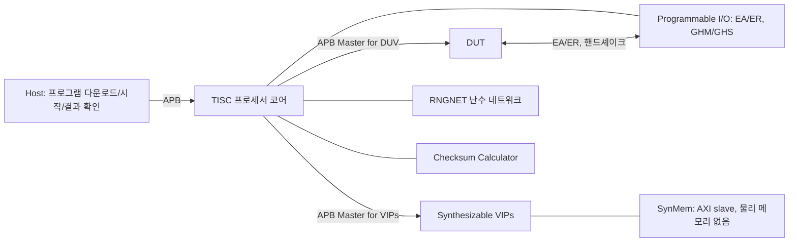

<!-- generated by yt-paper; edits will be overwritten -->

# Synthesizable Random Testbench for Multimedia IP Verification

[:material-open-in-new: 원문 보기](https://dvcon-proceedings.org/wp-content/uploads/synthesizable-random-testbench-for-multimedia-ip-verification.pdf){ .md-button .md-button--primary target=_blank }

> 멀티미디어 IP의 대규모 constrained random 테스트를 시뮬레이션·에뮬레이션·FPGA에서 동일하게 재현하기 위해, 전용 테스트 프로세서 TISC와 메모리 모델 SynMem으로 구성한 외부 독립형(synthesizable) 테스트벤치 구조를 제안한 논문.

| 항목 | 내용 |
|---|---|
| 저자/출처 | Sanggyu Park (Samsung Electronics Co., Ltd). 원문에 학회명은 명시되어 있지 않음 |
| 유형 | PAPER |
| 카테고리 | Verification |
| ID | `ref-20261018-d099` |

## 핵심 인사이트

- 외부 호스트 의존(USB/PCIe 링크, 호스트 C 테스트)을 제거한 격리형(isolated) 테스트벤치는 동일 이슈를 시뮬레이션·에뮬레이션·FPGA에서 재현할 수 있게 해 디버그 비용을 줄인다는 것이 핵심 동기다.
- DV 엔지니어가 기존 SystemVerilog/UVM 워크플로를 유지하도록, 임베디드 C 대신 전용 ISA(TISC)를 설계해 레지스터 쓰기 시퀀스를 압축 인코딩하는 방식을 택했다. 단, 실제 프로세서 설계 비용이 크다는 트레이드오프가 있다.
- RNGNET(런타임 난수 생성 네트워크)은 LUT처럼 값이 연속적으로 변하는 데이터를 명령 몇 바이트로 대체한다. 원문 예시에서 Gamma LUT는 DUT_WRITE 방식 520바이트 대비 27바이트로 줄었다.
- 가변 길이 인코딩 등 압축 기법으로 레지스터 쓰기 프로그램 크기를 고정 길이 대비 13%~30% 수준으로 줄였으나, 랜덤 값이 많은 LUT(예: 800개 12-bit 이득값)는 압축 효과가 작았다.
- 프로그램 메모리를 64KB로 제한하는 설계 결정은 표 1 기준 테스트 프로그램 크기가 32KB 이하라는 데이터로 정당화된다. 다만 SynMem 관련 실험과 결론은 원문이 잘려 확인할 수 없다.

## 상세 요약

### 배경 및 문제 정의

- 멀티미디어 IP(ISP, Image Scaler, Display Processing Unit 등)는 화질·전력·처리 시간을 조정하는 수천 개의 파라미터를 가진다. 원문은 이런 설계를 커버하는 데 수백만 건의 랜덤 테스트가 필요해 시뮬레이션만으로는 시간이 부족하다고 지적한다.
- 시뮬레이션과 FPGA를 함께 쓰는 기존 구조는 다음 한계를 가진다.
  - **(a) 단순 구조**: 호스트 C/C++ 테스트 프로그램이 USB/PCIe로 DUT 레지스터와 SDRAM에 접근한다. 레지스터 접근과 데이터 전송 시간이 크고, USB 링크의 타이밍은 시뮬레이션에서 모델링하기 어려워 이슈 재현이 자주 실패한다.
  - **(b) 임베디드 마이크로컨트롤러 구조**: 외부 링크 문제는 없지만 시뮬레이션 속도 저하, 유지보수 복잡도 증가, 테스트 프로그램 디버깅 난이도 상승이 생긴다.
- 원문은 DV 엔지니어가 시뮬레이션용 DV 테스트벤치와 합성 가능 테스트벤치를 동시에 관리하기 어렵다는 점을 주요 문제로 든다. 또한 FPGA 전문 인력에게 도메인 지식을 전달하는 비용이 크다고 설명한다.

### 핵심 아키텍처 및 방법론

전체 구조는 외부 세계와 상호작용하지 않는 격리형 테스트벤치(Fig. 1(c))이며, 두 가지 핵심 요소로 구성된다.

**1. TISC (Test Instruction Set Core)**
- 테스트 프로그램 기술에 특화된 ISA를 가진 3단 파이프라인 프로세서다. 프로그램 메모리는 64KB SRAM이며, 호스트는 APB 슬레이브 인터페이스로 프로그램을 내려받고 시작 명령과 인터럽트/상태 레지스터로 결과를 확인한다.
- 실행 단위는 ALU(조합 논리), MDU(시프트·곱셈·나눗셈, 순차 구현, 1,762 gates), Decompression Unit으로 구성된다.
- 32개의 32-bit 레지스터 중 16개는 general, 나머지는 special로 나뉜다. 2-read 1-write 레지스터 파일의 복잡도를 줄이기 위한 분할이다.
- **압축 명령**: `DUT_WRITE`는 가상 명령으로, 주소를 8/16/24-bit 차분 또는 자동 증가(+4)로 인코딩하고 0 쓰기 값에 전용 opcode를 둔다. `DUT_WRITE_RND`는 RNGNET 출력을 쓰기 값으로 사용하며, `DUT_WRITE_RPT`는 반복 횟수를 상수 필드로 사용한다.
- `DUT_READ`는 읽기 값을 레지스터에 저장하거나 Checksum Calculator에 넘기고, `DUT_READ_TEST`는 기대값과 비교해 불일치 시 플래그를 세운다.
- **조건 실행**: 명령마다 조건 코드를 붙여 32개 general flag 중 하나로 실행 여부를 정한다. 분기를 줄여 흐름을 선형으로 만든다는 것이 설계 의도다.
- **명령 형식**: 첫 바이트 MSB로 조건/무조건을 구분하고 opcode는 7-bit다. 피연산자 형식은 28종이며, 명령 길이는 최소 8-bit에서 최대 80-bit(두 개의 32-bit 상수)까지다.
- **Programmable I/O**: Event Activator/Receptor(각 64-bit), General Handshake Master 3채널, Slave 2채널로 DUT와 신호 수준 통신을 한다. 32-bit AXI 인터페이스도 이 자원으로 구현할 수 있다고 한다.
- **타이머**: 특수 레지스터에 값을 쓰면 주기 또는 랜덤 이벤트를 만든다.
- **APB Master for DUV 부가 기능**: Checksum Calculator가 읽기 데이터를 자동 누적해 R15로 노출하고, APBRNG 레지스터로 APB 접근 사이에 랜덤 지연을 넣는다.
- **Clock Controller**: DUV와 VIP의 클록 enable을 제어해 다중 사이클 명령의 지연을 숨기거나, VIP 설정 중 DUV 클록을 끈다.
- **스택과 호출**: PUSH/POP 하드웨어 스택을 두며, CALL/RETURN은 RET0~RET2 3단계 중첩을 지원한다.

**2. RNGNET (Random Number Generation Network)**
- 제약이 복잡한 값(예: 이미지 폭·높이)은 제약 솔버가 필요하지만, DMA 베이스 주소처럼 단순한 값은 PRNG로 충분하다는 관점에서 설계됐다.
- 구성: PRNG 18개(8-bit PRNG 8개, 3-bit PRNG 여러 개), 각 PRNG는 SEED/INIT/ACTIVE 입력과 VALUE 출력을 가진다. 출력은 min/max CLIP을 거치고, CONCAT으로 32-bit 값을 만든다. SELECTOR, 32-bit 덧셈기, BASE 레지스터를 거쳐 R12로 노출된다.
- ACTIVE 신호는 3-bit PRNG와 ACTIVATOR(임계값 비교)로 생성해, 고주파·저주파 성분이 섞인 시퀀스를 만든다.
- 예시(Fig. 6): 256개 원소의 단조 증가 Gamma LUT를 생성한다. 원문은 LUT의 나머지 768개 매핑은 보간으로 얻는다고 설명한다.

**3. 프로그램 크기 최적화 기법 비교**
- Fig. 4: 같은 조건 분기 예제를 조건 플래그, JUMP, CALL로 구현했을 때 인코딩 크기는 각각 56, 70, 80바이트다. 원문은 조건 실행이 쓰기 명령을 선형화해 주소/데이터 압축에 유리하므로 "항상 크기 최적"이라고 주장한다. 이는 저자의 주장이며, 일반 조건에 대한 검증은 본문에 없다.

**4. SynMem (Synthetic Memory VIP)**
- 물리 메모리 없이 동작하는 AXI slave 모델이다. 읽기 데이터는 합성기로 만들고, 쓰기 데이터는 checksum으로 요약한다. 최신 모바일 AP의 36-bit 주소 공간을 다루기 위해 MMU 대신 이 방식을 택했다. 원문은 SDRAM을 쓰면 시뮬레이션 재현이 불가능해진다고 지적하고, 200MP 센서의 Bayer 이미지(240MB)를 USB로 올리면 수 분이 걸린다는 점을 예로 든다.
- 본문은 여기서 잘려 있어 세부 구조와 성능 수치는 확인할 수 없다.

### 실험 결과 및 결론

원문에 있는 정량 결과는 사례 연구와 Table 1에 한정된다. 결론 장과 SynMem 세부 검증은 잘려 있어 포함하지 않았다.

**Table 1 (구성 레지스터 수와 테스트 프로그램 크기)**

| IP | 시스템 레지스터 | 데이터 처리 레지스터 | 고정 길이 | 가변 길이 | 런타임 랜덤 생성 (LUT 제외) |
|---|---|---|---|---|---|
| Histogram-based Image Equalizer | 53 | 149 + LUT 174 | 58KB | 7.6KB | 6.2KB |
| UI Composer | 30 | 1,080 + 1,641 | 24KB | 14KB | 8KB |
| PDAF Accelerator | 131 | 1,746 + 2,304 | 61KB | 26KB | 18KB |
| Bayer Image Processor | 185 | 5,024 + 4,000 | 90KB | 32KB | 13KB |
| Image Scaler | 42 | 57 + 225 | 17KB | 6KB | 3KB |

- 표 열의 의미는 원문 표 구성을 따랐으며, 데이터 처리 레지스터 열의 "+LUT" 구분은 원문 표 헤더를 기준으로 해석했다.
- 가변 길이 인코딩은 고정 길이 대비 13%~30% 수준의 크기를 보인다.
- 원문은 모든 테스트 프로그램이 32KB 이하이므로 64KB 메모리 제한이 합리적이라고 결론짓는다.

**사례 연구**
- **Gamma LUT (RNGNET)**: DUT_WRITE 방식은 최소 520바이트, RNGNET 방식은 27바이트다. UI Composer의 HDR Gamma LUT(1,596개 항목)는 차분 인코딩을 써도 7KB 이상이다.
- **PDAF 통계 읽기**: 1,088 word(4,352바이트)를 `DUT_READ_RPT`로 1,088회 읽고, 체크섬으로 한 명령에 검증한다.
- **Image Scaler**: 100M 테스트로 모든 스케일링 비율을 커버했으며, 프로그램 전체 크기는 가변 길이 인코딩을 써도 600GB를 넘는다. 이는 테스트 프로그램을 런타임에 생성해야 하는 이유로 제시된다.
- **인터프리터 방식 대안**: TISC ISA를 범용 CPU 인터프리터로 구현하는 방식은 RNGNET·I/O·체크섬이 SW 속도 저하 또는 HW 디버깅 복잡도를 낳아 실패했다. DV 엔지니어가 단일 파형으로 상태를 볼 수 있다는 점이 전용 코어를 선택한 이유다.

**결론 요지**: 격리형 합성 가능 테스트벤치(TISC + SynMem)는 DV 엔지니어가 익숙한 방식으로 대규모 랜덤 회귀를 FPGA/에뮬레이션에서 수행하고, 시뮬레이션에서 동일 이슈를 재현하는 구조를 제공한다고 주장한다. 다만 본 요약의 근거는 원문 앞부분에 한정된다. 원문은 SynMem 세부 구조와 다중 AXI master 지원 등 후반 내용이 잘려 있어 검증되지 않았다."

## 관련 영상

<iframe src="https://www.youtube-nocookie.com/embed/BEUFeKUEctY" title="[DVCON2021]Synthesizable Random Testbench for Multimedia IP Verification" loading="lazy" allow="accelerometer; clipboard-write; encrypted-media; gyroscope; picture-in-picture; web-share" referrerpolicy="strict-origin-when-cross-origin" allowfullscreen></iframe>

**[DVCON2021]Synthesizable Random Testbench for Multimedia IP Verification** — [YouTube에서 보기](https://www.youtube.com/watch?v=BEUFeKUEctY) · [영상 페이지](../../videos/BEUFeKUEctY.md)
