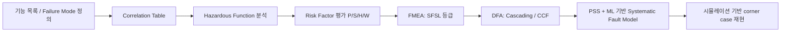

<!-- generated by yt-paper; edits will be overwritten -->

# Early Detection of Functional Corner Case Bugs using Methodologies of the ISO 26262

[:material-open-in-new: 원문 보기](https://dvcon-proceedings.org/wp-content/uploads/1096-Early-Detection-of-Functional-Corner-Case-Bugs-using-Methodologies-of-the-ISO-26262.pdf){ .md-button .md-button--primary target=_blank }

> ISO 26262의 HARA·FMEA·DFA 안전 분석 기법을 반도체 설계 검증에 적용해 리스크 점수로 검증 우선순위를 정하고, PSS와 선형회귀·확장 유클리드 알고리즘으로 시간 임계 corner case를 재현하는 SFA 방법론을 제안한다.

| 항목 | 내용 |
|---|---|
| 저자/출처 | Moonki Jang, Sunil Roe, Youngsik Kim, Seonil Brian Choi (Samsung Electronics) |
| 유형 | PAPER |
| 카테고리 | Verification |
| ID | `ref-20261018-d1ce` |

## 핵심 인사이트

- SFA는 failure mode를 Integration, Accessibility, Functionality, State transition, FFI(Freedom from Interference) 다섯 범주로 나누고, 특히 FM5(간섭 접근에 의한 corner case)를 실리콘 단계까지 숨는 주요 결함으로 본다.
- 리스크 점수는 Proven-in-use(P1~P4), Severity(S1~S4), 알려진 타 프로젝트 이슈, SW workaround(W1~W4)의 곱으로 계산되며, 이를 SFSL_A~D 등급으로 나눠 검증 우선순위를 정한다.
- DFA에서는 공통 원인 고장(Common Cause Failure)을 확인하기 위해 메모리 백도어로 ECC 오류, MMU translation fault, RAS 오류를 주입하고, False sharing·DVM broadcast·Exclusive access 같은 결합 요인을 함께 본다.
- 시간 임계 시퀀스를 맞추기 위해 클록 사이클 단위 delay counter를 TB에 두고, 두 함수 지연값 사이의 선형 관계를 이용해 확장 유클리드 알고리즘으로 공통 타임스탬프를 만드는 방식을 사용한다. 다만 실제 시스템의 비선형성은 ML 보정 과정에서 걸러낸다.
- 논문은 CPU에서 SFSL-B 이상 고위험 항목에 대해 기능 커버리지 bin을 약 15% 늘렸다고 보고하지만, 전체 검증 효과나 정량 비교 데이터는 제시하지 않는다. 또한 ISO 26262가 검증 방법론을 새로 규정하지 않는다는 점을 전제로 한 사례 연구 성격이 강하다.

## 상세 요약

### 배경 및 문제 정의

ISO 26262는 systematic failure에 대해 새로운 검증 방법을 제시하지 않지만, 모든 단계에서 지속적인 영향 분석과 리스크 평가를 요구한다. 논문은 복잡한 IP 간 상호작용에서 발생하는 systematic failure, 특히 특정 시점의 외부 간섭으로 생기는 corner case가 pre-silicon 검증에서 놓치기 쉽고, 실리콘 단계에서 발견되면 mask 수정 등으로 비용이 크게 증가한다고 지적한다.

이를 해결하기 위해 저자들은 ISO 26262의 HARA, FMEA, DFA 같은 안전 분석 기법을 설계 검증에 적용한 Systematic Failure Analysis(SFA)를 제안한다. 목표는 IP 단위에서 위험 요인을 찾아 시스템 수준 취약점으로 확장하고, 검증 우선순위를 정하는 것이다.

### 핵심 아키텍처 및 방법론

SFA는 다음 흐름으로 구성된다.

1. **Failure mode 분류**: FM1 Integration, FM2 Accessibility, FM3 Functionality, FM4 State transition(power/clock gating, reset), FM5 Absence of independence 또는 FFI로 나눈다. FM5는 외부 간섭이 특정 취약 지점에서 발생하는 경우라 기존 검증으로 재현하기 어렵다고 본다.

2. **Correlation table과 Hazardous function list**: 기능별로 들어오는 접근(incoming)과 나가는 영향(outgoing)을 정리해 의존 관계를 드러낸다. 취약 기능으로 power gating, clock gating, reset, buffer overflow, exception 처리를 꼽는다.

3. **리스크 점수 산정**: 리스크 점수는 다음 네 요소의 점수 곱으로 계산된다(Figure 1은 본문에서 수식이 누락되어 정확한 식은 확인할 수 없음).
   - Proven-in-use: P4(신규 in-house IP) ~ P1(다른 제품에서 사용된 IP)
   - Severity: S4(시스템 전체 불능) ~ S1(영향 없음)
   - 타 프로젝트 이슈 이력(errata 포함)
   - SW workaround: W4(HW 수정 필요) ~ W1(성능 영향 없는 SW 우회)

   계산된 값에 따라 SFSL_A(Risk > 12, 상세 검증 필요), SFSL_B(> 8, 추가 검증), SFSL_C(> 4, 영향 분석), SFSL_D(≤ 4, 낮음)로 분류한다. 저자들은 SFSL이 ISO 26262의 ASIL과 달리 치명적 실패의 위험도를 나타낸다고 설명한다.

4. **FMEA**: 기능, failure mode, 원인, 영향, 리스크 점수를 표로 정리한다. 예시로 CPU_CPD_FM5(snoop 간섭으로 ACE interface 정지)는 SFSL_A로 분류된다.

5. **DFA**: 두 가지를 확인한다.
   - Cascading failure: FMEA의 failure mode가 다른 요소를 연쇄 고장시키는 DFI(Dependent Failure Initiator)가 되는지 correlation table로 추적한다.
   - Common cause failure: 메모리 백도어 인터페이스로 ECC 오류, MMU translation fault, RAS 오류(L1/L2/L3 캐시, 인터럽트 컨트롤러, System MMU)를 주입하고, False sharing, DVM broadcast, Exclusive access를 결합 요인으로 본다. 이 결과는 PSS 기반 fault injection model과 FTR(Fault Tolerance Report)로 기록한다.

6. **ML 기반 시간 임계 시퀀스 생성**:
   - SW에서 delay를 주면 us 단위 해상도이고 CPU 캐시·파이프라인 상태에 따라 지연이 변하므로, TB에 클록 단위 delay counter를 두고 지연이 선형적으로 동작하도록 한다.
   - 각 함수 앞에 `pss_delay` action을 넣고 mailbox로 delay counter에 요청한다.
   - Output monitor가 목표 조건 발생 시각을 로그로 남긴다.
   - 함수 A, B의 delay 값과 목표 조건 발생 시각을 선형식으로 근사한 뒤, 확장 유클리드 알고리즘으로 두 함수가 같은 시각에 목표 조건에 도달하는 delay 조합을 구한다. 일반해는 $x = x_0 + k \cdot \frac{b}{d}$, $y = y_0 - k \cdot \frac{a}{d}$ 형태이며, $d = \gcd(a, b)$이다.
   - 외부 요인으로 선형성이 깨질 수 있어, 선형성이 확인된 데이터만 학습해 보정한다.

### 실험 결과 및 결론

논문은 정량적 벤치마크보다는 적용 결과와 방향성을 보여준다.

- SFA 결과를 ISO 26262-8:2018 9.5절의 검증 work product 항목에 맞춰 분류했는데, 대부분은 기존 설계 검증에서 이미 다뤄지는 내용이었다고 보고한다.
- Correlation table, 리스크 분석, DFA를 통해 의존 요소 간의 새로운 cross-function coverage bin을 추가했다.
- ML 기반 fault model로 hazardous function의 임계 시퀀스 조건을 시뮬레이션으로 커버할 수 있었다.
- CPU 검증에서 SFSL-B 이상 고위험 항목에 대해 기능 커버리지 bin을 약 15% 늘렸다고 보고한다.
- SFA 결과는 ISO 26262의 systematic fault 리스크 평가와 FMEDA(랜덤 고장률·진단 커버리지 추가) 작성에도 재사용할 수 있다고 주장한다.

결론적으로 저자들은 시스템 수준 위험을 IP의 최소 기능 단위에서 귀납적으로(bottom-up) 찾는 접근이 pre-silicon에서 systematic failure를 잡는 데 필요하다고 주장한다. 다만 본문이 제시한 근거는 사례 기반이며, 검출된 버그 수, 실리콘 재작업 감소량, 기존 방식 대비 정량 비교 등은 확인할 수 없다.

## 관련 영상

<iframe src="https://www.youtube-nocookie.com/embed/q5J0AUqZLUY" title="[DVCon2023] Early Detection of Functional Corner Case Bugs using Methodologies of the ISO 26262" loading="lazy" allow="accelerometer; clipboard-write; encrypted-media; gyroscope; picture-in-picture; web-share" referrerpolicy="strict-origin-when-cross-origin" allowfullscreen></iframe>

**[DVCon2023] Early Detection of Functional Corner Case Bugs using Methodologies of the ISO 26262** — [YouTube에서 보기](https://www.youtube.com/watch?v=q5J0AUqZLUY) · [영상 페이지](../../videos/q5J0AUqZLUY.md)
