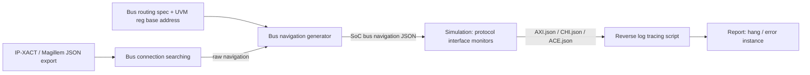

<!-- generated by yt-paper; edits will be overwritten -->

# Bus Trace System: Automating Bus Traffic Debugging in IP-XACT Based SoC Beyond Traditional Debugging Methods

[:material-open-in-new: 원문 보기](https://dvcon-proceedings.org/wp-content/uploads/1078.pdf){ .md-button .md-button--primary target=_blank }

> IP-XACT 기반 SoC 버스 연결 네비게이션을 자동 생성하고, 시뮬레이션 로그의 버스 트래픽을 역추적해 bus hang·error response의 문제 노드를 자동 지목하는 디버깅 방법론(BTS)이다.

| 항목 | 내용 |
|---|---|
| 저자/출처 | Wonyeong So, Yonghyun Yang, Sun-il Roe, Moonki Jang, Youngsik Kim, Seonil Brian Choi (Samsung Electronics Co. Ltd., Seoul, Korea). 학회/출처는 문서에 명시되어 있지 않음 |
| 유형 | PAPER |
| 카테고리 | Verification |
| ID | `ref-20261018-dded` |

## 핵심 인사이트

- 마스터에서 슬레이브까지의 버스 경로를 IP-XACT(Magillem JSON export)와 버스 라우팅 명세, 레지스터 base address 정보로 자동 구성하면, 파형 없이 로그만으로 hang 지점을 좁힐 수 있다.
- 로그를 시간 역순(끝에서 처음)으로 추적하면 이미 정상 처리된 트래픽 검토를 건너뛰어 최신 이상 지점을 빠르게 찾을 수 있다. 이 설계가 탐색 효율의 핵심이다.
- 각 프로토콜(AXI, ACE, CHI, custom)별 인터페이스 로그를 하나로 모으고 유효 트래픽만 기록하며 timer로 hang을 감지하도록 한 구성은, 마스터별 로그 파일을 만드는 방식보다 파일 수와 I/O 측면에서 효율적이라고 저자들이 주장한다.
- 논문은 debug 시간 절감과 TAT 단축을 주장하지만, 실제 측정된 시간 감소 수치는 제시하지 않는다. 실험은 버그 발생 비율(전체 버그의 약 10~12%)과 누적 발생 추이 중심이라 효과 검증은 정성적이다.
- 구현 측면에서 버스 라우팅 명세가 없는 raw navigation은 부정확할 수 있으므로, 라우팅 정보를 반영한 2단계 탐색과 IP base address 계산이 정확도에 직접 영향을 준다. 이 전제를 자사 SoC 구조에 맞춰 검증해야 한다.

## 상세 요약

### 배경 및 문제 정의

- SoC 복잡도 증가(수백만 트랜지스터 → 200억 이상 집적 등)로 검증 엔지니어 수와 디버깅 시간 비중이 늘고 있다. 문서 인용에 따르면 프로젝트당 검증 시간 비중은 2014년 47%에서 2018년 54%로 증가했다.
- 버스 hang과 error response는 버스 노드가 많을수록 원인 위치 파악이 어렵다. 기존 방식은 관련 버스 노드를 하나씩 확인하는 것이다. 문서 예시에서 마스터가 슬레이브까지 버스 노드 10개를 거치는 경우 노드당 확인 시간이 T라면 최악에는 10T가 걸린다.
- 문제 노드를 한눈에 식별하기 어렵다는 점이 핵심 문제다. BTS는 이 디버그 범위를 자동으로 좁히는 것을 목표로 한다.

### 핵심 아키텍처 및 방법론

BTS는 두 단계로 구성된다.

**Phase 1: SoC bus navigation 생성**
- IP-XACT 정보를 Magillem export로 JSON으로 변환한다. 버스 라우팅 명세와 SoC UVM register base address 파일도 각각 JSON으로 만든다.
- 시작 인스턴스는 host CPU로 두고, UVM register 모델에서 최종 목적지 인스턴스 목록을 얻는다.
- 탐색은 인터페이스의 key interface를 기준으로 이웃 인스턴스를 재귀적으로 따라간다. 예: AXI slave는 MISC_M 인터페이스를 key로 사용한다. 목적지 목록에 도달하면 종료하고 raw navigation을 만든다.
- raw navigation은 라우팅 정보를 반영하지 않으므로 부정확할 수 있다. 이를 2차 탐색으로 보정한다. 대상 IP의 base address를 기준으로 라우팅 instance의 address range를 확인해 실제 counter instance를 결정하고 최종 navigation을 만든다.

**Phase 2: 시뮬레이션 중 debug scope 자동 탐색**
- DUT 내부 인터페이스에 testbench용 SystemVerilog 인터페이스를 바인딩한다. 인터페이스는 프로토콜별 대표 인터페이스로 정의된다.
- 각 인터페이스 내부의 protocol inspector는 handshake를 검사해 유효 트래픽만 기록하고, burst length를 확인하며, timer로 hang을 감지한다.
- 마스터마다 로그 파일을 만들지 않고, 프로토콜별로 `AXI.json`, `CHI.json`, `ACE.json` 같은 파일 하나에 시간순으로 기록한다.
- 분석 스크립트는 시뮬레이션과 병행 실행된다. bus error response가 기록되거나 로그 출력이 timer 임계값 이상 멈추면 활성화된다.
- 트래픽 주소로 IP base address를 계산하고 해당 navigation 경로를 가져온 뒤, 로그의 끝에서 역방향으로 추적한다. 문서 예시에서 BLK_CPU가 0x1083_0808에 write를 보냈지만 응답이 없는 경우, base address는 0x1083_0000이다. 마지막 write 응답 로그가 BUS_FABRIC_2에서 찍혔으므로 응답이 BUS_FABRIC_1을 통과하지 못한 것으로 판단하고 BUS_FABRIC_1을 hang 지점으로 보고한다.

### 실험 결과 및 결론

**실험 설정 (Table 1, 3개 SoC 프로젝트)**

| Project | Bus hang | Error response | Total bugs | Ratio |
|---|---|---|---|---|
| A | 320 | 146 | 3,964 | 0.1176 |
| B | 76 | 36 | 1,057 | 0.106 |
| C | 411 | 92 | 4,199 | 0.12 |

- 세 프로젝트에서 bus hang과 error response는 전체 버그의 약 10~12%를 차지한다. 저자들은 이 비율만큼의 버그를 BTS로 식별할 수 있다고 해석한다.
- 누적 발생률(Figure 7) 분석에서 세 프로젝트 모두 구현(implementation) 시작 전에 전체 해당 버그의 50% 이상이 발생했다. 합성 시작 시점 기준으로도 50% 이상이 관찰된다고 보고한다.
- 저자들은 합성 전에 버스 통합을 빠르게 안정화하면 SoC 일정 단축에 도움이 된다고 주장한다. 또한 bus hang이 다른 IP 오동작이나 보안 위반 등의 버그 식별을 지연시키는 병목이 되므로, 버스를 먼저 안정화하는 것이 중요하다고 설명한다.

**한계 및 정리**
- 디버그 시간이나 TAT가 실제로 몇 % 줄었는지에 대한 정량 수치는 본문에 없다. 효과는 식별 가능한 버그 비율과 발생 시점 분포로만 간접적으로 뒷받침된다.
- 문서는 BTS가 bus hang과 error response 중심이라고 명시한다. 그 외 유형의 버그에 대한 적용 범위는 다루지 않는다.
- 결론적으로 BTS는 IP-XACT 기반 자동화와 역방향 로그 추적으로 버스 계층 디버그 범위를 자동으로 좁히는 방법이며, 합성 전 버스 안정화를 앞당기는 것을 주요 가치로 제시한다.

## 관련 영상

<iframe src="https://www.youtube-nocookie.com/embed/zHAIrWaCa3Y" title="[DVCON2024] Bus Trace System: Automating Bus Traffic Debugging in IP-XACT Based SoC Beyond ... Debug" loading="lazy" allow="accelerometer; clipboard-write; encrypted-media; gyroscope; picture-in-picture; web-share" referrerpolicy="strict-origin-when-cross-origin" allowfullscreen></iframe>

**[DVCON2024] Bus Trace System: Automating Bus Traffic Debugging in IP-XACT Based SoC Beyond ... Debug** — [YouTube에서 보기](https://www.youtube.com/watch?v=zHAIrWaCa3Y) · [영상 페이지](../../videos/zHAIrWaCa3Y.md)
