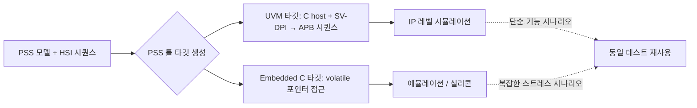

<!-- generated by yt-paper; edits will be overwritten -->

# Using PSS-2.0 Hardware-Software Interface to validate 4G/5G Forward Error Correction Encoder/Decoder IP in Emulation & Silicon

[:material-open-in-new: 원문 보기](https://dvcon-proceedings.org/wp-content/uploads/Using-Portable-Stimulus-Standards-Hardware-Software-Interface-PSS-HSI-to-validate-4G5G-Forward-Error-Correction-EncoderDecoder-IP-in-emulatio.pdf){ .md-button .md-button--primary target=_blank }

> PSS-2.0의 HSI(Hardware-Software Interface) 레이어를 이용해 IP 레벨 UVM 시뮬레이션부터 에뮬레이션·실리콘까지 동일한 테스트 시나리오를 재사용하며, 4G/5G FEC 인코더/디코더 IP를 검증한 Intel 사례 논문.

| 항목 | 내용 |
|---|---|
| 저자/출처 | Vinit Shenoy, Suresh Vasu, Nithin Venkatesh, Suhas Reddy, Joydeep Maitra (Intel Technology India Pvt Ltd, Bangalore); Luis Campos (Intel Corporation, Santa Clara) |
| 유형 | PAPER |
| 카테고리 | Verification |
| ID | `ref-20261018-e10a` |

## 핵심 인사이트

- HSI는 레지스터·메모리·인터럽트·동기화를 추상화해 단일 드라이버 로직을 작성하게 하며, PSS 툴이 UVM(SV-DPI 경유)과 임베디드 C 등 타깃별 코드를 생성하므로 UVM 시퀀스와 C 드라이버 사이의 'Portability Wall'을 넘는 것이 핵심 동기다.
- 레지스터 정의는 IP-XACT 유사 XML에서 스크립트로 HSI reg_c 모델로 변환했고, 베이스 주소·VF 수 같은 구성 파라미터는 const나 CSV 테이블로 분리해 IP/서브시스템/SoC 간 수직 재사용을 도모했다.
- randomization과 foreach 제약을 결합하면 활성화된 VF만 레지스터를 쓰는 등 시나리오 특화된 'directed' 코드가 생성되어 코드 footprint를 줄이고 디버깅을 쉽게 한다.
- ps_event의 wait()/emit()으로 ISR을 구현하고 sync()로 설정 단계와 데이터 전송 단계 사이에 동기점을 두어 동시성 스트레스를 높였다.
- 논문은 테스트 개발 시간 70% 단축을 보고하지만, 측정 방법·baseline·데이터 규모에 대한 상세 설명이 본문에 없어 정량 근거는 제한적으로 봐야 한다.

## 상세 요약

### 배경 및 문제 정의

검증 환경은 시뮬레이션, 에뮬레이션, FPGA 프로토타이핑, 실리콘 등 여러 플랫폼으로 나뉘고, 검증 범위도 IP → 서브시스템 → SoC로 확장된다. 업계의 일반적 방식은 IP/서브시스템 레벨에서는 UVM 테스트벤치, 임베디드 코어 기반 환경(에뮬레이션·실리콘)에서는 C 드라이버 기반 테스트이다. 이 때문에 UVM 시퀀스는 임베디드 코어에서 실행할 수 없고, C 드라이버 코드는 UVM 테스트벤치를 직접 구동할 수 없는 '포터빌리티 장벽(Portability Wall)'이 생긴다. 본 논문은 PSS-2.0에 새로 포함된 HSI를 활용해 플랫폼 간 테스트 콘텐츠의 수직 재사용(vertical reuse)을 달성한 Intel의 사례를 다룬다.

### 핵심 아키텍처 및 방법론

**HSI 개발 흐름**
- **레지스터 정의**: Intel은 사내 XML 포맷을 사용하며, 이를 HSI `reg_group_c` / `reg_c<R>` 모델로 변환하는 스크립트를 개발했다. `reg_c`는 값 타입 R(packed struct 또는 bit-vector), 접근 권한(기본 READWRITE), 폭 SZ로 파라미터화된다.
- **주소 영역 연결**: `set_handle()`과 `make_handle_from_region()`으로 레지스터 그룹을 주소 영역(예: 0x8F700000)에 매핑한다.
- **시퀀스 작성**: `write()` 호출 전 `post_solve`에서 랜덤화된 값을 구조체 필드에 채우고, `exec body`에서 쓰기를 수행한다.

**타깃 코드 생성 (툴 구현 의존)**
- *UVM 타깃*: PSS 툴이 C 호스트 코드를 생성하고, SV-DPI로 export된 `write_scalar()` 태스크가 APB 마스터 에이전트의 시퀀스(`write_word_seq`)로 변환된다. 호스트 코드는 UVM test의 run phase에서 fork된다.
- *임베디드 C 타깃*: 동일 HSI 시퀀스가 `*(volatile unsigned int*)(addr)` 형태의 직접 포인터 접근으로 변환된다.
- PSS 표준은 타깃 코드 생성 방식을 규정하지 않으므로, 본 논문의 코드 예시는 Intel 툴에 특화된 것이다.

**FEC IP 구조와 적용**
- FEC IP는 PCIe 디바이스로 호스트에 노출되며 여러 VF(Virtual Function)를 제공하고, 4G/5G 인코더·디코더 블록 여러 인스턴스를 포함한다. 이에 따라 PCIe 설정 공간, 블록별 레지스터 파일이 다수 존재한다.

**PSS 기법**
1. **레지스터 파일 인스턴스화 및 주소 분해**: 구성 파라미터(NUM_OF_VF 등)는 `const`로, 베이스 주소는 CSV 테이블(`table: ip_4g_fec_dl`)로 분리해 IP 레벨과 SoC 레벨 간 재사용을 돕는다.
2. **비연속 레지스터 배열**: 고정 오프셋(예: `i * 0x8`)을 `foreach` 제약으로 설정한다.
3. **랜덤화 + HSI 결합**: `hi_vf_regs[vf_id].QMGR_INGRESS_AQ[queue_id].write_val(...)`처럼 랜덤 구성 파라미터로 주소와 값이 결정된다.
4. **ISR 구현**: `ps_event`의 `wait()`는 암묵적 yield로 동작하고, ISR 내부의 `emit()`이 대기 중인 스레드를 깨운다.
5. **효율적 코드 생성**: `if (i in vf_en_list)` 조건으로 활성 VF에만 쓰기를 생성해 코드 크기를 줄이고, 드라이버와 테스트 케이스를 하나의 파일로 통합한다.
6. **동기화**: `ps_event.sync()`로 IP 설정 단계와 데이터 전송 단계 사이에 동기점을 두어 스트레스를 높인다.

### 실험 결과 및 결론

- **정량 결과**: 코어리스(core-less) 환경과 코어 기반 환경 간 테스트 재사용을 통해 테스트 콘텐츠 개발 시간을 기존 방법론 대비 **70% 단축**했다고 보고한다. 다만 측정 방법, 기준선, 테스트 규모에 대한 상세 설명은 본문에 없다.
- **정성 결과**: 동시성과 스트레스가 강화된 더 풍부한 시나리오 집합을 생성했고, Pre-Si와 Post-Si 팀이 공통 테스트 플랜으로 협업할 수 있었으며, 커버리지 클로저가 더 빨랐다고 한다.
- **운영 전략**: 간단한 기능 시나리오는 IP 레벨 시뮬레이션에서, 복잡한 스트레스 시나리오는 에뮬레이션과 Post-Si에서 실행하는 방식을 제안한다.
- **결론**: PSS-HSI는 검증 주기를 단축하고 생성 자극의 품질을 높일 수 있으며, 본 논문은 HSI 도입의 기초 개요를 제공하는 것을 목적으로 한다. 논문 본문은 개요 수준이며, 실제 FEC 검증의 버그 발견 수치나 상세 커버리지 데이터는 제시되지 않는다.

## 관련 영상

<iframe src="https://www.youtube-nocookie.com/embed/9xuC8uR_lGc" title="[DVCON2022]Using PSS-2.0 Hardware-Software Interface 4G/5G Forward Error Correction Emulation" loading="lazy" allow="accelerometer; clipboard-write; encrypted-media; gyroscope; picture-in-picture; web-share" referrerpolicy="strict-origin-when-cross-origin" allowfullscreen></iframe>

**[DVCON2022]Using PSS-2.0 Hardware-Software Interface 4G/5G Forward Error Correction Emulation** — [YouTube에서 보기](https://www.youtube.com/watch?v=9xuC8uR_lGc) · [영상 페이지](../../videos/9xuC8uR_lGc.md)
