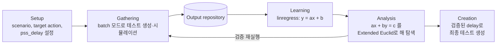

<!-- generated by yt-paper; edits will be overwritten -->

# PSS action sequence modeling using Machine Learning

[:material-open-in-new: 원문 보기](https://dvcon-proceedings.org/wp-content/uploads/PSS-action-sequence-modeling-using-Machine-Learning-1.pdf){ .md-button .md-button--primary target=_blank }

> PSS로 생성한 테스트의 action별 delay와 출력 timestamp 사이의 선형 관계를 linear regression으로 학습하고, Diophantine 방정식을 Extended Euclidean 알고리즘으로 풀어 여러 action의 target condition을 동시에 발생시킬 pss_delay 값을 자동으로 찾는 방법을 제시하며, 이를 PCIe/ACE deadlock 재현에 적용한 사례 연구이다.

| 항목 | 내용 |
|---|---|
| 저자/출처 | Moonki Jang, Myeongwhan Hyun, Hyunkyu Ahn, Jiwoong Kim, Yunwhan Kim, Dongjoo Kim (Samsung Electronics). 학회/출처는 원문에 명시되지 않음 |
| 유형 | PAPER |
| 카테고리 | Verification |
| ID | `ref-20261018-e710` |

## 핵심 인사이트

- 핵심 아이디어는 ML 자체보다 '선형성'에 있다. action별 delay와 timestamp의 관계가 선형이어야 회귀식과 Diophantine 해 탐색이 성립하며, 저자도 외부 요인에 의한 비선형 지연이 intercept를 바꿔 결과를 무너뜨린다고 명시한다. 시뮬레이션에서는 cycle delay counter와 매 사이클 mailbox 검사로 SW 루프 지연을 제거해 이 선형성을 확보한다.
- Analysis 단계는 'ax+by=c' 형태의 정수 해 탐색이므로, gcd(a,b)가 c를 나누지 않으면 해가 없다(Bézout). 실제 적용 전에 해 존재 여부를 먼저 확인해야 하며, 해는 k 파라미터로 무수히 생성되므로 그중 실행 가능한 delay 범위를 고르는 후처리가 필요하다.
- PCIe deadlock 사례에서 Action 2·3의 회귀식으로 공통 timestamp를 구한 뒤 Action 1의 측정값과 대조하는 방식이라 3변수 문제를 2변수로 줄여 풀었다. 저자도 ax+by+cz=y 형태의 3변수 해법 확장이 더 효율적이라고 언급하며, 이는 action 수가 늘어날 때의 확장 과제다.
- 문서에 제시된 실험은 PCIe deadlock 단일 사례뿐이며, 검증 커버리지 향상의 정량 수치(반복 횟수, 랜덤 베이스라인 대비 도달률 등)는 제시되지 않았다. '커버리지를 크게 높였다'는 주장은 정성적이므로 재현 시 별도 측정이 필요하다.
- Table II의 Action 1 데이터는 delay 0~3에서 timestamp 증분이 8, 10, 8로 완전한 선형이 아니며, Action 2의 delay=1 값(876154)도 다른 값들과 패턴이 맞지 않아 원문 표기 오류 가능성이 있다. 실제 적용 시에는 회귀 잔차를 확인하고 선형성을 검증하는 단계가 필수다.

## 상세 요약

### 배경 및 문제 정의

- **문제 상황**: PCIe RC buffer가 가득 찬 상태에서 CPU의 Writeback 트랜잭션과 PCIe posted write로 인한 snoop이 정확한 순서로 겹쳐야 PCIe↔ACE 프로토콜 간 deadlock이 발생한다. 이런 조건은 실리콘 레벨에서 발생하는 치명적 이슈이다.
- **기존 방식의 한계**: 재현은 주로 랜덤 테스트에 의존했고, 엔지니어가 결과를 반복 분석해 랜덤 제약을 수동으로 조정해야 했다. SW 상에서 동시에 수행되는 것처럼 보이는 세 function이 실제 HW에서는 서로 다른 시점에 실행되어, configurable delay를 넣고 결과를 비교하는 작업이 반복되었다.
- **목표**: 각 PSS action에 target condition만 지정하면, 그 조건들이 동시에 발생하도록 하는 delay를 엔지니어 개입 없이 찾아내는 것이다. 논문은 이를 PSS(데이터 생성 능력)와 ML(규칙성 학습)의 결합으로 본다.

### 핵심 아키텍처 및 방법론

TB 구성 요소와 4단계 ML 흐름으로 구성된다.

**TB 구성 요소**
- **PSS scenario generation**: 각 target action 앞에 `pss_delay()` 함수를 삽입한다. delay 값은 고정 값이나 랜덤 값으로 지정할 수 있다.
- **Cycle delay counter**: pss_delay 호출 시 delay 값과 CPU id를 mailbox 메모리에 기록하면, TB monitor가 매 사이클 mailbox를 검사하여 카운터를 동작시킨다. 카운트 종료 후 CPU에 인터럽트를 보내 지연 완료를 알린다. SW 루프 지연을 없애 사이클 단위 정확도를 확보하는 것이 핵심이다.
- **Output monitor**: target condition 파일을 커맨드 인자로 받아, 매 사이클 조건 발생 여부를 검사한다. 발생 시 테스트 정보, timestamp, 원인 action 정보를 로그로 출력한다.
- **Output repository**: 로그 분석기가 각 시뮬레이션 로그에서 monitor 메시지를 추출해 저장한다. 이것이 학습 데이터가 된다.

**ML 흐름**

1. **Learning**: (delay, timestamp) 좌표를 모아 SciPy `linregress`로 $y = ax + b$를 얻는다. 기울기 $a$는 $\Delta\text{timestamp} / \Delta\text{delay}$이다.
2. **Analysis**: 두 action의 회귀식을 같은 timestamp로 놓아 $a_1 x + b_1 = a_2 y + b_2$ 형태의 Diophantine 방정식을 만든다. 이를 $ax + by = c$로 정리하고 Extended Euclidean 알고리즘으로 gcd와 특해를 구한 뒤 일반해를 얻는다. $c$가 $\gcd(a,b)$의 배수가 아니면 Bézout 항등식에 따라 해가 없다. 얻은 delay로 학습 데이터를 다시 수집해 예측한 timestamp가 실제로 맞는지 확인하고, 이 단계에서 회귀식이 유지되는지도 검증한다.
3. **Creation**: 선형성이 검증된 delay 값으로 PSS 테스트를 생성해 target condition을 동시에 발생시킨다.

**예시 (Table I 데이터)**
- Action A: $2a + 1 = y$, Action B: $3b + 2 = y$
- 등식을 정리하면 $2a - 3b = 1$이다.
- 특해 $a_0 = -1$, $b_0 = -1$을 얻고 일반해는 $a = -1 - 3k$, $b = -1 - 2k$이다. $k = -1$에서 $(a, b) = (2, 1)$을 확인할 수 있다.

**PCIe deadlock 사례 적용**
- Action 1(RC buffer full), Action 2(Writeback), Action 3(snoop)의 target condition을 설정한다.
- pss_delay를 0~100까지 1씩 늘려 테스트를 생성하고 데이터를 수집한다.
- 회귀식: Action 2 $y = 2x_2 + 874352$, Action 3 $y = 3x_3 + 874354$. Action 1은 $y = 8x_1 + 1496546$으로 표기된다.
- Action 2와 3의 등식 $2x_2 - 3x_3 = 2$에서 특해 $X_2 = 4$, $X_3 = 2$를 구하고 일반해 $X_2 = 4 - 3k$, $X_3 = 2 - 2k$를 얻는다.
- $k = -103699$일 때 $X_2 = 311101$, $X_3 = 207400$이며, 두 action 모두 timestamp $1496554$가 된다. 이 값이 Action 1의 측정 timestamp 중 하나와 일치하므로 $\text{pss\_delay}_{1}=1$, $\text{pss\_delay}_{2}=311101$, $\text{pss\_delay}_{3}=207400$으로 세 action이 동시에 발생한다고 예측한다.
- 원문은 세 변수 문제를 두 변수 해로 푼 뒤 Action 1의 측정 데이터와 대조하는 방식이며, 3변수 $ax+by+cz=y$ 전용 해법이 더 효율적이라고 제안한다.

### 실험 결과 및 결론

- **검증 범위**: 문서에 제시된 실험은 PCIe deadlock 재현 사례 하나이다. 예측 delay로 세 target condition이 timestamp $1496554$에서 동시에 발생하는 것을 확인했다고 서술한다. 다만 반복 횟수, 성공률, 랜덤 테스트 대비 도달률 같은 정량 지표는 제시되지 않았다.
- **선형성 관찰**: Table II의 Action 1 데이터는 delay 0→1→2→3에서 timestamp가 1496546, 1496554, 1496564, 1496572로 증분 8, 10, 8이다. 완전한 선형이 아니며, 저자도 외부 요인에 의한 추가 지연이 존재한다고 명시한다. Action 2의 delay=1 값(876154)도 다른 값들의 패턴과 맞지 않아 원문 오기일 가능성이 있다.
- **저자 결론**: 실제 하드웨어 동시성을 SW 레벨 시나리오에서 제어하기 위해 PSS와 회귀 기반 학습을 결합하면 기존에 시뮬레이션에서 불가능하다고 여겨진 동시 이벤트를 만들 수 있으며, 이로써 검증 커버리지를 크게 높일 수 있다고 주장한다. 다만 이 주장은 정량 수치로 뒷받침되지 않는다.
- **한계와 향후 과제**: (1) 선형성 확보가 전제 조건이므로 외부 지연 요인을 제거하는 TB 설계가 필수다. (2) action 수가 늘어나면 다변수 Diophantine 해법이 필요하다. (3) 회귀는 단순 선형 모델이므로 비선형 지연이 큰 환경에는 적용이 어렵다.

## 관련 영상

<iframe src="https://www.youtube-nocookie.com/embed/KsLeNKgw_wU" title="[DVCON2022] PSS action sequence modeling using Machine Learning" loading="lazy" allow="accelerometer; clipboard-write; encrypted-media; gyroscope; picture-in-picture; web-share" referrerpolicy="strict-origin-when-cross-origin" allowfullscreen></iframe>

**[DVCON2022] PSS action sequence modeling using Machine Learning** — [YouTube에서 보기](https://www.youtube.com/watch?v=KsLeNKgw_wU) · [영상 페이지](../../videos/KsLeNKgw_wU.md)
