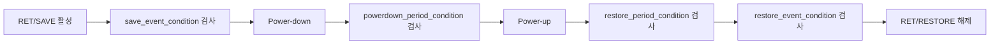

<!-- generated by yt-paper; edits will be overwritten -->

# Future Proofing Power Intent Specification through Unified Power Format (UPF) 4.0 for Evolving Advanced State Retention Strategies

[:material-open-in-new: 원문 보기](https://dvcon-proceedings.org/wp-content/uploads/1136-2.pdf){ .md-button .md-button--primary target=_blank }

> UPF 3.1로는 표현하기 어려운 고급 State Retention(SR) 전략의 clock/reset 경계 조건을 UPF 4.0의 새 retention 옵션(event/period condition, async_set_reset_effect 등)으로 명세·검증할 수 있도록 제안한 논문.

| 항목 | 내용 |
|---|---|
| 저자/출처 | Lakshmanan Balasubramanian, Amit Srivastava, Raguvaran Easwaran, John Decker, Rick Koster, Progyna Khondkar, Paul Bailey, Barry Pangrle, Shreedhar Ramachandra, Phil Giangarra, John Biggs, David Cheng (IEEE P1801 Working Group 관련 저자진; 학회명은 본문에 명시되지 않음) |
| 유형 | PAPER |
| 카테고리 | Verification |
| ID | `ref-20261018-e797` |

## 핵심 인사이트

- 기존 UPF 3.1은 save/restore 이벤트 시점만 검사할 수 있어, 전원 차단·복구 구간 전체에 걸친 CLK/RESET 조건을 RTL 단계에서 명세하기 어렵다. 이 격차가 PA 게이트 레벨이나 AMS 시뮬레이션 단계의 늦은 버그 발견으로 이어진다.
- UPF 4.0은 save_event_condition, restore_event_condition, restore_period_condition, powerdown_period_condition을 도입해 이벤트 구간과 기간 구간을 분리 명세한다. 기존 save_condition, restore_condition, retention_condition은 legacy 처리된다.
- async_set_reset_effect(ignored / retained_value / output_value)는 restore 구간 동안 set/reset이 출력과 저장값에 미치는 영향을 구분한다. 이 옵션은 시뮬레이션·검증 전용이며 합성/구현 흐름에는 직접 영향이 없다고 명시된다.
- 단일 제어(single-control)와 이중 제어(dual-control, SAVE/RESTORE) SR 소자별로 UPF_GENERIC_CLOCK 조건 조합(a~f 변형)을 제시해, 클럭 트리 전원 차단 여부에 따른 설계 트레이드오프를 명세 수준에서 표현할 수 있게 한다.
- 구현 정확성은 여전히 define_retention_cell과 map_retention_cell의 올바른 지정에 달려 있으므로, 검증 단계에서 조건을 확장하더라도 실제 셀 특성과 맞는지는 별도로 확인해야 한다.

## 상세 요약

### 배경 및 문제 정의

저전력 설계에서 power gating된 도메인의 상태를 유지하기 위해 State Retention(SR) 기법이 쓰인다. 전통적인 SR 소자는 단순한 레지스터나 플립플롭이며, SR 전략은 save/restore 이벤트 시점의 제어 신호로 기술된다. 그러나 공정 미세화와 저전력·고속 복구 요구에 따라 면적·전력 효율이 높은 고급 SR 소자가 등장했고, 이들은 clock 트리 상태나 reset 타이밍에 대한 추가 경계 조건을 동반한다.

논문은 이 조건들이 UPF 3.1 이하에서 표현되지 않는다고 지적한다. 현재 표준은 save 이벤트, restore 이벤트, power-down/power-up 사이 구간에 대한 검사만 허용한다. 그 결과 아키텍처·인프라 명세 위반이 RTL 단계에서 드러나지 않고, PA 게이트 레벨 시뮬레이션이나 AMS co-simulation 단계에서 늦게 발견된다. 이는 비용과 silicon bug 위험을 키운다.

### 핵심 아키텍처 및 방법론

논문은 IEEE 1801(UPF) 4.0에 추가할 구문·의미 확장을 제안한다. 핵심 구성은 다음과 같다.

- **새 조건 옵션**: `save_event_condition`, `restore_event_condition`, `restore_period_condition`, `powerdown_period_condition`을 `set_retention`에 추가한다. 이 옵션들은 `UPF_GENERIC_CLOCK`, `UPF_GENERIC_ASYNC_SET_RESET` 또는 현재 scope의 net/port만 참조할 수 있다.
- **이벤트와 기간의 분리**: save/restore는 이벤트 단위로 게이트되고, restore 및 power-down은 기간 전체에 걸쳐 조건을 만족해야 한다. 조건이 깨지면 해당 구간의 retained value는 X로 손상된다.
- **async_set_reset_effect**: `ignored`, `retained_value`, `output_value` 중 하나를 선택해 restore 구간 동안 set/reset이 출력과 저장값에 주는 영향을 지정한다.
- **applies_to**: 전략을 `flop`, `latch`, `any`에 한정해 적용 범위를 좁힌다.
- **레거시 처리**: `save_condition`, `restore_condition`, `retention_condition`은 legacy로 지정되어 새 옵션과 함께 일관되게 쓸 수 없다.

의미 정의는 다음과 같이 주어진다. `UPF_GENERIC_ASYNC_SET_RESET`은 set과 reset 입력(active-high 정규화 후)의 OR로 정의된다. 레벨 감지 save는 save_signal의 trailing edge를, 엣지 감지 save는 지정된 엣지를 save 이벤트로 본다.

논문은 두 종류의 SR 소자를 사례로 든다.

- **Single-control SR (RETN, active low)**: 시퀀스는 clock 정지, retention 활성화, save, power-down, power-up, restore, retention 해제 순이다. 클럭 조건은 a(무시)부터 f까지 여섯 가지 변형으로 나뉘며, 예를 들어 b는 save/restore 이벤트에서만 clock low를, d는 restore·power-down 구간까지 low를 요구한다. Reset 동작은 `async_set_reset_effect`의 세 가지 값으로 구분된다.
- **Dual-control SR (SAVE/RESTORE 분리)**: save와 restore 신호가 별개다. 클럭 조건 변형은 a~f이며, reset 동작은 RESTORE 활성 여부와 `async_set_reset_effect` 설정에 따라 달라진다. Q_ret는 실제 저장된 값을 나타낸다.

각 변형의 UPF 코드 예시가 본문에 제시되어 있다.

### 실험 결과 및 결론

이 논문은 정량적 벤치마크나 실험 수치를 제시하지 않는다. 대신 SR 전략 사례(single-control, dual-control)와 조건별 UPF 명세 예시, 그리고 clock·reset 동작 파형을 정성적으로 보여준다. 본문에 실제 시뮬레이션 결과나 도구 비교 데이터는 없다.

결론적으로 논문은 UPF 4.0 확장이 고급 SR 전략의 경계 조건을 RTL 단계에서 명세하고 검증할 수 있게 한다고 주장한다. 다만 본문에서 명시하듯 새 옵션은 현재 검증 전용이며 합성·구현 흐름에 직접 효과가 없다. 실제 구현 정합성은 `define_retention_cell`과 `map_retention_cell`의 정확한 지정에 여전히 의존한다. 참고문헌 [4]는 IEEE Standard 1801-2024이며, 본문은 UPF 4.0을 "upcoming"으로 기술하므로 이 논문은 표준 제안 단계의 문서로 읽는 것이 적절하다.

## 관련 영상

<iframe src="https://www.youtube-nocookie.com/embed/MH85nB2tYmI" title="[DVCON2025]Future Proofing Power Intent Specification UPF 4.0 for Evolving Advanced State Retention" loading="lazy" allow="accelerometer; clipboard-write; encrypted-media; gyroscope; picture-in-picture; web-share" referrerpolicy="strict-origin-when-cross-origin" allowfullscreen></iframe>

**[DVCON2025]Future Proofing Power Intent Specification UPF 4.0 for Evolving Advanced State Retention** — [YouTube에서 보기](https://www.youtube.com/watch?v=MH85nB2tYmI) · [영상 페이지](../../videos/MH85nB2tYmI.md)
