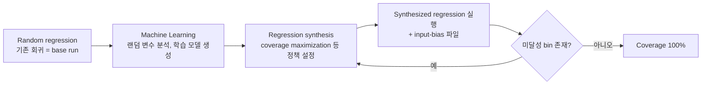

<!-- generated by yt-paper; edits will be overwritten -->

# AI - accelerating coverage closure using intelligent stimulus generation

[:material-open-in-new: 원문 보기](https://dvcon-proceedings.org/wp-content/uploads/1100.pdf){ .md-button .md-button--primary target=_blank }

> SoC 버스 매트릭스의 대규모 cross coverage(수십만~100만 bin)를 닫기 위해, Cadence Xcelium SimAI의 input-bias 기능으로 initiator-target 제약 기반 bias 파일을 만들어 미달성 bin 중심으로 랜덤 자극을 조정하는 방법을 제안하며, 실험에서 시뮬레이션 시간을 약 54% 줄였다고 보고한다.

| 항목 | 내용 |
|---|---|
| 저자/출처 | Jainender Kumar, Ronak Bhatt, Garima Srivastava (Samsung-India), Ashutosh Sinha, Prashant Teotia (Cadence-India). 발표 학회/저널 정보는 본문에 명시되지 않음 |
| 유형 | PAPER |
| 카테고리 | Verification |
| ID | `ref-20261018-ea2b` |

## 핵심 인사이트

- 커버리지 포화 문제의 원인은 랜덤 엔진이 같은 bin을 반복해서 맞히는 데 있다. 이 논문은 포화 이후 단계에서 미달성 bin 정보를 다음 반복에 반영하는 피드백 루프를 두어 이 문제를 다룬다.
- input-bias 파일은 initiator별 제약과 접근 가능한 target 정보로 Perl 스크립트가 자동 생성한다. 유효하지 않은 bin을 미리 걸러내므로 시뮬레이션 시간이 illegal bin 검증에 낭비되는 것을 막고, bin 수에 대한 의존도도 낮춘다.
- 보고된 효과는 학습을 회귀 초기에 시작할 때 더 크다. 본문 Figure 7도 같은 취지를 보인다. 실무적으로는 포화 직후가 아니라 coverage 증가가 둔화되기 전에 AI 단계를 넣는 것이 유리하다고 해석할 수 있다.
- 결과 수치는 자사 사례 한 건(약 100 initiator, 약 380 target, 약 600K bin)에서 나온 것이다. 8.4K→3.8K 시뮬레이션 시간 감소(약 54%)는 표와 본문에 있지만, 결론에서는 '최소 30%' 감소로 요약하고 있어 수치 표현이 일관되지 않다. 재현 조건과 베이스라인 정의를 함께 확인해야 한다.
- 벤더 도구(Xcelium SimAI) 기능에 의존하는 방법이며, 알고리즘 세부(학습 모델, 보상 함수, 수렴 정책 등)는 공개되지 않았다. 적용 시에는 bias 파일 생성 방식과 random seed 관리(랜덤성 보존 여부)를 직접 검증하는 것이 필요하다.

## 상세 요약

### 배경 및 문제 정의

현대 SoC는 IP 코어 수가 늘고 multi-chip(예: UCIe 연결) 구조가 확산되면서 버스 매트릭스가 복잡해졌다. 본문 예시에서 150 initiator × 500 target 구조는 source, destination, size, length, burst 등의 cross를 포함해 50만 개 이상의 bin을 만든다. 일부 SoC에서는 bin 수가 100만 개에 가깝다고 보고된다.

문제는 다음과 같이 정리할 수 있다.

- **커버리지 포화(saturation)**: 어느 시점 이후 랜덤 자극은 같은 bin을 반복해서 맞히므로 iteration을 거듭해도 증분 커버리지가 거의 없다.
- **시뮬레이션 비용**: 많은 테스트 실행, 메모리와 컴퓨팅 자원, 긴 검증 일정이 필요하다.
- **희귀 corner case**: 조건이 드물어 일반 회귀에서 도달되지 않는 bin이 남는다.

저자들은 이 문제를 AI/ML 기반 자극 최적화로 풀고자 하며, 구체적으로 Cadence Xcelium SimAI의 "input-bias" 기능을 사용한다.

### 핵심 아키텍처 및 방법론

**1) Cover group 자동 생성 (Perl 스크립트)**

입력 파일(initiator 제약, target 주소 공간, initiator-target reachability)을 바탕으로 스크립트가 각 initiator에 대한 cover group과 monitor 연결 파일을 생성한다. Initiator DB와 target DB를 유지하며, APB의 경우 active target(READ/WRITE 허용)과 passive target(READ만 허용)을 구분해 불법 cross를 막는다.

**2) 학습 및 합성 흐름**

- **Machine Learning 단계**: 회귀 실행 중 모든 랜덤 변수를 분석해 base regression을 만든다. 어떤 회귀든 base로 쓸 수 있으며 커버리지 수준은 상관없다고 명시한다. 실행 후 configuration, coverage bit-vector, randomization 데이터를 생성한다.
- **Synthesis 단계**: 반복 학습 프레임워크에서 사용자가 use case와 convergence policy를 정의한다. 예를 들어 미달성 bin을 겨냥하는 coverage maximization을 선택한다.
- **Synthesized run 단계**: 일회성 input-bias 파일을 제공한다. 이 파일은 cross-coverage 정의와 사용자 지정 랜덤 변수를 담으며, 실행마다 learning matrix가 갱신되어 control knob의 영향을 평가한다.

**3) input-bias 파일**

initiator와 접근 가능한 target의 유효 bin을 명시해 무효 bin에 시간을 낭비하지 않도록 한다. 본문 예시는 JSON 형식이며, initiator 이름, target 인덱스, Direction, Length, Kind, Size 값 목록을 담는다. 이 파일도 같은 Perl 스크립트로 생성된다.

**4) 주요 기능**

- **Automatic constraints learning**: 각 회귀에서 initiator 자극에 관련된 제약 변수 정보를 학습 모델에 누적한다.
- **Coverage gap detection**: 합성 회귀와 이전 학습 모델을 비교해 hit ratio가 0인 cover group을 찾아 수렴 전략을 정한다.
- **Optimized stimulus generation**: 제약과 cover group의 관계를 AI가 해석해 특정 랜덤 값을 더 자주 사용하도록 한다.
- **Redundant test 제거**: 추가 커버리지에 기여하지 않는 테스트를 줄이고, 이후 실행은 미달성 bin에 집중하되 랜덤성은 유지한다.

핵심 목표는 커버리지를 '되찾는' 것이 아니라 미달성 bin을 맞힐 확률을 높이는 것이다.

### 실험 결과 및 결론

**사례 1: mobile platform fabric (약 100 initiator, 약 380 target, 약 600K bin)**

| 항목 | 기존 회귀 | Input-bias 적용 |
|---|---|---|
| 89% → 100% (Table II 1행) | 약 8.4K 시간 | 약 3.8K 시간 (> 54% 감소) |
| 46% → 100% (Table II 2행) | 약 8.7K 시간 | 약 3.8K 시간 (> 56% 감소) |

본문 Results에서는 포화 98%에서 100%까지 기존 약 8.4K 시간이 필요했던 것을 약 3.8K 시간으로 줄였다고 설명한다. 특정 hard-to-hit cover group(wlbt_core, target bin 9250개, 기존 약 85% 커버리지)에서도 기존 8.7K 시간 대비 약 3.8K 시간으로 100%에 도달했다고 보고한다.

**학습 시작 시점의 영향**: 저자들은 AI를 회귀 초기에 적용할수록 이득이 크다고 보고하며, Figure 7이 이를 보여준다고 설명한다.

**결론 및 한계**

- 0.7M~1M bin 규모의 여러 복잡 SoC에 적용했으며, 일반 랜덤 자극은 마지막 단계에서 포화되는 반면 input-bias는 미달성 bin을 기반으로 자극을 조정해 증분 커버리지를 유지한다고 주장한다.
- 결론에서는 100% 커버리지를 '최소 30% 이상 짧은 시간'에 달성한다고 요약한다. 앞선 본문 수치(약 54~56%)와 차이가 있으며, 이는 보수적 하한 표현으로 보인다.
- 논문 자체는 벤더 도구 기반의 산업 사례 보고이며, 학습 알고리즘의 세부와 여러 프로젝트에서의 통계적 검증은 제시하지 않는다. 또한 Figure 6, 7은 본문 텍스트만으로는 세부 수치를 확인하기 어렵다.
- 저자들은 이 방식이 설계 아키텍처에 독립적이며 multi-die 구조에도 적용할 수 있다고 주장하지만, 이에 대한 실험 근거는 본문에 없다.
- 참고문헌은 UVM 테스트 실패 분류, 회귀 분석에 ML 적용, ML 기반 검증 최적화 등 관련 연구를 인용한다.

## 관련 영상

<iframe src="https://www.youtube-nocookie.com/embed/3KjFoF6fVDU" title="[DVCON2025]AI - accelerating coverage closure using intelligent stimulus generation " loading="lazy" allow="accelerometer; clipboard-write; encrypted-media; gyroscope; picture-in-picture; web-share" referrerpolicy="strict-origin-when-cross-origin" allowfullscreen></iframe>

**[DVCON2025]AI - accelerating coverage closure using intelligent stimulus generation ** — [YouTube에서 보기](https://www.youtube.com/watch?v=3KjFoF6fVDU) · [영상 페이지](../../videos/3KjFoF6fVDU.md)
