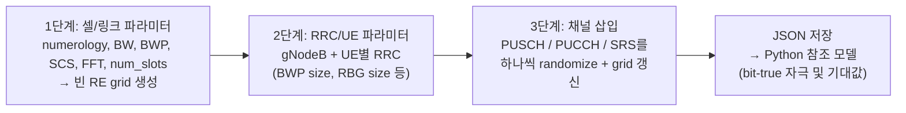

<!-- generated by yt-paper; edits will be overwritten -->

# Creating 5G Test Scenarios, the Constrained-Random way

[:material-open-in-new: 원문 보기](https://dvcon-proceedings.org/wp-content/uploads/1003-Creating-5G-Test-Scenarios-the-Constrained-Random-way.pdf){ .md-button .md-button--primary target=_blank }

> 5G-NR 상향링크(UL) 시스템 레벨 테스트를 위해, 자원 격자(RE grid)를 공유 상태로 두고 채널 타입별 제약을 여러 단계로 나눠 SystemVerilog 제약 랜덤 시나리오를 생성하는 방법론으로, 검증 실행 시간 대비 오버헤드는 약 1%라고 보고한다.

| 항목 | 내용 |
|---|---|
| 저자/출처 | Keshav Kannan and Eric P. Kim (Intel Corporation) |
| 유형 | PAPER |
| 카테고리 | Verification |
| ID | `ref-20261018-f0b1` |

## 핵심 인사이트

- 시스템 레벨 CRV의 핵심 난제는 수백 개의 상호 의존 랜덤 변수를 한 번에 푸는 것이다. 논문은 PUCCH+PUSCH 한 쌍만으로도 약 400개 파라미터가 얽힌다고 보고하며, 이를 단계별(1: 셀/격자 크기, 2: UE RRC 파라미터, 3: 채널 배치)로 분할해 해결한다.
- 단계 간 결합은 공유 RE grid(static enum 배열)를 통해서만 이루어진다. 각 채널 삽입 시 점유된 RB를 갱신하므로 이후 채널은 남은 자원에만 제약을 받아, 제약 간 충돌 가능성을 줄인다.
- PUSCH 시간 영역 제약(SLIV, mapping type)과 주파수 영역 제약(Type-0 RBG bitmap, Type-1 RIV)을 직교적으로 분리해 베이스 클래스와 서브 클래스에 나눠 두는 구조가 재사용성의 핵심이다.
- 랜덤 시드와 생성된 파라미터를 JSON으로 저장해 Python 참조 모델에 넘기는 흐름으로 bit-true 자극과 기대값을 함께 만든다. 또한 실패 테스트를 재랜덤화 없이 unit/top 레벨 간에 재생할 수 있어 디버그 turnaround를 줄였다.
- 논문 수치 근거: 428개 시나리오, 주간 시드 회귀로 설계 동결 후 80여 개 RTL 버그 검출, 커버포인트 80여 개. 다만 오버헤드 1%는 특정 시뮬레이션 환경 기준이며 제약 해석 시간 분포의 세부 데이터는 본문에 제시되지 않았다.

## 상세 요약

### 배경 및 문제 정의

블록 레벨에서는 CRV가 표준처럼 쓰이지만, 시스템 레벨(5G-NR PHY, RE grid 전체)에서는 파라미터 수와 상호 의존성 때문에 제약 작성과 solver 해석이 현실적으로 어렵다고 저자들은 지적한다. 예를 들어 한 UE에 PUCCH와 PUSCH 두 채널만 넣어도 약 400개의 랜덤 파라미터가 얽히고, UE와 채널 수가 늘면 복잡도가 급증한다. 64 UE를 한 슬롯에 PUCCH Fmt0, PUSCH Type1, SRS와 함께 배치하는 경우 논문의 Table V 분석에 따르면 총 랜덤화 파라미터 부하는 11,037개이다.

기존 대안인 directed test 방식은 가능한 채널/UE 조합을 모두 열거해야 하며, 시간이 많이 들고 오류가 생기기 쉬워 디버그가 설계 자체보다 테스트 시나리오 디버그에 더 많은 시간을 쓰게 만든다.

### 핵심 아키텍처 및 방법론

핵심은 랜덤화를 여러 단계로 나누고, 단계 사이를 **공유 RE grid**로만 연결하는 것이다.

- **RE grid 구조**: `re_grid_enum`(PUSCH, PUCCH Fmt0~3, SRS, OFB, BLANK, NA 등)을 담은 정적 배열 `re_grid_map[cc][slot][sym][rb][layer]`과 UE 식별자 배열 `re_grid_ue`로 구성된다. 채널이 삽입될 때마다 점유 RB가 갱신되어 이후 삽입은 `NA`(Not-Allocated) 영역에만 제약을 받는다.
- **1단계**: 셀 크기와 형태를 정하고 UE 수를 전달한다. Table II는 15가지 테스트 모드(FR1/FR2, SCS 15/30/60/120 kHz, 2x2 및 4x4 안테나, 1~4 CC, 대역폭 목록)를 정의한다.
- **2단계**: UE별 RRC 파라미터를 생성한다. BWP size, RBG size, puschRbgConfig 등이 여기에 포함되며, Program 2는 BWP 크기별 RBG 크기(3GPP TS 38.214 Table)를 `inside` 제약으로 표현한다. PUCCH, PUSCH, SRS 관련 RRC 파라미터도 이 단계에서 랜덤화된다.
- **3단계**: 채널 클래스 계층(Fig. 3)에서 한 번에 한 채널씩 삽입한다. `set_ucl(ue, cc, slot)`으로 대상을 지정한 뒤 `randomize()`를 호출한다. 
  - **PUSCH 시간 영역**: SLIV 기반 제약이며 mapping type A/B에 따라 `x0`(시작 심볼)과 `x1`(길이)의 허용 범위가 달라진다. 이는 베이스 클래스에 둔다.
  - **PUSCH 주파수 영역**: Type-0(RBG bitmap)과 Type-1(RIV) 제약이 크게 달라 서브 클래스로 분리한다. Program 4의 Type-1 예에서 `y0`, `y1`이 BWP 범위 안에 있고, 사각형 영역 `[x0:x1] × [y0:y1]` 내 셀이 모두 `NA`일 때만 `PUSCH`로 표시하도록 한다.
  - 시간 영역과 주파수 영역 제약은 직교적으로 분리되어, 제약 간 충돌을 줄인다.
- **Sequence**: Program 3처럼 UE, CC, 슬롯을 순회하며 PUCCH F2, PUSCH Type1, SRS를 차례로 삽입한다. 삽입 순서는 제한되지 않는다. 시퀀스는 단순하게 유지하고 복잡도는 채널 클래스 안에 가둔다.
- **출력**: 삽입된 채널의 랜덤화 결과를 Json 변환 클래스 배열에 저장하고, time-0에 JSON 파일로 내보낸다. Python 참조 모델이 이 설정을 읽어 bit-true 입력 자극과 골든 기대값을 만든다.

### 실험 결과 및 결론

- **랜덤화 오버헤드(Table VI)**: 1 slot / 1 UE / 1 채널은 30초 미만, 1 slot / 64 UE / 1 채널은 약 30분, 1 slot / 64 UE / 3 채널은 약 1시간 30분으로 보고된다. 같은 조건의 시뮬레이션 실행 시간은 slot당 1~2시간이다. 논문은 전체 검증 실행 시간 대비 CR 오버헤드가 약 1%라고 결론짓는다.
- **검증 성과**: 428개의 CR 시나리오를 만들고, 시드를 주간 단위로 돌려 설계 동결 후 80여 개 RTL 버그를 찾았다. 대부분 hang을 일으키는 critical 버그였다. 최대 처리량(full allocation, max CC), 64 UE 스트레스, 큰 RB 할당과 고페이로드 PUCCH Fmt2 같은 성능/스트레스 시퀀스도 추가했다.
- **재사용성**: 인프라를 unit/top 레벨에 플러그앤플레이로 재사용했다. 실패 테스트를 재랜덤화 없이 다른 레벨에서 재생해 블록 디버그를 빠르게 했다.
- **한계**: 본 논문은 UL 범위만 다루며 DL 확장은 "직관적"이라고만 언급한다. 1%라는 오버헤드 수치는 단일 환경 기준이며, 제약 solver 실패율이나 시드별 분포는 상세히 제시되지 않았다. 또한 PUSCH 주파수 할당 로직의 "복잡한 방법"(type 결정)은 범위 밖으로 남겨 두었다.

## 관련 영상

<iframe src="https://www.youtube-nocookie.com/embed/UUzJcTvJEOE" title="[DVCON2023]Creating 5G Test Scenarios, the Constrained-Random way" loading="lazy" allow="accelerometer; clipboard-write; encrypted-media; gyroscope; picture-in-picture; web-share" referrerpolicy="strict-origin-when-cross-origin" allowfullscreen></iframe>

**[DVCON2023]Creating 5G Test Scenarios, the Constrained-Random way** — [YouTube에서 보기](https://www.youtube.com/watch?v=UUzJcTvJEOE) · [영상 페이지](../../videos/UUzJcTvJEOE.md)
