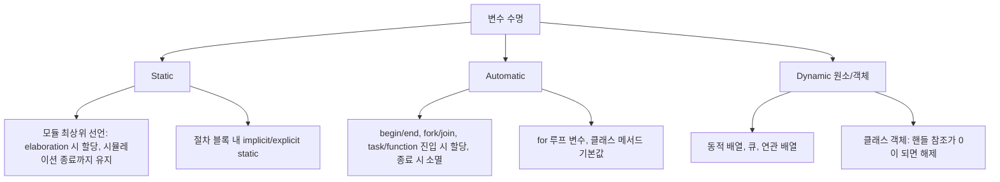

<!-- generated by yt-paper; edits will be overwritten -->

# The Life of a SystemVerilog Variable

[:material-open-in-new: 원문 보기](https://dvcon-proceedings.org/wp-content/uploads/the-life-of-a-systemverilog-variable.pdf){ .md-button .md-button--primary target=_blank }

> SystemVerilog 변수의 static/automatic 수명, 초기화 순서 문제, fork/join 수명 연장, 동적 배열·큐·연관배열·클래스 객체의 메모리 수명을 예제 중심으로 정리하고 흔한 버그의 수정 방법을 제시한 논문.

| 항목 | 내용 |
|---|---|
| 저자/출처 | Dave Rich (Mentor, a Siemens Business). 원문에 학회명·발표처 표기 없음 |
| 유형 | PAPER |
| 카테고리 | Verification |
| ID | `ref-20261018-f51f` |

## 핵심 인사이트

- 절차적 블록 안의 변수 선언 초기화는 기본적으로 implicit static이므로 호출마다 재초기화되지 않는다. 함수 재귀나 반복 호출에서 값이 누적되는 버그의 주원인이므로 function automatic 또는 변수에 automatic을 명시하는 습관이 필요하다.
- 모듈 최상위 정적 변수의 초기화 순서는 시뮬레이션 시작 시 비결정적이다(원문 기준 4P4=24가지 가능). 정적 변수 간 의존 초기화는 피하고, 절차적 코드에서 할당하거나 construct-on-first-use 패턴(초기화 여부를 확인하는 static 함수)을 쓰는 것이 안전하다.
- fork/join_none으로 생성된 자식 프로세스가 있으면 부모 scope의 automatic 변수 수명이 자식 종료까지 연장된다. 루프에서 값을 캡처하려면 automatic int vj = vi처럼 루프 안에서 복사본을 만들어야 한다.
- 클래스 객체는 참조 카운팅 방식으로 자동 해제되지만, static 변수나 static 큐에 핸들을 계속 보관하면 해제되지 않아 메모리 누수가 생긴다. 핸들의 수명(정적/자동/배열 원소/멤버)이 객체 수명을 결정한다는 점을 설계 시 고려해야 한다.
- 동적 배열은 밀집 접근과 전체 순회에 유리하고, 연관 배열은 희소 접근과 임의 키(문자열, 클래스 핸들 등)에 유리하며, 큐는 양 끝 push/pop에 적합하다. 원문은 각 자료구조의 메모리 오버헤드와 접근 비용 차이를 근거로 선택 기준을 설명한다.

## 상세 요약

### 배경 및 문제 정의

HDL의 `reg`/`wire` 개념에서 출발해 SystemVerilog 변수가 하드웨어 저장소이면서 소프트웨어식 변수의 성격을 함께 갖게 된 과정을 설명합니다. 하드웨어는 수명이 디바이스 전체인 반면, 소프트웨어는 scope와 프로세스에 따라 수명이 달라진다는 차이가 있습니다. SystemVerilog는 설계와 검증을 함께 다루므로 두 수명 모델을 한 언어에서 섞어 써야 하고, 테스트벤치가 설계 내부 변수를 cross-probe하는 경우 초기화 시점과 접근 가능 범위를 이해하는 것이 중요하다고 강조합니다.

원문이 지적하는 주요 문제는 다음과 같습니다.

- 정적 변수의 초기화 순서 비결정성 (static initialization order fiasco)
- 절차적 블록에서 선언 초기화가 한 번만 실행되는 implicit static 함정
- fork/join_none과 automatic 변수 수명 연장
- 동적 배열·큐·연관 배열·클래스 객체의 메모리 수명과 누수
- Verilog 시절 static 전용 설계에서 비롯된 함수/태스크 수명 문제

### 핵심 아키텍처 및 방법론

논문은 변수 수명을 scope 기준으로 분류하고 각 유형을 예제로 설명합니다.

**1. Scope와 Name Space**
- 모듈, 블록, 컴필레이션 유닛 scope가 있으며, 최상위 모듈 선언 변수는 static입니다.
- Figure 1은 패키지 변수 `P::A`를 두 인스턴스가 import해도 할당은 하나뿐이며, 계층 이름 `Y.m1.B`, `Y.m2.B`로 접근 가능함을 보입니다.

**2. Static 초기화 순서 문제와 회피**
- 정적 변수는 시뮬레이션 시작(time 0) 시점에 초기화되며 순서를 예측할 수 없습니다.
- 회피책: 의존 초기화를 피하고 절차 코드에서 할당하거나, construct-on-first-use 패턴을 사용합니다.

**3. Automatic 변수와 implicit static 규칙**
- SystemVerilog는 기본이 static이라 절차 블록 내부 선언 초기화(`int count = 0;`)는 illegal로 취급됩니다. 원문 Figure 3은 `countones` 함수가 호출마다 누적되는 문제를 보여주고, 네 가지 해결책을 제시합니다.
  1. 선언과 초기화를 분리
  2. 변수에 `automatic` 명시
  3. 함수에 `automatic` 명시(함수 기본 수명 변경)
  4. 의도한 경우 `static` 명시
- 루프 선언 변수와 클래스 메서드는 기본이 automatic입니다. 과거 Verilog와의 호환성 문제가 없었기 때문입니다.

**4. fork/join_none과 수명 연장**
- Figure 4에서 `vi`는 automatic이고 `automatic int vj = vi`로 캡처한 `vj`는 반복마다 새로 할당됩니다.
- join_none 자식 프로세스는 부모가 블록되거나 종료될 때까지 실행되지 않으므로, 자식이 끝날 때까지 scope 변수가 유지됩니다. 원문 예제의 출력은 `2 1 / 2 0` 또는 그 반대 순서입니다.

**5. 동적 데이터 타입**
- *동적 배열*: `new[]`로 할당하며 크기 변경 시 전체 복사가 일어날 수 있습니다. 인덱스가 0부터 시작하고 블록 접근에 효율적입니다.
- *큐*: 연결 리스트로 구현되어 head/tail push/pop에 유리하지만, 원소당 메모리 오버헤드가 크고 중간 접근은 순회가 필요합니다.
- *연관 배열*: 원소가 접근 시점에 개별 할당됩니다. 희소 접근과 string·class handle 같은 임의 키에 적합하고, 대부분을 쓰는 경우에는 동적 배열이 효율적입니다. 원문 Figure 7은 기본값 패턴(`'1`) 사용 시 접근만으로는 할당되지 않음을 보여줍니다.
- *배열의 배열*: SystemVerilog는 진정한 다차원 배열이 아니라 배열의 배열을 지원합니다. Figure 8은 `byte DQ[][$]`에서 각 행의 크기가 달라지는 예를 보입니다.

**6. 클래스 객체**
- 객체는 `new()`로 생성되며 handle로만 접근합니다. 명시적 destroy 구문이 없고, 시뮬레이터가 참조를 추적해 참조가 없으면 해제합니다. 해제 시점은 사용자가 관찰할 수 없습니다.
- 변수의 수명(static, automatic, 배열 원소, 다른 객체의 멤버)이 객체의 수명을 간접적으로 결정합니다.
- Figure 9의 예: `run1`은 temp 객체가 함수 종료 시 소멸하지만, `run2`는 temp 핸들을 static 큐에 넣어 객체를 유지합니다. 최종적으로 핸들 6개가 남습니다(정적 변수 `h` 1개와 큐 원소 5개). 원문은 참조를 해제하지 않으면 메모리 누수가 발생한다고 경고합니다.

**7. 서브루틴 수명**
- 초기 Verilog는 함수와 태스크가 static만 가능해 재귀나 재진입이 불가능했습니다. 합성기가 호출 시 스택을 동적으로 만들 수 없다는 이유였습니다.
- Verilog-2001은 `automatic` 키워드를 추가했고, SystemVerilog는 모듈·인터페이스에 대한 기본 수명 지정을 추가했습니다(`module automatic`).
- 클래스 메서드는 항상 automatic이며 static 수명으로 선언할 수 없습니다. 클래스의 `static` 키워드는 수명과 무관하고 클래스 타입의 멤버임을 뜻합니다.
- Figure 10의 `factorial(3)`은 static 기본값에서 잘못된 결과 1을 내고, `automatic`으로 바꾸면 6을 냅니다.

### 실험 결과 및 결론

본 논문은 벤치마크나 정량 실험이 아니라 예제 코드 기반의 설명 논문입니다. 각 Figure에서 의도한 출력과 잘못된 출력을 제시합니다.

- **초기화 문제**: Figure 3의 `countones` 함수는 호출 시마다 누적되어 두 번째 결과가 8이 되는 식의 오류를 보입니다. 네 가지 수정 방식으로 올바른 결과를 얻습니다.
- **재귀 함수**: static 구현은 결과 1, automatic 구현은 결과 6을 냅니다.
- **동적 데이터**: 배열의 배열 예제에서 총 바이트 수가 15에서 18로 바뀐다고 기술합니다.
- **클래스 객체**: 최종 참조 수 6(핸들 1 + 큐 원소 5)을 제시합니다.

결론적으로 논문은 변수 수명 오해에서 생기는 코딩 오류를 정리하고, 자료구조별 메모리 할당 특성을 비교해 선택 기준을 제공합니다. 실무적으로는 절차 블록과 함수에서 `automatic`을 명시하고, 정적 초기화 의존을 피하고, 핸들과 큐의 수명을 명시적으로 관리하라는 것이 핵심 메시지입니다.

**원문 확인 필요 사항**: Figure 8 코드는 `DQ[4]`에 5개 원소를 넣는데(`repeat(i+1)`), 본문은 "4-element queue in DQ[4]"와 총 바이트 18이라고 씁니다. 코드 기준으로 `DQ[0] = DQ[4]` 후 총합은 19가 되므로, 수치는 원문 코드와 대조해 확인하는 것이 안전합니다. 또한 본문에 "5 variables named A"라고 한 Figure 2 설명과 실제 예제 구성도 완전히 일치하지 않는 부분이 있어 참고가 필요합니다.

## 관련 영상

<iframe src="https://www.youtube-nocookie.com/embed/b7Xs_FX_gzs" title="[DVCON2021]The Life of a SystemVerilog Variable " loading="lazy" allow="accelerometer; clipboard-write; encrypted-media; gyroscope; picture-in-picture; web-share" referrerpolicy="strict-origin-when-cross-origin" allowfullscreen></iframe>

**[DVCON2021]The Life of a SystemVerilog Variable ** — [YouTube에서 보기](https://www.youtube.com/watch?v=b7Xs_FX_gzs) · [영상 페이지](../../videos/b7Xs_FX_gzs.md)
