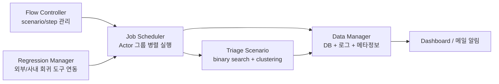

<!-- generated by yt-paper; edits will be overwritten -->

# Accelerating SOC Verification Using Process Automation and Integration

[:material-open-in-new: 원문 보기](https://dvcon-proceedings.org/wp-content/uploads/accelerating-soc-verification-using-process-automation-and-integration.pdf){ .md-button .md-button--primary target=_blank }

> SoC 검증의 IP/Block/Top 단계별 워크플로를 Flow Controller, Regression Manager, Job Scheduler, Triage, Data Manager 5개 모듈로 통합·자동화하여 검증 TAT를 단계별 최대 43% 줄였다는 삼성전자의 사례 논문.

| 항목 | 내용 |
|---|---|
| 저자/출처 | Seonghee Yim, Hanna Jang, Sunchang Choi, Seonil Brian Choi (Samsung Electronics, Hwaseong, Korea). 학회/게재처는 문서에 명시되지 않음 |
| 유형 | PAPER |
| 카테고리 | Verification |
| ID | `ref-20261018-f844` |

## 핵심 인사이트

- Top-down 통합이 아닌 bottom-up 방식을 택했다: 기존 검증 환경을 유지한 채 인터페이스 계층으로 감싸 검증 안정성 위험을 줄이고, 개발자별로 최적화된 환경을 보존하는 현실적 접근이다.
- 검증 워크플로를 scenario(start-step ~ end-step) 단위로 모델링하고, step을 pre/body/post로 나눠 재사용성과 실행 시점 파라미터 주입을 확보했다. 이는 사용자별 스크립트 환경 파편화 문제를 푸는 핵심 설계이다.
- Triage(실패 우선순위화)를 binary search와 density-based clustering으로 구현해, 실패 케이스를 재정렬하고 영향 범위를 좁혀 불필요한 재실행을 줄인다. RTL 변경 시 전체 회귀를 매번 돌리는 비용을 낮추는 데 목적이 있다.
- 시간 절감 수치는 VL1~VL4 단계별 모델(T 단위, max 기반 병렬 실행 가정)과 일부 IP/블록 실제 프로젝트 적용 결과로 제시되었으나, 적용 범위와 통계적 근거가 충분히 설명되지 않았다. 수치는 참고용으로 해석해야 한다.
- CI(Jenkins) 개념을 검증 워크플로에 확장했지만, 논문 스스로 부서 간 통합은 아직 진행되지 않았다고 밝힌다. 조직/프로세스 통합이 기술 통합만큼 중요한 과제임을 시사한다.

## 상세 요약

### 배경 및 문제 정의

스마트 디바이스 시장 경쟁이 심화되면서 SoC 개발에서 TAT(Turn Around Time) 단축이 중요해졌다. 그러나 SoC의 규모와 복잡도가 증가하면서 TAT를 맞추기 어려워지고 있다. 이를 해결하기 위해 SoC를 서브 블록으로 나누고, 개발 과정은 IP-level, block-level, top(SoC)-level의 3단계로 나뉜다. 각 단계마다 테스트벤치 개발과 회귀 테스트가 반복되며, 설계·검증 엔지니어는 자기 블록에 맞춘 스크립트와 도구를 각자의 개발 환경에서 만든다. 논문은 이렇게 사용자별로 파편화된 환경을 관리하는 부담이 커지고 있으며, 이것이 수작업 오류와 협업 비효율의 원인이라고 본다.

논문은 검증 단계를 VL1~VL4로 정의한다. VL1은 IP 검증, VL2는 IP와 block 검증이 주로 수행되고 top 검증이 시작되는 단계, VL3는 block과 SoC 검증 중심, VL4는 block과 SoC의 회귀 테스트 중심 단계이다.

### 핵심 아키텍처 및 방법론

논문은 통합 방식을 top-down, bottom-up, hybrid 세 가지로 구분하고, 검증 안정성과 기존 최적화 환경 보존을 이유로 bottom-up 방식을 채택했다. 기존 흐름은 유지하면서 수작업을 자동화하고, 단계별 워크스페이스 구조는 표준화하지 않고 모든 환경을 지원하는 방향이다. 제안 시스템은 다음 5개 모듈로 구성된다.

1. **Flow Controller**: 팀·단계별 워크플로를 통합 실행하는 CI 유사 시스템이다. 워크플로는 start-step과 end-step 사이의 step 시퀀스인 scenario로 정의되며, 각 step은 pre/body/post로 나뉘어 body만 외부에 노출된다. step과 scenario는 재사용 가능하며, 실행 시점에 조건 입력을 주입할 수 있다.
2. **Regression Manager**: 회귀 테스트 케이스를 관리하며, 사내 큐와 상용 회귀 도구(서드파티 도구)를 연동한다. 환경 구성 정보는 메타데이터로 보고된다.
3. **Job Scheduler**: 우선순위나 예약 시간에 따라 scenario 단위 job을 스케줄링한다. 실행 단위는 Actor 그룹이며, 로드 밸런싱을 위해 병렬 처리한다. 각 job은 scenario와 step의 상태를 실시간으로 관리한다.
4. **Triage Scenario(TS)**: 회귀 결과를 바탕으로 실패를 분류한다. 현재 버전은 binary search로 문제 범위를 좁히고 재실행하며, density-based clustering으로 블록별 테스트 케이스를 클러스터링해 에러 케이스를 우선순위대로 재정렬한다. 설계 변경 시 모든 테스트를 주기적으로 돌리는 비효율과, 블록 간 상호 영향으로 인한 잠재 에러를 함께 해결하려는 목적이다.
5. **Data Manager**: 모든 job 실행 데이터를 수집한다. 검증 태스크와 결과는 DB에 저장되고, 사용자 입력과 로그는 파일로 저장된다. RTL 변경 이력을 시뮬레이션 실패와 상관시켜 디버그를 돕는다. 상태는 대시보드와 메일 알림으로 전달된다.

### 실험 결과 및 결론

논문은 단계별 검증 시간 모델을 제시한다. IP 단계의 기존 시간을 A, block 단계를 B, top을 C로 두고, 제안 시스템에서는 병렬 실행으로 max 값을 취한다. 예를 들어 VL1에서 A1=4T, B1=16T이면 기존 20T에서 실패가 없을 때 16T로 줄어든다. 실패 케이스 재검증 시간은 별도로 더해진다.

실제 프로젝트 적용 결과(Figure 8, 본문 기준)는 다음과 같다.

| 검증 단계 | 검증 시간 감소율 |
|---|---|
| VL1 | 약 35% |
| VL2 | 43% |
| VL3 | 28% |
| VL4 | 27% |

VL3와 VL4의 감소폭이 작은 이유는 IP 단계 검증 시간 절감 효과가 포함되지 않기 때문이라고 설명한다. 논문은 전체 프로젝트에 적용된 것이 아니라 일부 IP와 대응 블록, 그리고 SoC top에 적용된 결과라고 명시한다. 결론으로 플랫폼화된 검증 환경으로 테스트 수가 줄고, 남은 시간을 추가 검증에 써서 품질도 높였다고 주장한다. 향후 계획으로는 클러스터링 기반 재정렬 고도화, sanity test 분류 모델 도입, 동적 분산 job 스케줄링이 제시되었다.

**한계**: 시간 절감 모델의 가정(병렬 max 실행, 실패 발생 확률 분포)이 통계적으로 충분히 검증되지 않았고, 논문도 실제 적용을 통한 근사 해석이라고 밝힌다. 또한 부서 간 조직 통합은 진행되지 않았다고 명시되어 있다. 정량 결과의 재현 조건과 베이스라인 정의가 상세히 제시되지 않았으므로, 수치는 해당 프로젝트 맥락의 참고치로 읽는 것이 적절하다.

## 관련 영상

<iframe src="https://www.youtube-nocookie.com/embed/zgdf-5MBHk4" title="[DVCON2020] Accelerating SOC Verification Using Process Automation and Integration" loading="lazy" allow="accelerometer; clipboard-write; encrypted-media; gyroscope; picture-in-picture; web-share" referrerpolicy="strict-origin-when-cross-origin" allowfullscreen></iframe>

**[DVCON2020] Accelerating SOC Verification Using Process Automation and Integration** — [YouTube에서 보기](https://www.youtube.com/watch?v=zgdf-5MBHk4) · [영상 페이지](../../videos/zgdf-5MBHk4.md)
