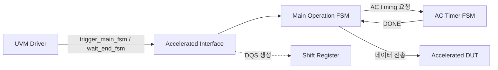

<!-- generated by yt-paper; edits will be overwritten -->

# Design scheme for Emulator-friendly Memory Verification IP to Accelerate Simulation Performance

[:material-open-in-new: 원문 보기](https://dvcon-proceedings.org/wp-content/uploads/1015.pdf){ .md-button .md-button--primary target=_blank }

> UVM 기반 Memory VIP의 빈번한 HVL–HDL 통신을 줄이기 위해 데이터 전송을 배열 단위로 묶고 AC 타이밍을 synthesizable FSM/shift register로 옮겨, NAND 시나리오에서 시뮬레이션 성능을 약 27배 개선한 emulator-friendly VIP 설계 기법.

| 항목 | 내용 |
|---|---|
| 저자/출처 | Sunghyeon Kang, Munsik Bae (SK hynix Inc.), Jinsung Song, Minsung Kang, Sangkyoo Jeong (SK hynix Inc.), Seokho Hong (Siemens EDA). 학회/출처는 본문에 명시되지 않음 |
| 유형 | PAPER |
| 카테고리 | Verification |
| ID | `ref-20261018-fb94` |

## 핵심 인사이트

- 성능 병목은 DUT 자체보다 emulator(HDL)와 non-accelerated testbench(HVL) 사이의 통신 횟수에 있으므로, 전송 횟수를 줄이기 위해 트랜잭션을 배열로 묶어 한 번에 전달하는 것이 핵심 설계 원리다.
- UVM driver/monitor 내부의 #delay 기반 AC 타이밍 모델링은 emulator에서 이벤트로 관측되어 성능을 떨어뜨리므로, AC timer FSM(일회성 타이밍)과 shift register(DQS 같은 반복 스트로브 신호)로 대체해 untimed 영역만 남기는 접근이다.
- Main Operation FSM(IDLE/WAIT/DRIVE/PAUSE/EXIT)과 trigger_main_fsm()/wait_end_fsm() 인터페이스 태스크 쌍으로 driver 호출을 최소화하며, 읽기는 IDLE 진입 시, 쓰기는 EXIT 시점에 데이터를 한 번에 교환한다.
- 벤더별 비공개 커맨드나 미출시 메모리 스펙에 대응하기 위해 EDA 제공 VIP 대신 자체 customized VIP를 만드는 필요성을 제시한다. 다만 디버그 이점 등은 정량화되지 않았다.
- 실험은 단일 DUT(PCIe 4.0 SSD controller), 단일 시나리오(Sequential Write-Read), 단일 NAND 토폴로지에 한정되며 결과는 사례 수준이다. 초록의 'Memory' 일반화 주장은 NAND 중심 실험으로 뒷받침되는 범위를 넘어서므로 다른 메모리(DRAM 등)로의 확장은 별도 검증이 필요하다.

## 상세 요약

### 배경 및 문제 정의

SoC 규모가 커지면서 시뮬레이션 TAT(Turn-Around-Time)가 크게 늘어나고 있다. 이를 줄이는 방법 중 하나가 emulator를 이용한 co-emulation이다. 그러나 DUT(Design Under Test)는 emulator에서 가속되더라도, 합성 불가능한 UVM testbench는 시뮬레이터에서 동작한다. 이 과정에서 Memory VIP와 DUT 사이의 빈번한 인터페이스 통신이 병목이 되어, 실제 메모리 보드를 emulator에 연결한 경우에 비해 성능이 크게 떨어진다.

또한 메모리 벤더는 차세대 메모리를 빠르게 대응해야 하며, NAND의 벤더 고유 커맨드처럼 공개되지 않은 기능을 EDA 벤더의 기성 VIP가 즉시 지원하기 어렵다는 점을 문제로 제기한다. 따라서 자체 customized VIP가 필요하다는 것이 논문의 출발점이다.

### 핵심 아키텍처 및 방법론

핵심 아이디어는 UVM Driver/Monitor의 역할을 합성 가능한 interface(HDL 측)로 옮기는 것이다.

1. **배열 기반 트랜잭션 전달**: emulator(Interface)와 simulator(VIP Driver) 사이의 대역폭 한도 내에서 트랜잭션 크기에 맞춘 배열을 선언하고, 이를 FSM으로 제어한다. Driver는 태스크를 한 번 호출해 한 번의 데이터 전송으로 트랜잭션을 처리한다.

2. **Main Operation FSM**: 상태는 다음과 같다.
   - IDLE: Driver가 `trigger_main_fsm()`을 호출해 DRIVE로 진입. 읽기 시 Data Array를 Interface로 전달 후 `wait_end_fsm()` 호출.
   - WAIT: Read/Write 데이터 전송을 기다림.
   - DRIVE: Interface와 DUT 사이 데이터 전송. Backpressure 발생 시 PAUSE로 이동.
   - PAUSE: 호스트(메모리 컨트롤러)가 수신할 수 없을 때 대기.
   - EXIT: 전송 완료 또는 command abort 후 IDLE로 복귀. 쓰기 시 이 시점에 Driver가 Data Array를 획득.

   데이터 전송 시점은 읽기는 IDLE(트리거 시), 쓰기는 EXIT 시점에 한 번씩이며, DUT와의 실제 전송은 DRIVE 상태에서 AC 타이밍을 따른다.

3. **AC 타이밍 모델링**: 기존 방식은 #delay로 구현되어 emulator에서 이벤트로 관측되므로 느리다. 이를 두 가지 모델로 대체한다.
   - **AC Timer FSM** (IDLE/SET/COUNT/CHECK/DONE): 명령 발행 시 한 번 활성화되는 파라미터(예: tDQSQ, tQH, tCHz)를 AC timing list에 등록하고, 순차적으로 카운트한다. CHECK 상태에서 남은 timing이 있으면 SET으로 돌아가고, 없으면 DONE으로 Main FSM에 완료를 알린다.
   - **Shift Register** (스트로브 생성): 모든 데이터 비트마다 적용되는 tDQSRE 같은 신호를 FSM 대신 shift register로 구현한다. RE 신호를 emulator 클록으로 샘플링해 첫 비트에 기록하고, 1bit/cycle로 이동시켜 목표 지점에 도달하면 DQS를 토글한다.

### 실험 결과 및 결론

**실험 조건**: emulator는 Siemens Veloce StratoM(OS v23.0.2), 시뮬레이터는 Questa 2023.3, DUT는 PCIe 4.0 SSD controller SoC, 호스트 인터페이스는 VirtuaLab PCIe 1.9.0이다. NAND 토폴로지는 4 Channels, 4 Chip Enables, 2 Logical Units이다. 시나리오는 Sequential Write-Read이며, 비교군은 (1) 기존 NAND VIP, (2) 재설계 NAND VIP, (3) 실물 NAND 보드다.

**결과** (Fig. 7):

| 구분 | Simulation time (ms/hour) | Data transfer (KB/sec) |
|---|---|---|
| 기존 NAND VIP | 7.38 | 10 |
| 재설계 NAND VIP | 204 | 360 |
| 실물 NAND 보드 | 304 | 550 |

- 시뮬레이션 시간 기준 약 27배 향상(204/7.38 ≈ 27.6), 실물 대비 약 67%(204/304).
- 데이터 전송률 기준 약 36배 향상, 실물 대비 약 65%.

**결론**: 빈번한 데이터 교환이 필요한 SoC(예: NAND controller) 검증에서 데이터 타입 선언과 FSM 기반 interface로 emulator–simulator 통신을 줄이고, AC 타이머를 synthesizable 문법으로 재작성하여 test 측의 시간 소모 영역을 줄였다. 저자들은 이를 통해 실물 메모리 시제품 이전 단계의 조기 검증 가능성을 제시한다.

**한계 및 해석 시 유의점**: 실험은 단일 DUT, 단일 시나리오(순차 쓰기-읽기), 단일 NAND 구성에 한정된다. 초록은 'Memory VIP' 일반을 언급하지만 실제 검증은 NAND에 국한된다. 또한 디버그 편의성(checker, debug signal)의 이점은 정량화되지 않았다. 재현에 필요한 상세 코드나 FSM 구현 세부사항, 기존 VIP와의 비교 조건(예: 동일 시뮬레이션 설정 여부)에 대한 정보는 본문에 제한적으로만 나온다.

## 관련 영상

<iframe src="https://www.youtube-nocookie.com/embed/NZnsCEQcW28" title="[DVCON2025]Design scheme for Emulator-friendly Memory Verification IP to Accelerate Simulation " loading="lazy" allow="accelerometer; clipboard-write; encrypted-media; gyroscope; picture-in-picture; web-share" referrerpolicy="strict-origin-when-cross-origin" allowfullscreen></iframe>

**[DVCON2025]Design scheme for Emulator-friendly Memory Verification IP to Accelerate Simulation ** — [YouTube에서 보기](https://www.youtube.com/watch?v=NZnsCEQcW28) · [영상 페이지](../../videos/NZnsCEQcW28.md)
