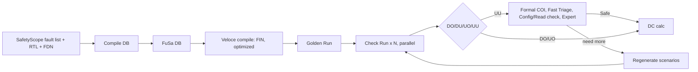

<!-- generated by yt-paper; edits will be overwritten -->

# Functional Safety Workflow of Internal IP (NPU) Within Large Automotive IC Through Analysis and Emulation Usage for SW-based Safety Mechanisms

[:material-open-in-new: 원문 보기](https://dvcon-proceedings.org/wp-content/uploads/1040.pdf){ .md-button .md-button--primary target=_blank }

> 자동차 SoC 내 NPU IP의 SW 기반 안전 메커니즘(SM3, SM1/SM2)을 Siemens Veloce 에뮬레이션 fault campaign으로 검증해 ASIL B 목표 DC 91.21%(실측 91.49%)를 달성한 워크플로우 사례 연구.

| 항목 | 내용 |
|---|---|
| 저자/출처 | Andrey Likhopoy, Sangkyu Park, Hyeonuk Noh, Wonil Cho (Samsung Electronics); Inhwan Kim, Robert Serphillips, Chanjin Kim, Justin Lee, James Kim (Siemens EDA); Sougata Bhattacharjee, Gulshan Kumar Sharma, Akshaya Kumar Jain (Samsung Semiconductor India Research) |
| 유형 | PAPER |
| 카테고리 | Verification |
| ID | `ref-20261018-fef8` |

## 핵심 인사이트

- DC 목표는 ASIL B의 SPFM 90%에 측정 오차 margin 1.21%를 더한 91.21%로 설정했으며, 블록별 FIT rate 분포에 따른 가중 평균으로 최종 DC를 산출했다.
- 테스트 시나리오 품질은 기능 검증 수준 이상이어야 하며, 실제 SW 시나리오는 IP 기능을 충분히 쓰지 않아 DC가 낮게 나오므로 minor 기능까지 포함하는 시나리오가 필요하다.
- UU 케이스 분석에 Fast Triage(Golden vs Check Run 파형 비교), Configuration check(ECC/parity/WDT 활성 여부), Read transition check(메모리 읽기 트랜잭션 확인)를 체계적으로 적용했다.
- Veloce 컴파일 최적화(Dead logic, No port in memory, FIN=FDN)와 COI 분석으로 injection 대상을 줄여 런타임을 절감했으며, 이는 인증 기간 단축에 직결된다.
- 단일 비트 fault 관측을 위해 극단값 대신 중간값을 쓰고 LUT bypass, 양/음 혼합 MAC 출력 등으로 포화를 피하는 데이터 설계 기법은 재사용 가치가 높다.

## 상세 요약

### 배경 및 문제 정의

자동차 반도체는 ISO 26262에 따라 HARA로부터 ASIL 등급과 safety goal이 도출되며, IP 단위에서는 safety mechanism(SM)의 진단 커버리지(DC)를 입증해야 합니다. 본 논문은 Samsung Electronics의 NPU IP(영상 센싱용 AI 가속기)를 대상으로 한 fault campaign(FC)에서, 메모리 부분은 주로 시뮬레이션으로 검증했지만 로직 부분을 보호하는 SW 기반 SM(SM1, SM2, SM3의 self-test 등)은 에뮬레이션으로 검증했다는 사례를 다룹니다.

목표는 ASIL B에 해당하는 DC 90%에 측정 오차 margin 1.21%를 더한 91.21% 이상을 달성하는 것입니다. 초록에서는 fault injection 런타임과 데이터 관리 부담이 안전 수준 달성과 인증 기간의 병목이라고 지적합니다.

### 핵심 아키텍처 및 방법론

**NPU 구성 및 SM 배치**
- NPU는 PU0, PU1, PU2(연산 블록), MEM(메모리 접근), CTRL(제어)로 구성됩니다.
- 메모리는 parity/ECC(SM9–SM13)로 보호하고, 로직은 firmware가 구동하는 self-test(SM2, SM3) 등 SW 기반 SM으로 보호합니다.
- 블록별 FIT rate 분포를 기준으로 예상 DC를 설정했습니다. SM3는 전 블록을 커버하는 필수 SM이며 목표 91.21%, SM1/SM2는 CPU 블록에 대해 60%로 설정했습니다. 최종 DC는 로직/메모리 부분의 가중 평균으로 계산합니다.

**에뮬레이션 기반 FC 워크플로우 (Siemens 툴체인)**
1. SafetyScope에서 생성한 fault list, RTL, fault detection net(FDN)을 Compile DB에 입력합니다.
2. 결과 fault list는 FuSa DB에 저장되고, Veloce 컴파일이 이를 참조해 fault injection net(FIN)과 에뮬레이터용 블록을 생성합니다. 각 fault net에 SA0/SA1을 부여하므로 fault 수는 2N이 됩니다. 영구 고장만 고려합니다.
3. Golden Run에서 FDN 값을 기록하고, 각 fault를 같은 시나리오에서 주입한 Check Run과 비교합니다.
4. 결과는 alarm 감지 여부(D/U)와 observe 관측 여부(O/U)로 DO, DU, UO, UU 네 가지로 분류됩니다.

**런타임 최적화**
- 컴파일 단계 최적화: Deadlogic(fanout 없음), No port in memory(읽기 주소 없는 메모리), FinAndFdn(FIN과 FDN 중복)을 주입 없이 제외합니다.
- Vector Analysis에서 상수 노드를 제거하고, 여러 Check Run을 병렬 실행합니다.
- 초기 상태를 Golden Run에서 저장해 각 Check Run에서 복원함으로써 시스템 초기화 시간을 생략합니다.
- DO가 확인되면 즉시 종료하는 early termination을 적용합니다.

**테스트 시나리오 생성 원칙**
- 시나리오는 Host의 CPU 부팅 → WDT 활성 → Command Scheduler 구동 → 블록 동작 → CRC 비교 → pass/fail/hang interrupt 흐름을 따릅니다.
- 기능 검증 시나리오보다 높은 품질이어야 하며, 실제 SW 시나리오는 IP 기능 일부만 사용하므로 DC가 낮게 나옵니다.
- 시스템 hang과 data mismatch를 모두 감지할 수 있어야 하며, 체인형 sub-IP는 각 블록을 미세한 변동에 민감하게 설정합니다.
- 단일 비트 변화를 관측하기 위해 극단값(0x0000, 0xFFFF) 대신 중간값(0x8000, 0x7FFF)을 사용합니다. 극단값은 포화(saturation)로 fault가 가려질 수 있습니다.
- 성능만 저하되는 fault는 시스템 레벨 성능 시나리오에서 잡는 것을 전제로 합니다.

**UU 분석 방법론**
- Formal COI 분석: 관측 cone 밖의 UU는 Safe로 분류합니다.
- Fast Triage: Golden과 Check Run 파형에서 모듈 포트 간 편차를 추적해 전파가 차단되는 지점을 찾습니다.
- Configuration check: ECC/parity/WDT 등 보호 기능의 활성 여부를 SW 코드와 파형을 동시에 보며 확인합니다(Codelink 사용).
- Read transition check: 메모리 셀 fault는 해당 주소를 실제로 읽는 트랜잭션이 없으면 전파되지 않으므로 Safe로 분류합니다.
- Expert Judgement: spec-out, debug, clock gating, invalid range, performance 기능에 속하는 fault는 Safe로 판정합니다.

**PU0/PU1/MEM 및 PU2 시나리오 개선 기법**
- 처리 비트폭에 맞춘 특수 데이터 패턴(MSB=1 나머지 0, MSB=0 나머지 1)을 사용합니다.
- 다중 입력 중 하나에만 특수 패턴을 적용하고 나머지는 단순화해 변화가 IP 체인 끝까지 전파되도록 합니다.
- LUT 체인은 시나리오마다 대상 LUT 하나만 활성화하고 나머지는 bypass해 포화를 줄입니다.
- MAC 출력이 양수/음수로만 고정되면 clipping이 발생하므로, 부호 있는 출력이 중간값을 갖도록 입력을 구성합니다.
- 레지스터는 0과 all-1을 연속 write/read/compare하는 시나리오로 랜덤 값보다 빠르게 커버합니다.
- PU2는 실제 SW 시나리오 → 기능 검증 시나리오 → 메모리 연산 추가 → 특정 레지스터 접근 패턴 추가 순으로 반복 개선했습니다.

**DC 계산식**

$$DC = \frac{DU + DO + (\text{Dead Logic} + \text{No port in mem} + FIN{=}FDN) + COI + Safe}{\text{Fault list} - \text{Compile(optimized: FIN=FDN)}}$$

(논문 식의 번호 ①–⑨는 각 항목을 가리킵니다.)

### 실험 결과 및 결론

**SM3 (Self-test, 전 블록)**
- PU0 / PU1: 블록 valid net 4220개 중 DO 비율이 반복을 거치며 개선되었고, 최종 DC는 각각 96.44%입니다. 표 V에 따르면 PU0의 DO 비율은 36.70% → 56.70% → 87.15% → 89.08% → 90.26%로 5회 반복 후 상승했습니다.
- PU2: 최종 DC 86.43%이며, 표 VI에 따르면 DO 비율은 8회 반복에 걸쳐 38.29%에서 81.96%까지 올랐습니다.
- MEM: 최종 DC 83.92%로 목표(90%)에 미달합니다. 표에서 UU가 1022개로 많이 남아 있습니다.
- CTRL: 최종 DC 63.38%로 목표 60%를 넘었지만, 예상 DC 60%와 비교해 여전히 낮은 블록입니다.
- PERI: 최종 DC 81.82%입니다.
- 전체 최종 DC는 91.49%로 목표 91.21%를 충족했습니다. 기대 DC(91.41%)와 비교해도 실측이 소폭 높습니다.
- 최종 suite는 30개의 최적화된 시나리오로 구성됩니다.

**SM1, SM2 (CPU)**
- CPU memory(SM1, ECC): 최종 DC 89.63%로 예상치 90%에 근접합니다.
- CPU logic(SM2, STL): 최종 DC 60.98%로 목표 60%를 충족합니다.
- 전체 CPU 부분은 61.13%입니다. ARM 제공 시나리오 수가 제한적이어서 Codelink 기반 추가 UU 분석은 향후 과제로 남겼습니다.

**결론**
- 반복적인 시나리오 개선, COI와 Expert Judgement를 통한 Safe 분류, 파형 기반 디버그 방법론으로 목표 DC 91.21%를 달성했다고 보고합니다.
- 시나리오 런타임 최적화는 향후 과제로 남았습니다.
- 본 문서는 SM3 블록별 결과 중 MEM과 PU2의 최종 DC가 개별 예상치에 못 미치는 점을 보여주지만, 전체 가중 평균으로 목표를 달성했다는 것이 논문의 결론입니다. 다만 본문이 일부 잘려 있어 Table VII 표의 열 정렬 중 일부 수치는 명확히 확인하기 어렵습니다.

## 관련 영상

<iframe src="https://www.youtube-nocookie.com/embed/ZOCbWSYhnJM" title="[DVCON2024]Functional Safety Workflow Internal IP (NPU) Large Automotive IC Analysis Emulation Usage" loading="lazy" allow="accelerometer; clipboard-write; encrypted-media; gyroscope; picture-in-picture; web-share" referrerpolicy="strict-origin-when-cross-origin" allowfullscreen></iframe>

**[DVCON2024]Functional Safety Workflow Internal IP (NPU) Large Automotive IC Analysis Emulation Usage** · 📝 [이전 영상 (2024-07-30)](https://youtu.be/l5LVIft6xNs) — [YouTube에서 보기](https://www.youtube.com/watch?v=ZOCbWSYhnJM) · [영상 페이지](../../videos/ZOCbWSYhnJM.md)
